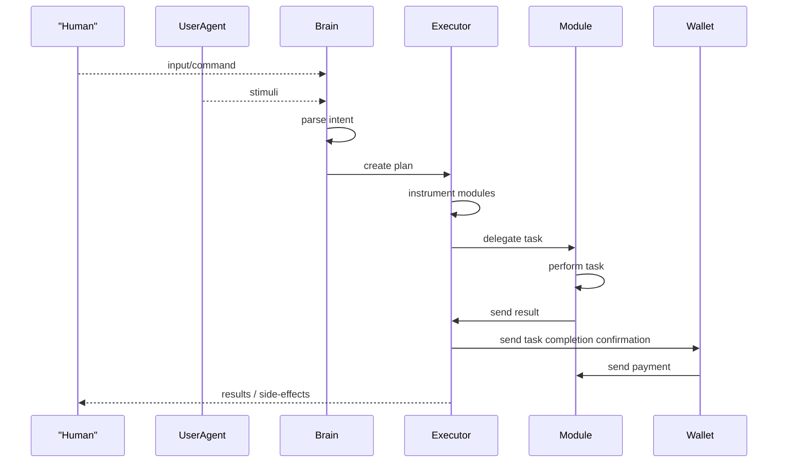
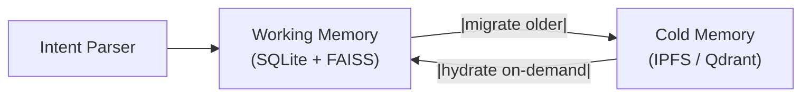
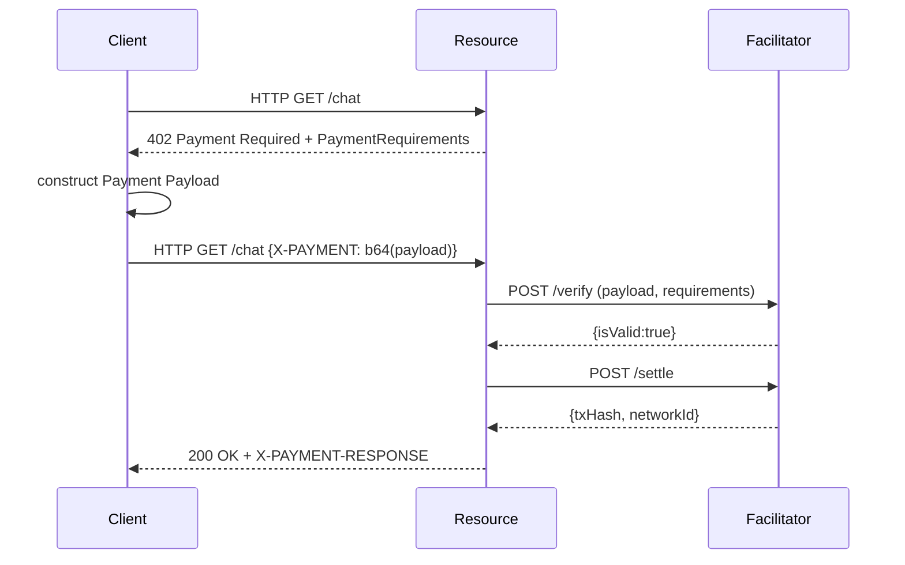
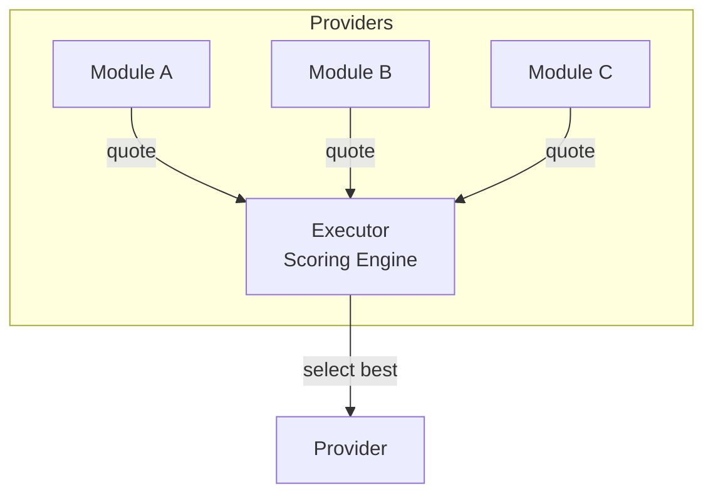
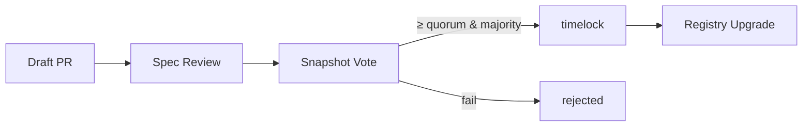

# Modular Agent Ecosystem Spec (draft v1)

> **Executive Summary**  
> The Modular Agent Ecosystem (MAE) is a cypherpunk‑aligned, fully permissionless protocol that lets autonomous software agents discover, pay, and collaborate with verifiable off‑chain modules, all without surrendering user privacy or introducing central chokepoints.
> Built to be deployed on any EVM‑compatible L2, MAE combines deterministic sandbox VMs, selective disclosure tokens, and on‑chain settlement hooks (x402) to create an end‑to‑end trust layer for AI and automation.
> This whitepaper specifies the architecture, security model, economic incentives, and governance needed to bootstrap a self‑sustaining marketplace of privacy‑preserving digital labor.

## 1 - Vision & Scope

Create an **open, extensible protocol** allowing autonomous software agents to interoperate, trade services, and evolve, much like *cells* in a living organism. Each agent can:

1. **Perceive** semi structured inputs (messages, events, sensor feeds).
2. **Act** via built in functionality and be extended by third-party modules, external APIs, or other agents.
3. **Transact** value natively (built‑in fee settlement, using the *CREDIT* token).
4. **Evolve** with backward‑compatible versioning.

The spec targets:

* Language‑agnostic runtimes (initial PoC in TypeScript/Rust + Docker runtime sandbox).
* Deterministic, testable interactions.
* Community governance for upgrades.

---

## Problem Statement

Today’s AI‑as‑a‑Service platforms are opaque, vendor‑locked, and require users to send sensitive data to centralized black boxes.  Hacky bot frameworks proliferate but lack a shared payment layer, deterministic execution, or meaningful reputation.  Meanwhile, legacy HTTP APIs still expect credit‑card payments and manual key management.  MAE addresses these gaps by:

* Presenting an alternative modular approach to building truly capable **intent driven agents** which can be extended infinitely as required.
* Moving computation to **verifiable sandboxes**, run locally or on TEE-backed remote servers to keep data private.
* Standardising a **payment handshake** (x402) so any endpoint can request crypto fees natively.
* Creating a **public registry** where modules prove code integrity, SLA, and stake thereby removing blind trust.
* Embedding **governance and incentives** so the ecosystem can evolve without central custodians.

### 1.1 Who Benefits & Why It Matters

| Audience                         | What they gain from MAE                                                                                                                   |
| -------------------------------- | ----------------------------------------------------------------------------------------------------------------------------------------- |
| **Independent hackers / SMEs**   | Publish a Module/Agent once, earn streaming CREDIT every time any Agent uses it, no gatekeepers, no revenue‑share middleman.              |
| **Privacy‑conscious users**      | Delegate tasks to Agents that *prove* they never leak data; keep PII encrypted and local.                                                 |
| **AI researchers**               | Swap in custom models or novel inference back‑ends/agent apps and benchmark real‑world demand instantly; receive stake‑weighted feedback. |
| **Data‑center operators**        | Register “beefy‑GPU” SystemSpecs and earn higher performance scores; fill idle capacity with paid inference jobs.                         |
| **Open‑source maintainers**      | Monetise libraries as Modules, with transactions and reputation handling out of the box.                                                  |
| **Enterprises / DAO treasuries** | Replace brittle ad‑hoc bots with auditable Agents; built‑in escrow and dispute resolution reduce vendor lock‑in.                          |

*Key takeaway*: **Anyone** can deploy a capability, be it a simple webhook, a GPU‑heavy inference engine or a compliance checker, and start earning as soon as other Agents find it in the Registry.  The protocol’s deterministic sandboxes and on‑chain payment flows remove the friction of billing, trust, and integration.

### 1.2 Naming Conventions

* **MAE (Modular Agent Ecosystem)** — the open specification you are reading.  
* **Phantomgrid** — the flagship reference implementation of MAE, including the on‑chain contracts, runtime images, SDKs, and tooling.  Other teams may build their own compliant networks, but Phantomgrid will serve as the canonical public deployment operated by the core contributors.

---

## 2 - Core Abstractions

### 2.1 Agent

| Aspect              | Description                                                                                                       |
| ------------------- | ----------------------------------------------------------------------------------------------------------------- |
| **ID & Manifest**   | Globally unique, semantic versioned (`agent:weather.v1.2.3`).                                                     |
| **Lifecycle hooks** | `init`, `onInput`, `tick`, `shutdown` etc.                                                                        |
| **Interfaces**      | *Perception* (listen and understand), *Action* (publish/delegate commands), *Economics* (quote, invoice, settle). |
| **Metadata**        | Name, author, license, required capabilities, fee model etc.                                                      |
| **Security**        | Signed manifest + capability grants.                                                                              |

#### 2.1.1 Capability vs Module (Cheat‑Sheet)

| Concept        | Analogy (EVM)        | Scope & lifecycle                                                                                                                         |
| -------------- | -------------------- | ----------------------------------------------------------------------------------------------------------------------------------------- |
| **Capability** | Opcode / Pre‑compile | Protocol‑level *interface* (`vision/ocr@1`).  Immutable once accepted; describes input/output schema and semantics.                       |
| **Module**     | Smart‑contract impl  | Concrete OCI image that implements **one or more** capabilities; carries its own performance profile, fee model, audit report, and stake. |

*Many Modules → one Capability* – multiple providers can compete to serve the same capability with different cost/SLA trade‑offs.

#### 2.1.2 Capability Namespace Tiers

| Tier             | ID pattern                   | Who can mint                       | Lifetime & rules                                                                       |
| ---------------- | ---------------------------- | ---------------------------------- | -------------------------------------------------------------------------------------- |
| **Experimental** | `dev.<owner>/<action>@0`     | Any staked account (`minDevStake`) | Auto‑expires after 180 days unless upgraded; no governance vote required.              |
| **Canonical**    | `<namespace>/<action>@MAJOR` | CAP vote                           | Subject to 12‑month deprecation window on MAJOR bump; one canonical entry per version. |

**Promotion path** – Developers prototype as `dev.alice/ocr@0`; after community adoption they submit a Governance CAP to elevate it to `vision/ocr@1`. The Registry then aliases the experimental ID to the canonical one for the remainder of the 180‑day period.

Registry logic:

* `capId` starting with `dev.` can be registered directly via `registerDevCapability` with ≥ `minDevStake` and an `expiresAt` timestamp.  
* Cron upkeep prunes expired experimental IDs.  
* Canonical IDs are created/updated only via successful CAP votes.

### 2.2 Module (Capability Implementation)

| Aspect                   | Description                                                                                                                                              |
| ------------------------ | -------------------------------------------------------------------------------------------------------------------------------------------------------- |
| **ID & Manifest**        | Globally unique, semantic, version‑controlled (`module:ocr.v1.0.0`).                                                                                     |
| **Endpoints**            | Must expose `quote()`, `execute()`, `invoice()`; pricing follows x402 (§ 6).                                                                             |
| **Metadata**             | Name, author, license, required capabilities, fee model etc.                                                                                             |
| **Resources**            | Declares CPU, memory, GPU, network, concurrency in **SystemSpec**.                                                                                       |
| **Fee Model**            | Flat, resource‑metered, or streaming; encoded in manifest field `feeModel`.                                                                              |
| **SystemSpec**           | JSON object describing performance & SLA; parsed by Executors for provider scoring (see example below).                                                  |
| **ModelQuant**           | *(Optional)* Hint for LLM Modules—e.g., `gguf‑q4`, `int8`—so Agents can predict VRAM footprint.                                                          |
| **supportsResourceHint** | `true` if the Module’s `quote()` endpoint returns a non‑zero `resourceHint` object (peak RAM/GPU/disk/CPU); allows Executors to pre‑check host capacity. |
| **Security**             | OCI image signed with *cosign*; SBOM hash, Witness Build attestations, optional `/attest` TEE report; may specify `runtimeClass`.                        |

> **SystemSpec advertisement** — Every Module MUST embed a `systemSpec` in its manifest so Executors can reason about latency, throughput, and resource trade‑offs.

```jsonc
{
  "cpuModel":  "AMD EPYC 7B12",
  "cpuCores":  8,
  "memoryGB":  32,
  "gpu":       { "name": "NVIDIA A100", "memoryGB": 40 },
  "netMbps":   1000,
  "maxJobs":   16,
  "latencySLAms": 300,
  "qps": 450,           // tokens per second at P95
  "gpuSlices": 4,       // MIG or MPS slices offered
  "supportedTeeTypes": ["SGX", "Nitro"],
  "geoTags": ["EU-FRA1", "NA-SJC"],
  "transports": [
    { "kind": "grpc",  "endpoint": "https://mod.example.com:443" },
    { "kind": "wt",    "endpoint": "https://mod.example.com:443/agent-wt" },
    { "kind": "webrtc","sdpCid":  "bafy...webrtcsdp" }
  ]
}
```  

These fields feed directly into the Executor’s provider‑selection heuristic (§ 6.5) and into on‑chain SLA enforcement.

### 2.3 Human‑Readable Names via ENS

MAE intentionally avoids deploying its own naming contract.  
Instead it piggy‑backs on the Ethereum Name Service (ENS) so users get familiar wallet / dApp UX without extra gas or maintenance overhead.

| Concept                  | Description                                                                                                                                                                                                            |
| ------------------------ | ---------------------------------------------------------------------------------------------------------------------------------------------------------------------------------------------------------------------- |
| **Global ID**            | Stable semantic identifier such as `module:ocr.v1` or `agent:weather.v2`.                                                                                                                                              |
| **ENS label (optional)** | Any ENS domain (`ocr.demo.eth`, `voice.ai.eth`). The owner adds a TXT record `maeId=module:ocr.v1` (or `agent:foo.v2`).                                                                                                |
| **Resolution flow**      | 1. Executor detects an ENS string in the request. 2. Queries the ENS resolver → pulls TXT records. 3. Extracts the `maeId` value. 4. Calls `Registry.lookup(maeId)` to obtain ProviderRecords (endpoints, stake, SLA). |

> **Global ID** — This semantic ID pins what capability is offered along with its stake, version, and SLA. Actual network coordinates (IP:port, POP, TLS hash) live inside the returned **ProviderRecords** and can change without touching ENS.

Features:

* No new on‑chain contract → zero additional gas or governance surface.
* Works with every ENS‑aware wallet and library today.
* Module authors can reuse existing `.eth` identities or sub‑names.
* Reverse lookup: a Module may publish `TXT maeEns=ocr.demo.eth` in its manifest for UI display.

## 3 - Base System ("Proto‑Agent")

The minimal executable bundle every Agent inherits: **Brain + Executor + Wallet**, running inside a sandbox VM and communicating with external Modules and other Agents.

```text
┌──────── Brain ────────┐  
│ ┌── Intent Parser ─-┐ │  
│ │ Context Engine    │ │  
│ │ Memory Store      │ │  
│ └───────────────────┘ │  
│      |         │      │  
└──────┼────────-┼─────-┘  
       ▼         ▼          
┌──────-──────┐┌──────────┐
│  Executor   ││  Wallet  │
└─────────────┘└──────────┘
```



### 3.1 Brain

1. **Input Adaptors** normalise raw stimuli/commands → `RawInput`; Adapter pattern to extend with new input sources (e.g., file‑system, IoT, web crawler).
2. **Intent Parser** fuses RawInput + context with NLP & symbolic pipeline → `Intent` object.
3. **Context Engine** – Tiered store: (1) **Static KV** (user-set prefs), (2) **On-Demand Views** with `ttl` / `ephemeral` tags, and (3) default-on **reactive `contextd` daemon** (opt-out).  Enriches intents with user preferences, live system facts, and external feeds.
   1. **User Preferences** Enriches the intent with information the user has specified either via configs or verbally from past interactions to make it contextually able to process the intent
   2. **Memory Store** Multi-tier memory architecture which enriches the intent with past experiences and memories generated by the agent. Allows for storage and recollection of learned skills/information via RAG style setup; supports pluggable back‑ends (SQLite, Redis, IPFS, Vector Datastore).
      1. **Working Memory (WM)** – fast, in-process SQLite + FAISS (or Redis) holding recent events (TTL, size quota).  
      2. **Cold Memory (CM)** – encrypted, content-addressed blobs (IPFS or external Vector DB) for long-term recall.  
        Events migrate from WM → CM once age > `wmTTL` or WM exceeds quota.
          1. **Global Context** Provides additional context to the intent for things like filesystem trees and other system settings pertinent to the task.
          2. **Module Directory** Provides information about the capabilities of the presently available local modules
4. **Planner** – Builds a DAG of PlanSteps. Advanced mode supports limited DSL wrappers (`if`, `foreach`, `askUser`) and control tags (`parallel`, `retry`, `timeout`, `circuitBreaker`, `onError`). When a node fails, structured error metadata (`err.code`, `err.stage`, `err.payloadCid`) feeds an **onError** handler that can auto‑retry, switch provider, trigger a fallback PlanStep, or escalate an `askUser` prompt. The flattened DAG plus onError rules is signed for auditability; subsequent patches are versioned on re‑planning.
5. **Executor** resolves each capability to a concrete Module, enforces QoS/SLO, and streams payments via **Wallet**.
6. Results feed back to Brain and optionally to the Memory Store where needed. Evaluator attempts to match up results to expectation and responds with some data to the user.

#### 3.1.0 Intent Parser Specification

The Intent Parser is a component of the agent that converts **semi‑structured input** + **context** into a normalised `Intent{type, args, meta}` object.

**Data sources it fuses**  

| Source                   | API                                                                          | Purpose                                                                   |
| ------------------------ | ---------------------------------------------------------------------------- | ------------------------------------------------------------------------- |
| Raw Input Adaptor output | `RawInput` proto (see § 3.1.2)                                               | Primary text / event payload                                              |
| User Preferences         | `preferences.yaml` (language, tone, …) + learnings from usage history        | Inject policy tags (`privacy=high`, etc.) and other customization options |
| Memory Store             | gRPC `Memory.ReadNearest(k=10, vector)`                                      | Retrieve similar past intents / embeddings                                |
| Global Context           | `Context.Settings("network.timezone")`, `Context.Filesystem("path-to-file")` | Supply implicit parameters (dates, locales, filesystem trees)             |
| Module Directory         | `Executor.listCapabilities()`                                                | Suggest default capability IDs                                            |

##### Processing pipeline

1. `Normalizer` – Unicode NFC, punctuation cleanup, PII scrub.  
2. `Classifier` – Transformer (e.g., DistilBERT fine‑tune) → intent‑class logits.  
3. `Entity Extractor` – spaCy / Rule‑based hybrid → named entities, slots.  
4. `Preference Merger` – Overlay user prefs (`lang=de`, `currency=EUR`).  
5. `Memory Augment` – Attach `relatedEvents:[eventId]` if cosine sim ≥ 0.8.  
6. `Context Enricher` – Replace “next Tuesday” with absolute date using locale/timezone.  
7. `Capability Hint` – Look up `intentClass → capabilityId[]`; return ranked list.  
8. **Output** → `Intent{type, args, confidence, provenance}` where `provenance` lists each augmentation step and hash of source data + `ExecutionPlan{intent, context}`

##### Extensibility

* Module Directory: `parser.d/modules/*.mae` loaded via manifest.  
* Each module exposes `fn transform(IntentDraft) -> IntentDraft`. Execution order is deterministic, declared in manifest.

##### Determinism & Auditing

* Given identical inputs + preferences + context snapshot, the parser **must** yield byte‑identical `Intent` JSON.  
* A SHA‑256 of the final Intent plus provenance is recorded in the Audit Root, enabling dispute replay.

> *Goal*: decouple domain‑specific parsing from core planning while ensuring every decision is transparent, auditable, and reproducible.

#### 3.1.1 Intent → Capability Pipeline

1. **Parsing & Classification**  
   * The Intent Parser consumes raw user input or event payloads and produces a preliminary `Intent{type, args, raw}`.  
   * A lightweight transformer model (or regex/state machine for constrained domains) assigns an **Intent Class** (e.g., `summarise`, `translate`, `fetch-weather`).

2. **Slot Extraction**  
   * The Context Engine enriches the intent with entities and disambiguates pronouns (`"summarise *this* pdf"` → `{targetCid}` supplied).  
   * Policy tags (privacy level, max budget) are attached.

3. **Capability Lookup**  
   * The Brain maps `Intent.type` to one or more **Capability IDs** via a local `overlay.yaml`, e.g.  

     ```yaml
     summarise:   text/summarise@1
     translate:   lang/translate@1
     fetch-weather: data/weather.fetch@0
     ```  

   * If multiple capabilities match (e.g., language `en→de` vs `en→fr`), the **Selector Plug‑in** narrows down based on arguments.

4. **Feasibility & Cost Estimation**  
   * For each candidate capability, Brain queries the Executor’s `estimateCost(capabilityId, args)` which simulates a `quote()` call and returns expected CREDIT spend + latency.

5. **Plan Generation**  
   * Brain emits an **Executable Plan**—a DAG of `PlanStep{capabilityId, args, maxFee, dependencyIds}`.  
   * Each PlanStep is handed to the Executor, which performs provider discovery (§ 3.2.1).

6. **Adaptive Re‑planning**  
   * If all providers fail or cost > max budget, Brain triggers a fallback intent (`summarise‑locally`, `notify‑user‑error`) and regenerates a plan.

##### Diagram


#### 3.1.2 Universal Input Adaptors

To handle chat text, speech, GUI clicks, IoT sensor events, or API web‑hooks in a uniform way, MAE ships pluggable **Input Adaptors**:

| Adaptor       | Raw Input                                       | Output to Intent Parser                                           |
| ------------- | ----------------------------------------------- | ----------------------------------------------------------------- |
| `text.chat`   | Free‑form user chat                             | `{type:"chat", lang:"en", text:"…", ctxId:"123"}`                 |
| `speech.stt`  | Audio stream                                    | Same as `text.chat` but with `"source":"mic"`                     |
| `gui.command` | Button press                                    | `{type:"ui_event", control:"btn#42", action:"tap"}`               |
| `iot.sensor`  | MQTT/LoRa payload                               | `{type:"sensor", sensorId:"temp‑a", value:22.3}`                  |
| `webhook.*`   | HTTP callback                                   | `{type:"webhook", path:"/upload", payload:{…}}`                   |
| `agent.task`  | Internal PlanStep event                         | `{type:"task_event", stepId:"abc", status:"DONE", output:"cid:…}` |
| `module.call` | Programmatic callback from another Module/Agent | `{type:"module_call", caller:"module:ocr.v1", payload:{…}}`       |

*Automated Sources* — `agent.task` events are emitted by the Executor whenever a PlanStep finishes and can trigger downstream intents. `module.call` events allow one Module to invoke another without routing raw data through the user, preserving privacy while enabling complex pipelines.

##### 3.1.2.1 Adaptor Manifest & Runtime Contract

Every Input Adaptor is itself a **Module** whose `moduleId` follows the pattern `input.<kind>@<semver>`  
(e.g., `input.text.chat@2`).  The OCI image MUST contain an `adaptor.manifest.json` with the fields below.

```jsonc
{
  "adaptorId": "input.text.chat@2",
  "version": "2.0.1",
  "inputSchemaCID": "bafychat-json-schema",      // IPLD-schema for raw payload
  "outputSchemaCID": "bafyintent-json-schema",   // schema for Intent object
  "languages": ["en", "de", "fr"],
  "deterministic": true,
  "wasmDigest": "sha256:abc123…",                // optional if image is WASM-only
  "securityClass": "stateless",                  // stateless | buffer-10s | stateful 
  "permissions": {
    "network": "none",
    "fs": "read-only"
  }
}
```

* **Input / Output Schemas** — MUST be JSON‑Schema or IPLD‑Schema; provides machine‑verifiable contract.
* **Deterministic** — Set `deterministic=true` if *every* run with identical input yields identical output bytes.
* **SecurityClass** —  
  * `stateless`  — WASI-preview2, `net=none`, resource caps (16 MB input, 256 MB RSS, 2 s CPU); **unaudited Modules are rejected by default** unless the user opts-in via Configurator.
  * `buffer-10s`: may hold data ≤ 10 seconds for streaming (e.g., STT).  
  * `stateful`: long‑term state; discouraged unless justified (e.g., hotword cache).

##### Runtime gRPC

Adaptors expose a minimal gRPC service inside the sandbox:

```protobuf
service InputAdaptor {
  rpc Parse (RawInput) returns (IntentEnvelope);
  rpc Health (Ping) returns (Pong);        // optional
}
```

* `RawInput.payload` is validated against `inputSchemaCID` before invoking `Parse`.
* `IntentEnvelope` contains `{intent, confidence: float32, meta}` — confidence allows Brain to fallback if below threshold.

##### Determinism Proof

For adaptors flagged `deterministic=true`, the Witness Builder runs the same test‑vector suite twice; if output hashes differ, the adaptor cannot be published in the global Registry.

##### Governance & Versioning

1. **Minor bump** (`@2 → @3`) allowed after 90‑day stability window.  
2. **Deprecation** — A CAP may mark an adaptor kind deprecated; Agents receive a `ADAPTOR_DEPRECATED` event.  
3. **Collision resolution** — First‑come with ≥ 10 000 CREDIT stake or via CAP vote.

> *Design goal*: make adaptors as auditable and sandboxed as any other capability, so that “raw input → intent” is predictable, privacy‑safe, and peer‑reviewable.

Adaptors are simple WASM or TS modules that **must** be deterministic and stateless; they are versioned exactly like any other Module (`input.chat@2`). Agents include only the adaptors relevant to their domain in the Brain’s extension list.

#### 3.1.3 Capability‑ID Lifecycle

##### Deprecation Timetable

| Stage          | Meaning                                                             | Duration (from MAJOR bump) |
| -------------- | ------------------------------------------------------------------- | -------------------------- |
| **Active**     | Current, fully supported version.                                   | N/A                        |
| **Deprecated** | Superseded by newer MAJOR; providers must keep endpoints alive.     | 12 months                  |
| **Retired**    | Providers MAY remove; stake can be withdrawn; overlay pin required. | After sunset window        |

* **Global Registry** — `RegistryCore` stores a mapping `capabilityId → canonicalManifestCID`.  A capability ID is a short URI (`text/summarise@1`).  Version bumps (`@2`) require Governance CAP review to avoid namespace squatting.
* **Local Overlay** — Each Agent maintains a *capability overlay* (JSON/YAML) where it can **alias** or **override** global IDs with local prototypes:

```yaml
# overlays/overlay.yaml
text/summarise@1: module:localSummariser.v0-dev   # local dev build
lang/translate@*: module:openAIproxy.deprecated   # force local fallback
```

During lookup:

1. Brain checks its overlay: if an override exists **and** its Module stake ≥ minDevStake, use it.
2. Otherwise, query `RegistryCore` to resolve to a global Module set.
3. If the Agent installs a new local Module (`mae install ./my‑ocr`), CLI auto‑patches the overlay.

* **Sync Rules**  
  * Overlay file is **not** sync’d peer‑to‑peer (keeps user customisations private).  
  * When a global capability ID is deprecated, the Agent receives a `CAPABILITY_DEPRECATED` event via the pub‑sub mesh and removes the mapping.

#### 3.1.3.a Capability Overlay Management

Most users will occasionally need to **pin** an older Module, test a local prototype, or bias their Agent toward specific providers.  
MAE supports this via a per‑profile **Overlay Map** (mapping *capability → preferred module*) stored at `~/.mae/overlays/<profile>/overlay.yaml`

##### YAML schema

```yaml
version: 1        # overlay format version
overrides:
  text/summarise@1:  module:localSummariser.v0-dev   # exact pin
  vision/ocr@*:      module:ocr@1                    # wildcard
prefs:
  providerBias: gpu-local   # gpu-local | cheapest | lowest-latency
  allowUnaudited: false
meta:
  created:   "2025-06-15T14:03Z"
  profileId: "workstation-amy"
  sig: ""                    # optional Ed25519 signature
```

##### Precedence rules

 1. Exact override beats wildcard (vision/ocr@2 > vision/ocr@*).
 2. Overlay beats Registry deprecation—Agent warns but obeys the pin.
 3. Multiple overlays: Agent picks file matching $MAE_PROFILE; default is default.
 4. If meta.sig present, Agent verifies it against overlayPubKey; failure disables overlay until user confirms.

> Goal: let power-users experiment locally without polluting the global Registry, while preserving deterministic behaviour for everyone else.

#### 3.1.4 Tiered Memory Flow

* Ingest – New `MemoryEvent` lands in WM (sub-5 ms latency).
* Migration – Background job compresses & pins events older than `wmTTL` (default 4 h) or when `wmQuotaMB` surpassed.
* Cold Recall – If WM vector search misses, Brain issues async lookup to CM Module; results cached back into WM.
* Deletion – Revoked data purged instantly from WM and scheduled for CM tombstone.



#### 3.1.5 Context Engine Tiers

| Tier               | Example keys                                          | Storage / refresh                                                                                    | Default TTL                   |
| ------------------ | ----------------------------------------------------- | ---------------------------------------------------------------------------------------------------- | ----------------------------- |
| **Static KV**      | `prefs.lang`, `prefs.currency`, API keys              | `context/static.yaml` (edited by Configurator or CLI)                                                | ∞ (manual)                    |
| **On-Demand View** | `fs.homeFreeGB`, `system.uptime`, `ext.price.eth_usd` | KV entry + view script (`.wasm`), `ttl:` triggers lazy refresh, `ephemeral:` computes on each access | `ttl` field or 5 min fallback |
| **Reactive**       | `net.ipv4`, sensor feeds, live market ticks           | **`contextd` side-car** streams deltas via gRPC                                                      | Push, real-time               |

##### Tag schema example

```yaml
prefs.currency: "EUR"
prefs.lang: "de"
system.tz: { value: "CET", ttl: 24h }
fs.homeFreeGB: { view: "diskFree.wasm", ttl: 10m }
net.ipv4: { view: "ifconfig.wasm", ttl: 10s, ephemeral: true }
ext.price.eth_usd:
  view: "priceWatcher"
  provider: "coingecko"
  ttl: 0          # interpreted as reactive
```

#### 3.1.6 Planner DSL (Hybrid)

#### 3.1.7 Provenance Snapshot Rules

Not every Agent needs full audit‑grade snapshots all the time.  MAE distinguishes three operational *roles*:

| Role                                                                                            | Snapshot Requirement                                                                                                              | Default Behaviour                                                      |
| ----------------------------------------------------------------------------------------------- | --------------------------------------------------------------------------------------------------------------------------------- | ---------------------------------------------------------------------- |
| **Service Agent / Module**                                                                      | **MANDATORY** – must emit SnapshotRoot for every top‑level Intent it services for someone else.                                   | Enforced by Registry; missing root ⇒ SLA breach.                       |
| **Local Personal Agent**                                                                        | Optional but recommended for debugging and “user memory.”                                                                         | Disabled by default (`snapshotOptIn: false`); Configurator can enable. |
| **Collaborative Workflow Agent** (acts on behalf of user interacting with another user’s Agent) | **Conditional** – if any *counterparty* requests provenance, both sides must turn on snapshots for the duration of that workflow. | Negotiated during `INTENT` handshake (`needsProvenance=true`).         |

A *Service Agent* is any Agent or Module that lists itself as **public=true** in its manifest and accepts CREDIT from external wallets.

##### Snapshot Contents — Public vs Private Bundles

Snapshots are split into **two tar.zst archives** so that user data never leaks by default:

| Bundle                       | Mandatory files                                                                                          | Purpose                                                         | Typical size |
| ---------------------------- | -------------------------------------------------------------------------------------------------------- | --------------------------------------------------------------- | ------------ |
| **Public**                   | `plan.json`, `modules.json`, `quotes.json`, `planErrors.jsonl`, `metrics.prom`, `signature.sig`          | Provable by anyone; contains **no PII**                         | 2–15 KB      |
| **Private** (AES‑256 sealed) | `intent.json`, `context.snapshot.pb`, `rawInput.cid`, `results.cidlist`, optional `proof.zkp`, `extra/*` | Decrypted only if user or dispute contract releases `sealedKey` | 1–50 KB      |

Hashes:

```text
pubHash  = sha256(publicTar)
privHash = sha256(privateTar)   # privHash = 0x0 if provenance disabled
snapHash = sha256(pubHash ‖ privHash)
```

On‑chain anchor:

```solidity
event SnapshotRoot(
    bytes32 pubHash,
    bytes32 privHash,
    bytes   sealedKey   // one‑time AES‑GCM key sealed to CT‑721 root or arbitrator pubkey
);
```

Field‑level policy from the Intent Parser:

* `public`   → cleartext in Public bundle  
* `hashed`   → SHA‑256(value) in Public  
* `sealed`   → AES‑GCM in Private  
* `zkproof`  → only proof file in Private

*Constraint*: uncompressed size of both archives combined MUST be ≤ 5 MB; large artefacts are referenced by CID only.

##### Frequency Defaults

| Agent class          | Rule                                                    |
| -------------------- | ------------------------------------------------------- |
| Service Agent        | Every top‑level Intent (user request).                  |
| Local Agent (opt‑in) | Every top‑level Intent OR manual `mae snapshot export`. |
| Streaming workflow   | Initial + diff patch every 10 min or DAG mutation.      |

Configurator flag example:

```yaml
snapshotOptIn: true       # personal agent
snapshotTTL: 30d          # local retention
```

Snapshots are TAR‑zstd archives; hash → `snapHash`. Service Agents MUST post `SnapshotRoot(snapHash)` on-chain or emit `SnapshotCID(cid)` IPFS event.

##### Deterministic Re‑play Contract

Given `(RawInput, ContextSnapshot, FlattenedPlan, ModuleDigests)`, any verifier can deterministically re‑play and compare Result CIDs.  No network egress is allowed during re‑play except IPFS fetches for declared hashes.

*Goal*: Provide cryptographic breadcrumbs for stakeholders that require them, without imposing heavy storage costs on purely local or ephemeral Agents.

| Wrapper / Tag    | Purpose                          | Limits (configurable via Governance) |
| ---------------- | -------------------------------- | ------------------------------------ |
| `parallel`       | Run child PlanSteps concurrently | Fan‑out ≤ 32                         |
| `retry`          | Automatic bounded retry          | Attempts ≤ 5                         |
| `timeout`        | Per‑node deadline (ms)           | 1 s – 120 000 ms                     |
| `circuitBreaker` | Fail fast after X recent errors  | Window 10; X ≤ 3                     |
| `if`             | Deterministic conditional branch | Depth ≤ 3                            |
| `foreach`        | Bounded loop over list           | List ≤ 256 items                     |
| `askUser`        | Prompt user to clarify           | Blocks plan until answer             |

##### Error‑Handling (`onError`)

Each PlanStep MAY include an `onError` object:

```jsonc
"onError": {
  "match": ["NETWORK", "AUTH", "VALIDATION", "ANY"],
  "actions": [
    { "type": "retry", "max": 2 },
    { "type": "switchProvider" },
    { "type": "askUser", "question": "Upload new credentials?" },
    { "type": "fallback", "capabilityId": "text/summarise.local@0" }
  ]
}
```

*Error code taxonomy*: `NETWORK`, `AUTH`, `VALIDATION`, `RESOURCE`, `ANY`.

*Action types*:

| Action           | Result                                                                                   |
| ---------------- | ---------------------------------------------------------------------------------------- |
| `retry`          | Re‑run same provider up to `max` attempts (exp back‑off).                                |
| `switchProvider` | Executor selects next best provider per § 6.5.                                           |
| `askUser`        | Planner pauses; Brain asks user. If unanswered after `askTimeout`, moves to next action. |
| `fallback`       | Brain spawns new PlanStep using alternative `capabilityId`.                              |

If no rule matches, Planner aborts task, refunds JobBond, and emits `INTENT_UNFULFILLED`.

All errors are logged in the Audit Root via:

```protobuf
message PlanError {
  string  code;        // taxonomy
  string  stage;       // quote | execute | settle
  bytes   payloadCid;  // optional CID with logs
}
```

*Design goal*: Agents self‑heal for common issues yet surface intelligible prompts to users when human guidance is most valuable.

### 3.2 Executor

* **Task Scheduler** – Prioritises, time‑slices, retries.
* **Capability Matcher** – Resolves which local module or remote agent can satisfy an action.
* **QoS Layer** – Rate limits, deadline enforcement, concurrency caps.

#### 3.2.1 Discovery & Fallback Logic

1. **Local Bloom Cache** — Executor first checks its Bloom‑filter of capability hashes; if hit, skip on‑chain lookup unless bloom indicates possible false‑positive. If the capability’s `retiredAt` timestamp is non‑zero (expired), Executor treats the ID as invalid **unless** an explicit overlay override exists.
  a. **Host‑Guard** — If the selected provider’s `quote()` response contains a `resourceHint`, Executor compares each dimension against local sandbox limits (`memFreeMB`, `vramFreeMB`, `cpuBudget`). If any exceeds the host, mark provider **UNFIT** and try the next candidate. If all providers are UNFIT, Planner emits `PLAN_RESOURCE_EXCEEDED`.
  b. **Safe-Caps & Probe** — When a provider’s `quote()` omits `resourceHint` (`memMB = 0`), Executor:
    * Launches the Module inside **conservative cgroup caps**:  
      `memLimit = min(host.freeMem × 0.25, 1 GiB)`, `cpuQuota = 2 cores`, `tmpDisk = 512 MiB`.
    * Executes a tiny **Probe PlanStep** (e.g., 32 × 32 px image for OCR) and records peak RSS / VRAM from cgroup stats.
    * If `peak × scaleFactor` still exceeds host limits, marks provider **UNFIT** before running the real job.
    * Any cgroup OOM kill emits error code `RESOURCE`; Planner’s `onError` map can `switchProvider` or `fallback` to a lightweight capability.
2. **Capability Query** — Executor calls `Registry.lookup(capabilityId)` which returns an array of **ProviderRecord{moduleId, endpoint{ip,port}, tlsHash, sysSpec, rating, price}** already filtered by compliance with the Agent’s policy (e.g., runtimeClass, TLD allow‑list).  These endpoint fields are ephemeral; only the `moduleId` and stake form the canonical identity.
3. **ENS Resolution** — If the task references an ENS domain (`ocr.demo.eth`), Executor queries the ENS resolver for TXT record `maeId`, yielding `moduleId`.
4. **Scoring & Selection** — Apply the scoring algorithm in § 6.5 to the candidate set.
5. **Availability Heart‑beat** —
   1. Send a light‑weight `PING` gRPC to the chosen Module.
   2. If response misses SLA (e.g., > 500 ms) mark provider `DEGRADED` and try the next highest‑score candidate.
   3. If candidate advertises `edgeReady:true`, Executor may select the nearest POP pre-warm pool (Fly.io Machines / Cloudflare Workers WASM) for sub-100 ms cold-start.
   4. For WebTransport/WebRTC, Executor picks the POP whose advertised RTT < 50 ms.
6. **Zero‑Hit Fallback**  
   * If `Registry.lookup` returns **empty**, Executor broadcasts a *Capability Request* on the pub‑sub mesh:  
     `capReq{capabilityId, budget, ttl}`.  
   * Any listening Agent/Module can respond with `capOffer{moduleId, quote}`; Executor re‑runs scoring on offers received within `ttl` (default 3 s).
7. **Last‑Chance Path** — Still empty?  
   * **Local Build**: If source code URL is embedded in the intent’s metadata, Executor spawns a sandbox to compile the module ad‑hoc (limited to 30 s).  
   * **User Escalation**: Emit `INTENT_UNFULFILLED` event to the Brain; Brain can prompt the user, adjust the plan, or retry later.
8. **TEE Policy** If a provider advertises multiple `supportedTeeTypes`, the Executor chooses the first entry that matches its own `allowedTeeTypes` profile list; otherwise the provider is deemed **UNFIT**.

All fallback events are logged to the Audit Root so that reputation penalties can apply to providers that frequently go offline.

#### 3.2.2 Cost-Forecast & Funding Bond

Before dispatching the very first PlanStep, the Executor performs a **pre-flight cost forecast**:

1. **Quote sweep** – For every distinct `{capabilityId, args}` in the flattened plan call `quote(estimateOnly=true)` and gather `(maxFee, minFee, feeModel)`.  
2. **Worst-case sum** – Compute:

  ```text
  maxTotal = Σ (maxFee × (1 + slippageBufferPct))
  ```

  where `slippageBufferPct` defaults to 5% but can be tightened in the profile.
3. **Wallet reserve** - Call `wallet.reserve(planId, maxTotal, expirySecs)` which locks the amount in the Wallet’s local ledger so concurrent plans cannot deplete it.
4. **Stream pre-fund** – For any feeModel:"stream" steps, the Wallet’s StreamMonitor tops the target ERC-1620 stream to at least minBufferSeconds before execution starts.
5. If balance is insufficient the Executor emits PLAN_INSUFFICIENT_FUNDS; Brain can ask the user for additional budget, or re-plan with cheaper providers.
6. On successful plan completion—or abort—wallet.release(planId) frees any unused reserve.

### 3.3 Wallet

* **Wallet Abstraction** – Multi‑currency (**CREDIT**, other stablecoins).
* **Quotation Engine** – Builds a cost graph for composite tasks.
* **Settlement** – Streaming payments / escrow & dispute mechanism.

---

## 4 - Data & Knowledge Model

| Layer            | Purpose                               | Example                                |
| ---------------- | ------------------------------------- | -------------------------------------- |
| **Envelope**     | Auth, nonce, fee quote, payload hash. | `{hdr, sig, fee, payload}`             |
| **Intent**       | Normalised action request.            | `Intent(type="summarise", target=url)` |
| **Context**      | Key–value store, TTL.                 | `ctx.userPrefs.language="de"`          |
| **Memory Event** | Immutable fact.                       | `event#8752 ⇒ {intent, result, cost}`  |

GraphQL + Protobuf suggested for schema.

---

## 5 - Communication Protocol

* **Transport tiers**  
  1. **gRPC-H2** (ALPN `agent/1`, port 443) — primary server-to-server path.  
  2. **WebTransport** (`agent-wt` path) — browsers & WASM Agents share the same HTTP/3 port.  
  3. **WebRTC data-channel** — NAT-traversal fallback; ICE/TURN specified in `ProviderRecord`.  
  4. **JSON-RPC over WSS** (`agent-js`) — minimal subset for ultra-low-power clients.  
  Executors attempt transports in that order unless overridden by profile policy.
* **Discovery**:
  * If an ENS name is supplied, resolve its TXT record `maeId` → obtain the Global ID.
  * Call `Registry.lookup(globalId)` to fetch signed manifests (no separate naming contract).
* **Capability Negotiation**: Handshake → agree on schema version + fee quote.
* **Payment Hooks (x402)**: HTTP resources that require fees MUST follow the [x402](#61-x402-protocol-primer) 402-handshake (`PaymentRequirements → X-PAYMENT`).
* **Event Types**: `INTENT`, `QUOTE`, `PAYMENT_REQUIRED`, `PAYMENT_SENT`, `ACCEPT`, `RESULT`, `ERROR`.

---

## 6 - Economic Model

1. **Unit of account**: token *CREDIT*, 18 decimals.
2. **Price sources**: Agents expose static or dynamic pricing (oracle‑backed).
3. **Payment flows**:
   * *Pre‑pay*: Client escrows max budget.
   * *Streaming*: Executor unlocks on progress.
   * *Post‑pay*: Invoice settled on receipt (credit‑scored peers only).
   * `QuoteResponse` MAY include a `resourceHint` object so Executors can validate host RAM/GPU/disk/CPU before launching the Module.
4. **Disputes**: Cryptographically verifiable execution trace → arbitration DAO.
    Disputes are adjudicated by the Dispute DAO (§ 11.12); winners receive up to the disputed amount, losers forfeit bond plus possible stake slash.
5. **Competitive Provider Market**: Multiple third-party Agents/Modules can register equivalent **modules implementing the same capability**; pricing and SLA competition is encouraged.
6. **Funding bond (off-chain)** – At plan-creation time the Wallet locks `maxTotal` CREDIT via `wallet.reserve(planId, amount)` so simultaneous plans cannot over-spend the same balance.  Any unused remainder is released at plan end.

>*“70 % of all protocol-level fees are burned automatically; 30 % is re-minted to the DAO Treasury via `MintedFromBurn`.”*

### 6.1 x402 Protocol Primer

The ecosystem **adopts the open-source Coinbase [x402](https://github.com/coinbase/x402)** standard for HTTP-native value transfer. A request for a paid resource MUST comply with the following contract:

| Header / Code          | Purpose                                                          |
| ---------------------- | ---------------------------------------------------------------- |
| `402 Payment Required` | Sent by the resource server when more funds are required.        |
| `X-PAYMENT`            | Base64-encoded **Payment Payload** provided by the client/Agent. |
| `X-PAYMENT-RESPONSE`   | Optional response from server containing settlement metadata.    |

**Payment Required Response** (body of the 402 reply)

```jsonc
{
  "x402Version": 1,
  "accepts": [ /* array<PaymentRequirements> */ ],
  "error": "string | null"
}
```

**PaymentRequirements** (excerpt)

```jsonc
{
  "scheme": "exact",           // logical settlement scheme
  "network": "base-sepolia",  // chain ID or alias
  "maxAmountRequired": "10000000000000000", // atomic units
  "resource": "https://api.example.com/chat", // URI being purchased
  "payTo": "0xCafe…",         // receiver address (EIP-3009 compatible)
  "asset": "0xBEEF…",         // ERC-20 contract
  "maxTimeoutSeconds": 30,
  "description": "LLM token stream"
}
```

### 6.2 Supported Payment Schemes

1. **`exact`** – transfer a fixed amount *up-front* before work begins.  
2. **`upto`** – Authorises up to a ceiling; final amount decided at settlement (metered usage).  
3. **`stream`** – Continuous drip (per second) using ERC-1620-style streams.  
  Executor opens a classic ERC-1620 stream. The Wallet’s `StreamMonitor` keeps ≥ minBufferSeconds prepaid. If balance hits 0 the Module may pause; the Wallet tops-up automatically.

Each `(scheme, network)` pair MUST be listed in the Registry's `SupportedKinds` array and MUST have a matching verifier implementation inside at least one **facilitator server**.

### 6.3 Verification & Settlement Flow



*Facilitator servers* are **stateless micro-services** that:

1. Validate signatures & allowances (EIP-3009 permits-by-signature).  
2. Broadcast the payment tx on-chain (or verify pre-payment).  
3. Return `txHash`, `networkId`, `success`.

#### 6.3.1 Request‑Embedding Modes for Account‑Abstraction (AA)

MAE Agents MUST embed a **cryptographic commitment** to the paid HTTP request inside the calldata of the
`type 0x3` AA transaction so that the on‑chain payment can be tied, after the fact,
to the exact bytes that were processed off‑chain.

| Mode            | Calldata field(s)                            | Off‑chain flow                                                                                                                                                                            | Recommended when…                                                                       |
| --------------- | -------------------------------------------- | ----------------------------------------------------------------------------------------------------------------------------------------------------------------------------------------- | --------------------------------------------------------------------------------------- |
| **Hash‑only**   | `reqHash : bytes32`                          | Client transmits full HTTP request over TLS to its chosen **facilitator**;facilitator must see an AA tx whose `reqHash = keccak256(fullRequest)` before forwarding to `https://resource…` | Requests > 2 kB or containing privacy‑sensitive data                                    |
| **Inline‑gzip** | `compressedRequest : bytes` (max 24 kB gzip) | Client includes a Base64‑gzipped body right in calldata (→ verifiable & replay‑protected); facilitator extracts & forwards                                                                | Small requests (< 1 kB post‑gzip) and when a facilitator side‑channel is not convenient |

**AA‑first rule recap** – If the AA tx already transfers CREDIT ≥ `maxAmountRequired` to `payTo`, facilitators MUST ignore any
EIP‑3009 permit in the `Payment Payload`; the on‑chain transfer is final.

##### Facilitator pseudocode

```python
def verify_payment(req, tx):
    if tx.type == 0x3 and tx.to == req.payTo and tx.value >= req.maxAmountRequired:
        if req.reqHash and sha3_256(req.fullRequest) != req.reqHash:
            return ERR_HASH_MISMATCH
        # OK – AA‑first path
        return OK
    elif req.permit and verify_eip3009(req.permit):
        return OK
    else:
        return ERR_PAYMENT_REQUIRED
```

*Size limits* — Inline‑gzip must be ≤ 24 kB uncompressed (≈0.02 $ gas on typical L2).
For larger bodies the hash‑only path is REQUIRED.

> **Privacy note:** Only the 32‑byte `reqHash` is stored on‑chain, so headers, query params,
and sensitive JSON bodies remain off‑chain.  During a dispute, the requester can selectively reveal
`fullRequest` to an arbitrator, who recomputes the hash and proves it matches on‑chain calldata.

### 6.4 Wallet Module Mapping

| Wallet Capability  | x402 Primitive                                      |
| ------------------ | --------------------------------------------------- |
| *Quote build*      | Read `accepts` ⇒ choose cheapest `(scheme,network)` |
| *Pre-pay*          | Craft `exact` payload, sign permit, broadcast       |
| *Metered run-time* | Open `stream` then periodically *extend* allowance  |
| *Settlement*       | Call facilitator `/settle` or roll-up local proofs  |
| *Dispute escrow*   | Hold funds in contract; on-chain arbitration DAO    |

> **Note** — All amounts are denominated in micro-credit (`1 CREDIT = 10^18 units`). Decimal handling MUST follow [EIP-3009](https://eips.ethereum.org/EIPS/eip-3009) semantics for *transferWithAuthorization*.

### 6.5 Provider Selection Logic (Executor)

When several providers offer the same `capabilityId` the **Executor** builds a *cost-reputation graph* and chooses the optimal candidate at call-time:

| Metric         | Source                                   | Weight (default) |
| -------------- | ---------------------------------------- | ---------------- |
| Reputation     | On-chain stake-weighted score            | 40 %             |
| Quote Price    | `quote()` flat or metered fee            | 25 %             |
| Latency (SLA)  | `latencySLAms` from SystemSpec           | 15 %             |
| Code Integrity | # of matching witness build attestations | 10 %             |
| Capacity       | Current concurrency / advertised limit   | 10 %             |

**Region preference** — Executors may set `preferredRegions:["EU","NA"]`.  
Providers whose `geoTags` intersect that list keep full score; otherwise a 15 % malus is applied.  
If `requireRegion:true`, non-matching providers are discarded as **UNFIT**.

**Hint bonus** — Providers whose manifest sets `supportsResourceHint:true` earn a **+10% score multiplier** (applied after normalisation), nudging ecosystem adoption while remaining backward-compatible.



Pseudo-algorithm (TypeScript):

```ts
const providers = registry.find(capabilityId);
const scored = providers.map(p => ({
  id: p.id,
  score:
    0.4 * p.reputation +
    0.25 * normalizePrice(p.quote) +
    0.15 * (1 - p.latencyPct) +
    0.1 * p.witnessScore +
    0.1 * (1 - p.capacityLoad)
}));
return scored.sort((a,b)=>b.score-a.score)[0];
```

*Note* — Executors may optionally bias for GPU presence (`sysSpec.gpu`) or high‑memory nodes by adjusting the weight vector via a Governance CAP.

The weight vector is **configurable** via Governance CAPs; additional dimensions (e.g., carbon footprint, geo-jurisdiction) can be appended later without breaking compatibility.

---

## 7 - Versioning & Compatibility

* **SemVer** for agents/modules.
* **Spec Evolution**: `MAJOR.minor.patch`, CAP (Change‑Adoption Proposal) process, deprecation window.
* **Negotiation**: Old ↔ new via adapter stubs or polyfills.

---

## 8 - Security & Privacy

* Capability-based sandbox (Docker).
* Signed agent manifests & module packages.
* End-to-end encryption on message envelopes.
* Encryption **at rest** – all task inputs, outputs, and logs are AES‑256‑GCM–encrypted on disk; keys are derived from per‑agent secrets and never written to storage.
* Rate limits tied to wallet stake.
* Trusted Execution Environments — custom 24 MB Alpine image with `provefs`, optional SGX/Nitro/pKVM attestation exposed via `/attest`.
* CapabilityToken (CT-721) – selective-disclosure NFT plus zk-proof authorization.
* Secure Session Layer – Mutual-TLS pinned to enclave hash, X25519 key exchange, AES-GCM-256.
* Data Envelope v1 – authenticated, encrypted wrapper `{hdr, capProof, ciphertext, sig}`.
* Audit Log Root – Merkle root of encrypted execution trace emitted per task for dispute resolution.
* Reputation & Slashing – stake-weighted score; on-chain penalties for malicious Modules.
* ZK-Circuit Library – standard Noir predicates (age, passport, credit score) hosted on IPFS.
* Proof Aggregation – EIP-4844 blob batch verifier reducing SNARK gas by ~90 %.
* Formal Verification – Scribble invariants + Certora/Coq proofs pinned via `verificationCID`.
* Computation Location Policy — Any Module or Agent MAY delegate computation to third‑party infrastructure **assuming that** the computation runs inside an audited sandbox or TEE exposing `/attest`, and all inputs remain end‑to‑end encrypted. Components that satisfy these privacy guarantees *and* advertise stronger `SystemSpec` (e.g., multi‑GPU/TPU, high-throughput networking) earn a higher performance score. Components that forward to/rely on opaque SaaS APIs continue to receive lower reputation weight. Secure weight rental enclaves (Nitro, SEV-SNP) that expose `/attest` are treated as audited sandboxes and score equal to local execution.

---

## 9 - Governance & Community

A transparent, token‑weighted process for evolving the protocol and funding public goods.

### 9.1 Governance Token

* **Voting Power** — 1 liquid CREDIT ≜ 1 vote (staked or in wallet).  
* **Snapshot** — Voting weight measured at block *t₀* (proposal creation).
* **Circulating supply (Circₜ).** - Quorum percentages are measured against **circulating supply**, not total minted:
  * **TotalMinted** — `ERC20.totalSupply()`.  
  * **TreasuryBalance** — tokens held by the DAO Treasury.  
  * **Unvested** — supply still locked in vesting contracts at snapshot block.  
  * **ProtocolReserve** — liquidity-mining & incentive reserve address.  
  * **Burned** — CREDIT sent to `0x0000…dead`.

Staked CREDIT **is counted** toward Circₜ because it remains liquid and voting-eligible.

```text
Circₜ = TotalMinted – TreasuryBalance – Unvested – ProtocolReserve – Burned
```

### 9.2 Proposal Types

| Type                | Examples                                                      | Threshold (quorum % of circulating)                    |
| ------------------- | ------------------------------------------------------------- | ------------------------------------------------------ |
| **Core Upgrade**    | Registry contract patch, CAP acceptance                       | ≥ 5 % total supply quorum; ≥ 50% *for*; 2‑day timelock |
| **Treasury Spend**  | Grants, audits, LP provision                                  | ≥ 3 % quorum; ≥ 50% *for*; 2‑day timelock              |
| **Parameter Tweak** | Burn %, rewardRate, eraseAppealWindow, weight vector in § 6.5 | ≥ 2 % quorum; ≥ 50% *for*; 1‑day timelock              |
| **Signal Only**     | Non‑binding off‑chain preferences                             | ≥ 1 % quorum; simple majority                          |

### 9.3 Lifecycle of a CAP (Change‑Adoption Proposal)



1. **Draft PR** — Author submits PR to `mae-spec` repo with detailed diff + test vectors + external audit report.  
2. **Spec Review** — 5‑day window for technical comments; Stewards tag *Final*.  
3. **Snapshot Vote** — On‑chain *ballot* auto‑generated; 7‑day voting period.  
4. **Timelock** — Successful proposal queued for 2 days; emergency veto (multi‑sig, 2 of 3 Stewards) can pause once for 48 h.  
5. **Merge** — Registry’s upgrade proxy executes `upgradeTo(newImpl)` or parameter set.
6. **Sunset tag** — If the CAP introduces a MAJOR version for any `capabilityId`, it MUST set `deprecatedUntil = now + 365 days` on the previous version in the Registry, initiating the deprecation window defined in § 3.1.3.

### 9.4 Delegate Model

* Holders may **delegate** votes to any address.  
* Delegation state is stored in the Governance contract; update incurs 25 000 gas.  
* Delegates exceeding 1 % of total votes are auto‑indexed by the Governance UI.

### 9.5 Emergency Procedures

| Scenario                   | Action                                                                           |
| -------------------------- | -------------------------------------------------------------------------------- |
| Critical contract bug      | Stewards initiate **EmergencyUpgrade CAP** ⇒ 12‑h vote ⇒ 4‑h timelock.           |
| Oracle price manipulation  | Stewards can pause affected markets (`pausePair`) for 24 h (single use / epoch). |
| Sybil attack on governance | Time‑weighted voting (30‑day min hold) can be activated by CAP.                  |

### 9.6 Community Programs

* **GrantDAO** — 10 % of Treasury earmarked for tooling, education, and regionals. Grants approved by sub‑DAO (3/5 elected signers).  
* **Bug Bounty Escrow** — Up to 1 % of Treasury held in Immunefi multisig.  
* **Public Goods Matching** — Quadratic funding rounds every quarter, using 2 % of Treasury per round.

> Treasury inflow comes from 30 % of burned fees + optional inflation share.
> *Rationale*: clear thresholds and delays ensure upgrades are deliberate yet agile; emergency hooks cover existential threats without undermining decentralisation.

---

## 10 - Committed Design Choices

The following decisions are **locked‑in** following the latest requirements:

| Area                     | Decision                                                                                                     |
| ------------------------ | ------------------------------------------------------------------------------------------------------------ |
| **Settlement Layer**     | **EVM‑compatible L2** (e.g. Abstract, Base, Arbitrum) — low gas, high tps, Solidity tooling.                 |
| **Off‑chain Runtime**    | Agents & Modules execute in **Docker containers**, orchestrated by the Executor.                             |
| **Fee Models Supported** | **Flat per‑call**, **resource‑metered**, and **streaming subscription** pricing.                             |
| **Identity**             | **Optional ENS labels** via TXT record (`maeId=`) map to global IDs; reverse records supported.              |
| **Reputation**           | **Stake‑weighted reputation**: locked CREDIT stake + performance metrics.                                    |
| **Privacy**              | **zk‑Attestations & proofs** (Semaphore/Noir) to verify capabilities without leaking data.                   |
| **Audit Policy**         | Registry rejects unaudited Modules/Adaptors by default; user may opt-in via Configurator (`allowUnaudited`). |

---

## 11 - Security & Privacy Architecture

A holistic framework ensuring agents can collaborate without compromising user data or ecosystem integrity.

### 11.1 Threat Model & Trust Domains

| Domain                         | Assets at Risk                          | Main Threat Actors                                 |
| ------------------------------ | --------------------------------------- | -------------------------------------------------- |
| **User ↔ Delegate Agent**      | Personal data, preferences, wallet keys | Host OS malware, credential theft                  |
| **Agent ↔ Module (off‑chain)** | Task payloads, result integrity         | Malicious/buggy module, traffic inspection         |
| **On‑chain Contracts**         | Staked CREDIT, registry entries, proofs | Economic exploits, re‑entrancy, governance capture |
| **Network & Transport**        | Session keys, metadata                  | MITM, replay, Sybil swarm                          |

### 11.2 Core Components

| Component                          | Purpose                                                                     | Key Specs / Standards                                                                                                      |
| ---------------------------------- | --------------------------------------------------------------------------- | -------------------------------------------------------------------------------------------------------------------------- |
| **CapabilityToken (CT‑721)**       | Selective‑disclosure permission NFT bound to Merkle root of user profile    | *Fields*: `root`, `capURI`, `issuerSig`, `expiry`, `zkProof` CID. Immutable post‑mint.                                     |
| **ZK Proof Library**               | Circuits proving properties on hidden data (age, balance, preference match) | Noir/Circom; verifier deployed per‑circuit; Plonk proving system.                                                          |
| **Docker Enclave Wrapper**         | Isolated runtime + remote attestation                                       | Enarx/Gramine; `/attest` REST endpoint returns SGX quote + image hash.                                                     |
| **Reference Runtime Image**        | 24 MB Alpine-musl image pre-hardened with Landlock & eBPF tap               | `ghcr.io/mae/agent-runtime:1.x` — deterministic build; embeds `provefs` for system-level provenance.                       |
| **Secure Session Layer**           | Mutual‑TLS pinned to enclave hash; X25519 for ECDH                          | RFC 9325 compliant; AEAD: AES‑GCM‑256.                                                                                     |
| **Data Envelope v1**               | Authenticated, encrypted task/request wrapper                               | `hdr{agentId,nonce,ctId}`, `capProof`, `ciphertext`, `sig`.                                                                |
| **Reputation & Slashing Contract** | Stake‑weighted score, blinded ratings, dispute bond                         | Score = `log2(stake+1)*successRate`; zk‑rating proof range \[0‑5]; 7‑day cooldown before withdrawal.                       |
| **Registry v1**                    | Canonical lookup, resource/SLA catalogue, and governance                    | Fields: `codeHash`, `verifierAddr`, `minStake`, `deprecated`, `rating`, `sysSpec`, `sla`. Time‑locked upgrade proxy (48h). |
| **Audit Log Root**                 | Tamper‑evident execution trace hash                                         | Agent emits Merkle root of encrypted log; stored under `LogRoot` event.                                                    |

### 11.3 Capability Authorization Flow

1. **Mint**: User wallet → `CT‑721.mint(root, caps, expiry)`.
2. **Proof Build**: Delegate Brain generates proof π that desired `capHash ∈ root`.
3. **Quote**: Agent asks Module contract `quote(intent, π)`.
4. **Verify**: On‑chain verifier checks π & stake ≥ `minStake`.
5. **Session**: Executor spins enclave, completes DH, sends encrypted payload.
6. **Result**: Module returns encrypted result + optional zk model‑integrity proof.
7. **Settlement**: Wallet streams CREDIT; Registry updates success stats.
8. **SLA Verification**: The relying Agent may (optionally) replay or outsource a *witness run*.  If the Module’s result diverges from its advertised deterministic output or violates `latencySLAms`, a dispute can be opened and stake is subject to slashing.

### 11.4 Privacy Patterns

* **Local‑first enrichment** – raw user data never leaves Brain.
* **Merkle commitments** – only roots are shared; proofs reveal single leaves.
* **Blinded feedback** – reputation updates via Pedersen commitments.
* **Proxy re‑encryption** – one‑time access to result blobs for paying agents.

### 11.5 Compliance & Legal Notes

* GDPR/CCPA alignment: users can revoke CT‑721; chain logs revocation event.
* OFAC screening built into Registry (chainlink oracle).

### 11.6 PII Vault & Disclosure Policies

* **PII Vault (local)** – AES‑GCM sealed store keyed to user hardware; indexed by semantic tags (`name.full`, `passport.number`, `dob`).
* **Policy Engine** – Declarative JSON policy maps `TaskType → RequiredFields → DisclosureMode` (`plain`, `hash`, `zk‑proof`).
* **Disclosure Modes**

  | Mode                  | Description                                                                                               | Typical Use                             |
  | --------------------- | --------------------------------------------------------------------------------------------------------- | --------------------------------------- |
  | **Plain (encrypted)** | Plaintext field, encrypted in transit (AES‑GCM), processed inside the enclave with strict TTL enforcement | Airline API needs exact passport number |
  | **Hashed**            | SHA‑256(token) where downstream only needs stable ID                                                      | Loyalty‑program linking                 |
  | **ZK‑Proof**          | SNARK asserts predicate (e.g., age ≥ 18)                                                                  | Age‑restricted booking                  |

### 11.7 Secure Flight‑Booking Flow (PII Example)

| Step | Actor                               | Action                                                                                                               | Security Mechanism                                     |
| ---- | ----------------------------------- | -------------------------------------------------------------------------------------------------------------------- | ------------------------------------------------------ |
| 1    | User→Delegate Brain                 | `"Book me a flight Lagos→Berlin next Tues"`                                                                          | –                                                      |
| 2    | Brain                               | Parses intent→Task graph (`searchFlights`, `bookFlight`)                                                             | –                                                      |
| 3    | Brain (Policy)                      | Looks up `bookFlight` policy → requires `[name.full, dob, passport.number, nationality, email]`                      | Policy Engine                                          |
| 4    | Brain→PII Vault                     | Fetches encrypted fields                                                                                             | Local sealed vault                                     |
| 5    | Brain                               | Bundles **PII‑Blob** in CBOR ➜ encrypts with random AES‑K; builds `capProof π` that blob originates from CT‑721 root | AES‑GCM; zk‑proof (`blobHash ∈ root`)                  |
| 6    | Brain→TravelBooking Module contract | `quote(intentHash, π)`                                                                                               | On‑chain verifier; stake check                         |
| 7    | Module Enclave attestation          | Brain verifies SGX quote (`MRENCLAVE=0xabc…`)                                                                        | Remote attestation; image hash pinned in Registry      |
| 8    | Brain                               | Encrypts AES‑K with enclave RSA PK; sends `Envelope{π, EncKey, EncBlob}` via mTLS                                    | Proxy re‑encryption; mutual‑TLS pinned to enclave hash |
| 9    | Module (inside enclave)             | Decrypts PII; calls airline REST API over HTTPS                                                                      | Outbound request sealed; no PII writes to disk         |
| 10   | Module                              | Receives PNR, e‑ticket; seals audit log; zeroises PII; signs deletion proof δ                                        | TEE `EEXIT`; signed log root                           |
| 11   | Module→Brain                        | Returns `{pnr, itineraryCID, δ}` encrypted                                                                           | AES‑GCM                                                |
| 12   | Brain                               | Verifies δ; stores minimal receipt; schedules wallet charge                                                          | Verifies enclave signature                             |
| 13   | Wallet                              | Streams CREDIT to Module                                                                                             | ERC‑1620 stream                                        |
| 14   | Brain→Blockchain                    | Posts `AuditRoot`, attestation hash; ratings commit                                                                  | Transparency + reputation update                       |

**No raw PII ever hits the chain or untrusted memory.** If Module leaks data, deletion proof fails → Agent files dispute → stake slashed per §13.4.

### 11.8 Core Security Infrastructure

#### 11.8.1 Runtime Isolation & Attestation

Every sandbox exposes **POST /attest** returning a *JSON Web Evidence (JWE)* envelope:

```jsonc
{
  "teeType":   "SGX" | "Nitro" | "pKVM" | "SNP" | "Kata" | "DevMock",
  "format":    "OE-JSON v1",
  "quote":     "<base64url>",          // raw quote / PCR blob
  "imageHash": "sha256:abcd…",         // OCI layer digest checked against Registry
  "nonce":     "0x…",                  // supplied by relying Agent
  "sig":       "<base64url>"           // host-key signature over (nonce‖quote‖imageHash)
}
```

Executors verify the signature, ensure imageHash equals the codeHash pinned in the Registry, and call the matching verifier for the declared teeType.  The result is cached for ≤ 15 minutes.

#### 11.8.2 Standard ZK-Circuit Library

The community package `@mae/privacy-predicates` (Noir) ships turnkey circuits—`ageOver18`, `ageInRange`, `passportValid`, `creditScoreAbove`. Compiled Plonk verification keys (VKs) are hosted on IPFS and referenced in the Registry for deterministic lookup.

**Conformance Proof** — deterministic modules attach a SHA‑256 of their output to the Execution Proof.  Reliant Agents can re‑compute locally (or via a trusted witness) in case of a dispute to ensure byte‑for‑byte equivalence, thus proving the Module behaved “exactly as advertised”.

#### 11.8.3 Independent Review & Audit Flag

Every Module or Adaptor manifest MUST declare:

| Field                    | Meaning                                                       |
| ------------------------ | ------------------------------------------------------------- |
| `auditStatus`            | `audited` (accredited report) > `self-audited` > `unaudited`. |
| `auditCID`               | IPFS CID of the audit PDF/JSON (omitted if unaudited).        |
| `auditHash` *(optional)* | SHA-256 of the report for on-chain reference.                 |

##### Registry Enforcement

* Executors refuse `auditStatus:"unaudited"` unless the Agent config has `allowUnaudited:true`.  
* Configurator prompt to set minimum allowed audit status.
* Governance maintains a signed JSON list of accredited audit firms; Configurator surfaces this list and may allow users to add their own options.

> *Policy*: match smart-contract best practice to be audited by default; users may consciously accept risk for experimental code.

#### 11.8.4 Synthetic Identity Escrow for Non-TEE APIs

For third-party services that cannot run inside a TEE, Agents route calls through an enclave-backed **Identity Escrow Service**. The service stores real PII, issues short-lived surrogate JWT-SD tokens to the SaaS, and self-revokes after the TTL. Escrow stake is slashed upon proven leakage.

#### 11.8.5 Gas-Optimised Proof Aggregation

An **EIP-4844 blob-based batch verifier** bundles ≥128 SNARK proofs into a single Poseidon-rooted blob. The off-chain aggregator submits one `aggregateProof` transaction (~60 k gas) to the Registry's `submitBatch` endpoint, reducing cost by ~90 % compared to individual verifications.

#### 11.8.6 Formal Verification Pipeline

Smart-contract specs are expressed in **Scribble** invariants and checked via **Certora Prover**. Storage-upgrade safety is proven in Coq. Verification artefacts (reports, hash of proof scripts) are pinned to IPFS and linked in the Registry under `verificationCID`. Nightly CI fails on any regression.

#### 11.8.7 Snapshot Privacy Controls

* **Split archives** — public bundle (no PII) + sealed private bundle; chain stores only the two hashes.  
* **SealedKey disclosure** — AES key `sealedKey` is encrypted to the user’s CT‑721 root. It is revealed **only** when the user opts in (`mae snapshot export --reveal`) *or* a dispute contract requests it and the user signs consent.  
* **Selective erasure** — Private bundle contains `expiresAt` (UNIX seconds). After TTL, Agents delete the local copy and may publish `CID_ERASURE(cid)` so pinning nodes drop it.  
* **Replay sandbox** — Arbitrators re‑execute snapshots inside the deterministic reference runtime image with network egress blocked except IPFS pulls for declared CIDs.  
* **ZK‑Proof substitution** — PII fields that can be proven via SNARKs (`age≥18`, `balance≥min`) are stored as `proof.zkp` instead of raw data.

##### Right-to-Be-Forgotten (R2F) Workflow

* On deletion, Brain emits `CID_ERASURE(cid, expiresAt)`; `expiresAt = now + 30 d` unless user sets shorter.
* A DAO-operated off-chain **R2F Cron** aggregates events and publishes a signed *Erase-List* bloom filter to IPFS every 10 minutes.
* Pin-nodes and cold-storage providers MUST unpin CIDs appearing in the list unless a valid `CID_HOLD` exists.
* Service Agents under active dispute may veto erase for **≤ 30 d** by emitting `CID_HOLD(cid, reason, until)`.
* Pin-nodes post `EraseAck(cid)` when removal completed; Cron records coverage metrics in public dashboard.

> These controls let Service Agents remain fully auditable while personal agents keep sensitive data off‑chain unless explicitly required and authorised.

### 11.9 Code Verification & Supply-Chain Security

A concise checklist ensuring every agent and module shipped into the ecosystem is **provably authentic, reproducible, and continuously audited**.

1. **Deterministic Build Pipeline**  
   – Hermetic Dockerfiles (pin image digests, no `apt-get update`).  
   – Generate a Software Bill-of-Materials (SBOM, CycloneDX) at build time.  
   – Attach SLSA-level attestations (≥ 3) to every release artifact.
2. **Signing & Transparency**  
   – Sign OCI images with *cosign*; upload signature & SBOM hash to Sigstore.  
   – Registry stores `{codeHash,builderID,sbomRootHash,slsaLevel}` and a link to the transparency log.  
   – Witness builders (community CI) co-sign matching digests → higher reputation weight.
3. **Static / Dynamic Analysis Gates**  
   – Semgrep ruleset for secrets & vuln APIs.  
   – Dependency scanning via Trivy + OSV.dev.  
   – Fuzz critical parsers (AFL++/jazzer) before release.
4. **Runtime Admission Control (Executor)**

   ```ts
   const meta = registry.lookup(moduleId);
   const img  = oci.pull(meta.digest);
   assert(cosign.verify(img, meta.builderID));
   assert(img.labels.sbomHash === meta.sbomRootHash);
   attestTEE();                 // enclave-required flag
   networkPolicy.apply(img);    // egress allow-list + DNS pinning
   ```

5. **Continuous Monitoring**  
   – Nightly CVE scan against SBOM; deprecated flag set automatically on risk.  
   – Expired signatures trigger quarantine until re-attested.

### 11.10 Off-Chain PII Preservation & Secure Execution

Operational safeguards for any **data in‑flight, at‑rest, and in‑use** within sandboxed agents or modules.

* **Data‑Classification & Policy Engine** — OPA/JSON rules map `TaskType → [fields] × DisclosureMode`; the Executor blocks any task that violates the user‑defined policy.
* **Envelope Encryption** — Each payload is AES‑256‑GCM encrypted with a one‑time symmetric key that is itself sealed to the sandbox’s attestation public key (X25519). Transport uses TLS 1.3 (ALPN `agent/1`) end‑to‑end.
* **Sandbox Attestation** — Before any sensitive blob is transmitted, the relying Agent validates the `/attest` report (see § 11.8.1) and checks `codeHash` & `configHash` against Registry metadata. Optional enclave back‑ends embed the hardware quote in the same schema.
* **Secrets Management** — API credentials are fetched from Vault **only after** sandbox attestation succeeds and are injected via tmpfs‑mounted files that self‑destruct on process exit.
* **Controlled Egress** — A side‑car proxy enforces a deny‑by‑default network policy, strips headers, pins DNS, and logs a SHA‑256 digest of every outbound body for dispute proofs.
* **Storage & Retention** — Persistent blobs must be encrypted at rest; temporary working files reside on `tmpfs` and are wiped after task completion. Retention TTL obeys the PII Policy manifest (§ 11.6).
* **Audit Root** — Each task emits a Merkle root of `(timestamp, opHash)` signed by the sandbox key; the root is posted on‑chain or pinned to IPFS so arbitrators can reconstruct the trace.

```mermaid
sequenceDiagram
    participant User
    participant Brain
    participant Executor
    participant Enclave as "Module (TEE)"
    participant Registry
    parti<truncated__content/>