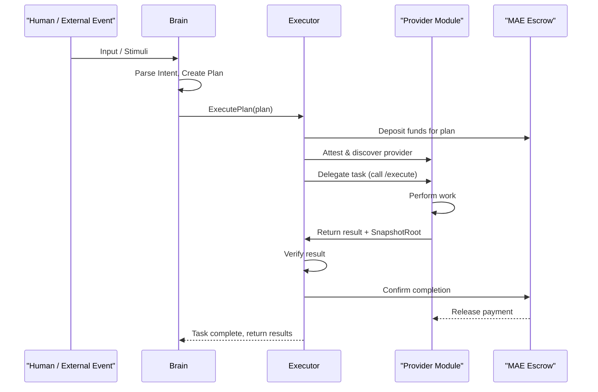
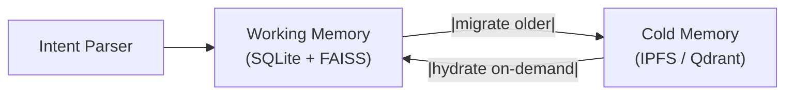
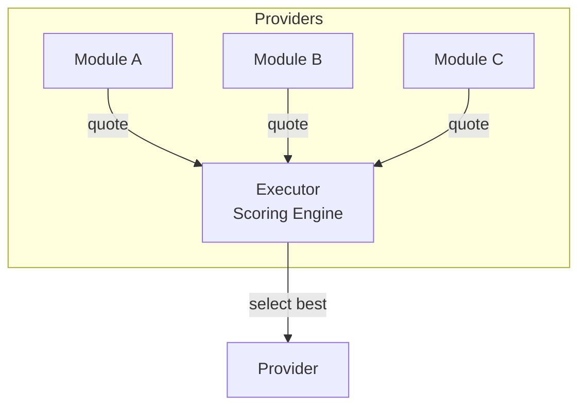
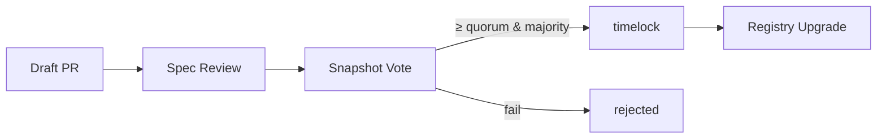
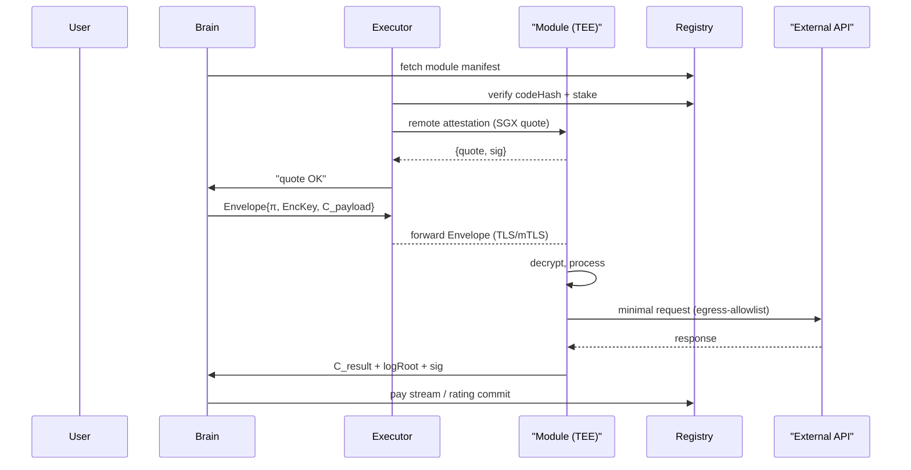

# Modular Agent Ecosystem Spec (draft v1-rc1)

The Modular Agent Ecosystem (MAE) is a cypherpunk‑aligned protocol that acts as the primary application and orchestration layer for a global, autonomous agent economy. It leverages **EigenCloud's cryptoeconomically secured compute fabric** to provide verifiable, off-chain execution for AI agents and their modules.
By building on this foundation, MAE provides the essential higher-level abstractions, including a modular capability system, a peer-to-peer services marketplace, and robust data privacy controls—needed to bootstrap a self-sustaining marketplace of digital labor, all without introducing central chokepoints.
This whitepaper specifies the architecture, security model, economic incentives, and governance needed to bootstrap a self‑sustaining marketplace of privacy‑preserving digital labor.

## Table of Contents

* [1 - Vision & Scope](#1---vision--scope)
* [2 - Core Abstractions](#2---core-abstractions)
* [3 - Base System ("Proto‑Agent")](#3---base-system-protoagent)
* [4 - Data & Knowledge Model](#4---data--knowledge-model)
* [5 - Communication Protocol](#5---communication-protocol)
* [6 - Economic Model](#6---economic-model)
* [7 - Versioning & Compatibility](#7---versioning--compatibility)
* [8 - Security & Privacy](#8---security--privacy)
* [9 - Governance & Community](#9---governance--community)
* [10 - Committed Design Choices](#10---committed-design-choices)
* [11 - Security & Privacy Architecture](#11---security--privacy-architecture)
* [12 - Example Workflows & Interaction Traces](#12---example-workflows--interaction-traces)
* [13 - Runtime Observability & SLO Framework](#13---runtime-observability--slo-framework)
* [14 - Wallet & Key‑Material Lifecycle](#14---wallet--keymaterial-lifecycle)
* [15 – Token Economics](#15--token-economics)
* [16 - State‑Bearing Module Migration](#16---statebearing-module-migration)
* [17 - Disaster Recovery & Registry Availability](#17---disaster-recovery--registry-availability)
* [18 ‑ DoS & Cost‑Flooding Protections](#18--dos--costflooding-protections)
* [19 – Side‑Channel & Escape Hardening](#19--sidechannel--escape-hardening)
* [20 – Self‑Sovereign Compliance Considerations (Cypherpunk Mode)](#20--selfsovereign-compliance-considerations-cypherpunk-mode)
* [21 – Configurator & Profile System](#21--configurator--profile-system)
* [22 – Conclusion](#22--conclusion)

## 1 - Vision & Scope

Create an **open, extensible protocol** allowing autonomous software agents to interoperate, trade services, and evolve, much like *cells* in a living organism. Each agent can:

1. **Perceive** semi structured inputs (messages, events, sensor feeds).
2. **Act** via built in functionality and be extended by third-party modules, external APIs, or other agents.
3. **Transact** value natively (built‑in fee settlement, using the *CREDIT* token).
4. **Evolve** with backward‑compatible versioning.

The spec targets:

* Language‑agnostic runtimes (initial PoC in TypeScript/Rust + Docker runtime sandbox).
* Deterministic, testable interactions.
* Community governance for upgrades.

---

## Problem Statement

Today’s AI‑as‑a‑Service platforms are opaque, vendor‑locked, and require users to send sensitive data to centralized black boxes.
While emerging decentralized compute networks like EigenCloud provide a secure foundation for running arbitrary jobs, they do not provide the specific protocols or economic abstractions needed for a rich, autonomous agent economy.
Hacky bot frameworks proliferate but lack a shared payment layer, discoverability, or a standardized model for compositional tasks.
MAE addresses these gaps by building on top of this secure compute primitive, providing the essential "application layer" that makes it useful for AI:

* Presenting an alternative, modular approach to building truly capable **intent driven agents** which can be extended infinitely as required.
* Defining a standard for **capability discovery** through a public registry where modules can advertise their function, performance (SLA), and cryptoeconomic stake.
* Standardising the use of a **payment handshake and on-chain escrow system** (§6) so any component can safely transact with any other.
* Embedding **governance and incentives** specifically tailored to the needs of an agent-based ecosystem.

### 1.1 Who Benefits & Why It Matters

| Audience                         | What they gain from MAE                                                                                                                                                             |
| -------------------------------- | ----------------------------------------------------------------------------------------------------------------------------------------------------------------------------------- |
| **Independent hackers / SMEs**   | Publish a Module or a composite Service Agent once, earn `CREDIT` every time any other component uses it. No gatekeepers, no revenue-share middlemen.                               |
| **Privacy‑conscious users**      | Delegate tasks to Agents that run on a compute fabric secured by the full economic weight of Ethereum via EigenLayer, with TEEs providing strong privacy guarantees.                |
| **AI researchers**               | Swap in custom models or novel inference back‑ends and benchmark real‑world demand instantly. Receive stake‑weighted feedback and funding for open models.                          |
| **EigenCloud Operators**         | Opt-in to the MAE AVS to service high-value AI/agent workloads. Earn fees in both `CREDIT` (from users) and native tokens (from EigenLayer emissions) for providing secure compute. |
| **Open‑source maintainers**      | Monetise libraries as verifiably secure Modules, with transaction and reputation handling handled by the protocol out of the box.                                                   |
| **Enterprises / DAO treasuries** | Replace brittle, ad‑hoc bots with auditable Agents whose execution integrity is secured by a decentralized network of hardware and cryptoeconomic stake.                            |

*Key takeaway*: **Anyone** can deploy a capability, be it a simple webhook, a GPU‑heavy inference engine or a compliance checker, and start earning as soon as other Agents find it in the Registry.  The protocol’s robust incentive architecture, deterministic sandboxes and on‑chain native payment flows remove the friction of billing, trust, and integration.

### 1.2 Naming Conventions

* **MAE (Modular Agent Ecosystem)** — the open specification you are reading.  
* **Phantomgrid** — The flagship reference implementation of the **MAE Application Layer**. This includes the on-chain contracts for the `Registry` and `Escrow` systems, the standardized agent/module SDKs, and reference implementations of the `Proto-Agent` and `Proto-Module` runtimes. Phantomgrid will also operate canonical **Infrastructure-as-a-Service (IaaS)** offerings, including TEE-based cloud services, allowing developers to easily deploy and host secure modules. The entire stack is designed to operate on top of EigenCloud for its underlying verifiable compute and cryptoeconomic security.
  
---

## 2 - Core Abstractions

### 2.1 Agent

| Aspect              | Description                                                                                                       |
| ------------------- | ----------------------------------------------------------------------------------------------------------------- |
| **ID & Manifest**   | Globally unique, semantic versioned (`agent:weather.v1.2.3`).                                                     |
| **Lifecycle hooks** | `init`, `onInput`, `tick`, `shutdown` etc.                                                                        |
| **Interfaces**      | *Perception* (listen and understand), *Action* (publish/delegate commands), *Economics* (quote, invoice, settle). |
| **Metadata**        | Name, author, license, required capabilities, fee model etc.                                                      |
| **Security**        | Signed manifest + capability grants.                                                                              |

#### 2.1.1 Capability vs Module (Cheat‑Sheet)

| Concept        | Analogy (EVM)        | Scope & lifecycle                                                                                                                         |
| -------------- | -------------------- | ----------------------------------------------------------------------------------------------------------------------------------------- |
| **Capability** | Opcode / Pre‑compile | Protocol‑level *interface* (`vision/ocr@1`).  Immutable once accepted; describes input/output schema and semantics.                       |
| **Module**     | Smart‑contract impl  | Concrete OCI image that implements **one or more** capabilities; carries its own performance profile, fee model, audit report, and stake. |

*Many Modules → one Capability* – multiple providers can compete to serve the same capability with different cost/SLA trade‑offs.

#### 2.1.2 Capability Namespace Tiers

| Tier             | ID pattern                   | Who can mint                       | Lifetime & rules                                                                       |
| ---------------- | ---------------------------- | ---------------------------------- | -------------------------------------------------------------------------------------- |
| **Experimental** | `dev.<owner>/<action>@0`     | Any staked account (`minDevStake`) | Auto‑expires after 180 days unless upgraded; no governance vote required.              |
| **Canonical**    | `<namespace>/<action>@MAJOR` | CAP vote                           | Subject to 12‑month deprecation window on MAJOR bump; one canonical entry per version. |

**Promotion path** – Developers prototype as `dev.alice/ocr@0`; after community adoption they submit a Governance CAP to elevate it to `vision/ocr@1`. The Registry then aliases the experimental ID to the canonical one for the remainder of the 180‑day period.

Registry logic:

* `capId` starting with `dev.` can be registered directly via `registerDevCapability` with ≥ `minDevStake` and an `expiresAt` timestamp.  
* Cron upkeep prunes expired experimental IDs.  
* Canonical IDs are created/updated only via successful CAP votes.

### 2.2 Module (Capability Implementation)

A module is a sandboxed, OCI-compliant image that implements one or more capabilities. To participate in the MAE marketplace, a module provider **MUST** also be a registered operator on the underlying verifiable compute network (i.e. EigenCloud), securing their service with a cryptoeconomic stake. To be discoverable and trusted, every module MUST contain a `module.manifest.json` file at its root. This manifest serves as the canonical description of the module's identity, capabilities, resource requirements, and security posture.

| Aspect                   | Description                                                                                                                                                                                                                 |
| ------------------------ | --------------------------------------------------------------------------------------------------------------------------------------------------------------------------------------------------------------------------- |
| **ID & Manifest**        | Globally unique, semantic, version‑controlled (`module:ocr.v1.0.0`).                                                                                                                                                        |
| **Endpoints**            | Must expose `quote()`, `execute()`, `invoice()`; pricing follows x402 (§ 6).                                                                                                                                                |
| **Metadata**             | Name, author, license, required capabilities, fee model etc.                                                                                                                                                                |
| **Resources**            | Declares CPU, memory, GPU, network, concurrency in **SystemSpec**.                                                                                                                                                          |
| **Fee Model**            | Flat, resource‑metered, or streaming; encoded in manifest field `feeModel`.                                                                                                                                                 |
| **SystemSpec**           | JSON object describing performance & SLA; parsed by Executors for provider scoring (see example below).                                                                                                                     |
| **ModelQuant**           | *(Optional)* Hint for LLM Modules—e.g., `gguf‑q4`, `int8`—so Agents can predict VRAM footprint.                                                                                                                             |
| **supportsResourceHint** | `true` if the Module’s `quote()` endpoint returns a non‑zero `resourceHint` object (peak RAM/GPU/disk/CPU); allows Executors to pre‑check host capacity.                                                                    |
| **Security**             | Runs on a verifiably secure compute network (EigenCloud AVS). The operator's stake provides the primary economic guarantee. The module's manifest is signed, and the OCI image includes an SBOM hash and SLSA attestations. |

> **SystemSpec advertisement** — Every Module MUST embed a `systemSpec` in its manifest so Executors can reason about latency, throughput, and resource trade‑offs.

#### The Module Manifest (`module.manifest.json`)

```jsonc
{
  // --- Core Identity & Versioning ---
  "id": "module:summarizer.acme.v1.2.3",   // Globally unique, semantic ID
  "name": "Acme Text Summarizer",          // Human-readable display name
  "version": "1.2.3",                       // Semantic version of this implementation
  "visibility": "private",                  // "public" | "private"
  "description": "A powerful text summarization module powered by the Acme-TS-2 model.",
  "author": "Acme Corporation",
  "license": "Apache-2.0",

  // --- Capabilities & Service Endpoints ---
  "implements": ["text/summarise@1"],       // Array of Capability IDs this module implements
  "endpoints": {                            // Public-facing service endpoints
    "quote": "/quote",                      // Path for getting a price quote
    "execute": "/execute",                  // Path for executing a task
    "invoice": "/invoice"                   // Path for retrieving an invoice
  },
  "feeModel": "resource-metered",           // "flat" | "resource-metered" | "stream"
  
  // --- Security, Privacy & Audit ---
  "security": {
    "runtimeClass": "H-Tier",               // "default" | "H-Tier"
    "audit": {
      "status": "audited",                  // "audited" | "self-audited" | "unaudited"
      "auditCID": "bafy...audit-report",    // IPFS CID of the audit PDF/JSON
      "auditor": "trailofbits.eth"          // (Optional) ENS of the auditing firm
    },
    "verifiableCompute": {
      "provider": "EigenCloud",
      "operatorId": "0x123..." // The provider's Operator ID on EigenCloud
    },
    "piiPolicy": {                          // (Optional) PII handling declarations
      "sendsToExternal": true,              // True if it sends PII to non-MAE APIs
      "externalDomains": ["api.acme.com"],  // List of external domains it contacts
      "piiSchemas": ["user.email"]          // List of PII schemas it transmits
    }
  },

  // --- Resource & Performance Specification ---
  "systemSpec": {
    "cpuModel":  "AMD EPYC 7B12",
    "cpuCores":  8,
    "memoryGB":  32,
    "gpu": { "name": "NVIDIA A100", "memoryGB": 40 },
    "netMbps":   1000,
    "maxJobs":   16,
    "latencySLAms": 300,
    "qps": 450,
    "gpuSlices": 4,
    "supportedTeeTypes": ["SGX", "Nitro"],
    "geoTags": ["EU-FRA1", "NA-SJC"],
    "hostingProvider": "aws",               // "aws" | "gcp" | "azure" | "self"
    "transports": [
      { "kind": "grpc", "endpoint": "https://mod.acme.com:443" },
      { "kind": "wt", "endpoint": "https://mod.acme.com:443/agent-wt" }
    ]
  },

  // --- Optional Hints & Metadata ---
  "modelQuant": "gguf-q4",                  // (Optional) Hint for LLM VRAM footprint
  "supportsResourceHint": true,             // True if quote() returns a resourceHint
  "maeEns": "acme-summarizer.eth"           // (Optional) Reverse-lookup ENS name
}
```

**Key Fields Explained:**

* **`visibility`**: Declares whether the module's source OCI image is public or is a private, encrypted blob that relies on the DAO-Governed Sealing Service (§ 11.4) for verification.
* **`implements`**: The most critical field, linking this concrete implementation to the abstract `capabilityId`(s) it serves.
* **`security.audit`**: Provides transparency on the module's security posture, allowing clients to filter for audited modules.
* **`security.piiPolicy`**: A declarative policy that enables the Agent's Policy Engine to enforce rules and obtain user consent before sending sensitive data to external, non-MAE APIs (§ 11.5).
* **`security.verifiableCompute`**: Critically, this object links the MAE module registration to its corresponding operator and stake on the underlying secure compute network (i.e. EigenCloud). This is the root of the module's cryptoeconomic trust.
* **`systemSpec`**: The performance and resource advertisement that feeds directly into the Executor’s provider selection logic (§ 6.4) and on-chain SLA enforcement.
* **`systemSpec.hostingProvider`**: Allows users to express a preference for modules running on major cloud infrastructure to mitigate physical side-channel risks (§ 19.1).

These fields feed directly into the Executor’s provider‑selection heuristic (§ 6.4) and into on‑chain SLA enforcement.

### 2.3 Human‑Readable Names via ENS

While the protocol uses stable, semantic `Global_ID`s (e.g., `module:ocr.v1`) for unambiguous machine-to-machine communication, these identifiers are not user-friendly. To enhance discoverability, memorability, and brand identity, MAE integrates with the Ethereum Name Service (ENS). This allows module and agent developers to associate their complex Global IDs with simple, human-readable names like `ocr.my-company.eth`.
This approach provides a user-friendly discovery layer without introducing a new, centralized naming system. It leverages existing, battle-tested infrastructure and allows participants to build a recognizable brand identity within the ecosystem.
MAE intentionally avoids deploying its own naming contract.  
Instead it piggy‑backs on the Ethereum Name Service (ENS) so users get familiar wallet / dApp UX without extra gas or maintenance overhead.

| Concept                  | Description                                                                                                             |
| ------------------------ | ----------------------------------------------------------------------------------------------------------------------- |
| **Global ID**            | Stable semantic identifier such as `module:ocr.v1` or `agent:weather.v2`.                                               |
| **ENS label (optional)** | Any ENS domain (`ocr.demo.eth`, `voice.ai.eth`). The owner adds a TXT record `maeId=module:ocr.v1` (or `agent:foo.v2`). |

Resolution flow:

1. Executor detects an ENS string in the request.
2. Queries the ENS resolver → pulls TXT records.
3. Extracts the `maeId` value. 4. Calls `Registry.lookup(maeId)` to obtain ProviderRecords (endpoints, stake, SLA).

> **Global ID** — This semantic ID pins what capability is offered along with its stake, version, and SLA. Actual network coordinates (IP:port, POP, TLS hash) live inside the returned **ProviderRecords** and can change without touching ENS.

Features:

* No new on‑chain contract → zero additional gas or governance surface.
* Works with every ENS‑aware wallet and library today.
* Module authors can reuse existing `.eth` identities or sub‑names.
* Reverse lookup: a Module may publish `TXT maeEns=ocr.demo.eth` in its manifest for UI display.

### 2.4 Proto-Module (The Base Provider)

The **Proto-Module** defines the minimal set of components required for a sandboxed program to act as a verifiable, trustworthy service provider within the MAE ecosystem. Its trust guarantees are rooted in the cryptoeconomic security of the underlying compute AVS (i.e., EigenCloud), upon which the MAE application-level standards are built. While any OCI-compliant image can be run, to be a valid, trustable Module that can participate in the marketplace, it MUST adhere to this fundamental structure.

```text
┌───────── Sandbox Boundary ─────────┐
│                                    │
│  ┌──────────────────────────────┐  │
│  │   Module Handler/Server      │  │
│  │  (gRPC, WebTransport, etc.)  │  │
│  └──────────────┬───────────────┘  │
│                 │ (request)        │
│                 ▼                  │
│  ┌──────────────┴──────────────┐   │
│  │      Module Core Logic      │   │
│  │ (Implements the capability) │   │
│  └──────────────┬──────────────┘   │
│                 │ (side-effects)   │
│                 │                  │
│ ┌───────────────▼──────────────┐   │
│ │ Canonical Environment Manager│   │
│ │             (CEM)            │   │
│ └──────────────┬───────────────┘   │
│                │ (notarized I/O)   │
│                │                   │
│  ┌─────────────┴───────────────┐   │
│  │    Snapshot Generator       │   │
│  └─────────────────────────────┘   │
│                                    │
└────────────────────────────────────┘
          │                 ▲
(result + SnapshotRoot)   (/attest)
```

**Core Components:**

1. **Handler/Server:** A lightweight server that exposes the required endpoints (e.g., `/quote`, `/execute`) over the transports declared in its manifest. It serves as the primary entrypoint for all external requests from clients.
2. **Module Core Logic:** This is the developer-provided code that implements one or more capabilities. It contains the business logic for the service (e.g., summarizing text, translating an image, etc.).
3. **Canonical Environment Manager (CEM):** As defined in § 11.3, this mandatory, trusted component intercepts all side-effecting system calls (network, clock, RNG, filesystem) made by the Core Logic. It notarizes these interactions by providing signed attestations.
4. **Snapshot Generator:** Upon task completion, this component gathers all Notary Attestations from the CEM, along with the initial inputs and final outputs, and bundles them into the signed `SnapshotRoot`. This snapshot is the verifiable receipt of the execution, which is essential for dispute resolution.
5. **/attest Endpoint:** Every module, by virtue of running on EigenCloud, supports a standardized attestation mechanism. This allows a client Executor to verify the integrity of the running code and the identity of the operator before sending any sensitive data. This function is provided by the underlying compute layer but consumed by the MAE application layer.

By mandating this structure, the protocol ensures that every service provider in the ecosystem, regardless of its specific function, is verifiable, auditable, and subject to the same rules of dispute resolution. A Module that does not correctly implement this structure cannot produce a valid snapshot and will automatically lose any dispute under the "Burden of Proof" rule (§ 11.11).

---

## 3 - Base System ("Proto‑Agent")

The minimal executable bundle every Agent inherits: **Brain + Executor + Wallet**, running inside a sandbox VM and communicating with external Modules and other Agents.

```text
┌──────── Brain ────────┐  
│ ┌── Intent Parser ─-┐ │  
│ │ Context Engine    │ │  
│ │ Memory Store      │ │  
│ └───────────────────┘ │  
│      |         │      │  
└──────┼────────-┼─────-┘  
       ▼         ▼          
┌──────-──────┐┌──────────┐
│  Executor   ││  Wallet  │
└─────────────┘└──────────┘
```



### 3.1 Brain

1. **Input Adaptors** normalise raw stimuli/commands → `RawInput`; Adapter pattern to extend with new input sources (e.g., file‑system, IoT, web crawler).
2. **Intent Parser** fuses RawInput + context with NLP & symbolic pipeline → `Intent` object.
3. **Context Engine** – Tiered store: (1) **Static KV** (user-set prefs), (2) **On-Demand Views** with `ttl` / `ephemeral` tags, and (3) default-on **reactive `contextd` daemon** (opt-out).  Enriches intents with user preferences, live system facts, and external feeds.
   1. **User Preferences** Enriches the intent with information the user has specified either via configs or verbally from past interactions to make it contextually able to process the intent
   2. **Memory Store** Multi-tier memory architecture which enriches the intent with past experiences and memories generated by the agent. Allows for storage and recollection of learned skills/information via RAG style setup; supports pluggable back‑ends (SQLite, Redis, IPFS, Vector Datastore).
      1. **Working Memory (WM)** – fast, in-process SQLite + FAISS (or Redis) holding recent events (TTL, size quota).  
      2. **Cold Memory (CM)** – encrypted, content-addressed blobs (IPFS or external Vector DB) for long-term recall.  
        Events migrate from WM → CM once age > `wmTTL` or WM exceeds quota.
          1. **Global Context** Provides additional context to the intent for things like filesystem trees and other system settings pertinent to the task.
          2. **Module Directory** Provides information about the capabilities of the presently available local modules
4. **Planner** – Builds a DAG of PlanSteps. Advanced mode supports limited DSL wrappers (`if`, `foreach`, `askUser`) and control tags (`parallel`, `retry`, `timeout`, `circuitBreaker`, `onError`). When a node fails, structured error metadata (`err.code`, `err.stage`, `err.payloadCid`) feeds an **onError** handler that can auto‑retry, switch provider, trigger a fallback PlanStep, or escalate an `askUser` prompt. The flattened DAG plus onError rules is signed for auditability; subsequent patches are versioned on re‑planning.
5. **Executor** is then tasked with carrying out the plan, which includes discovering providers, enforcing QoS, and managing the on-chain escrow and settlement process.
6. Results feed back to Brain and optionally to the Memory Store where needed. Evaluator attempts to match up results to expectation and responds with some data to the user.

#### 3.1.0 Intent Parser Specification

The Intent Parser is a component of the agent that converts **semi‑structured input** + **context** into a normalised `Intent{type, args, meta}` object.

**Data sources it fuses**  

| Source                   | API                                                                          | Purpose                                                                   |
| ------------------------ | ---------------------------------------------------------------------------- | ------------------------------------------------------------------------- |
| Raw Input Adaptor output | `RawInput` proto (see § 3.1.2)                                               | Primary text / event payload                                              |
| User Preferences         | `preferences.yaml` (language, tone, …) + learnings from usage history        | Inject policy tags (`privacy=high`, etc.) and other customization options |
| Memory Store             | gRPC `Memory.ReadNearest(k=10, vector)`                                      | Retrieve similar past intents / embeddings                                |
| Global Context           | `Context.Settings("network.timezone")`, `Context.Filesystem("path-to-file")` | Supply implicit parameters (dates, locales, filesystem trees)             |
| Module Directory         | `Executor.listCapabilities()`                                                | Suggest default capability IDs                                            |

##### Processing pipeline

1. `Normalizer` – Unicode NFC, punctuation cleanup, PII scrub.  
2. `Classifier` – Transformer (e.g., DistilBERT fine‑tune) → intent‑class logits.  
3. `Entity Extractor` – spaCy / Rule‑based hybrid → named entities, slots.  
4. `Preference Merger` – Overlay user prefs (`lang=de`, `currency=EUR`).  
5. `Memory Augment` – Attach `relatedEvents:[eventId]` if cosine sim ≥ 0.8.  
6. `Context Enricher` – Replace “next Tuesday” with absolute date using locale/timezone.  
7. `Capability Hint` – Look up `intentClass → capabilityId[]`; return ranked list.  
8. **Output** → `Intent{type, args, confidence, provenance}` where `provenance` lists each augmentation step and hash of source data + `ExecutionPlan{intent, context}`

##### Extensibility

* Module Directory: `parser.d/modules/*.mae` loaded via manifest.  
* Each module exposes `fn transform(IntentDraft) -> IntentDraft`. Execution order is deterministic, declared in manifest.

##### Determinism & Auditing

* To ensure reproducibility, the parser's output must be deterministic. Given identical inputs (raw input, preferences, context snapshot), the parser **must** yield a byte-identical `Intent` JSON.
* **Note on ML Models**: Achieving byte-for-byte determinism with ML models (like the `Classifier`) is notoriously difficult across different hardware. Therefore, modules using them MUST either:
  * Utilize fixed-point arithmetic and pin exact software versions (e.g., `distilbert-int8` running in a specific, versioned ONNX runtime).
  * Define a "semantic hash" function for the output that is robust to minor floating-point variations but captures the meaningful result.
    For the reference implementation, the former is mandated.
* A SHA‑256 of the final Intent (or its semantic hash) plus provenance is recorded in the Audit Root, enabling dispute replay.

> *Goal*: decouple domain‑specific parsing from core planning while ensuring every decision is transparent, auditable, and reproducible.

#### 3.1.1 Intent → Capability Pipeline

1. **Parsing & Classification**  
   * The Intent Parser consumes raw user input or event payloads and produces a preliminary `Intent{type, args, raw}`.  
   * A lightweight transformer model (or regex/state machine for constrained domains) assigns an **Intent Class** (e.g., `summarise`, `translate`, `fetch-weather`).

2. **Slot Extraction**  
   * The Context Engine enriches the intent with entities and disambiguates pronouns (`"summarise *this* pdf"` → `{targetCid}` supplied).  
   * Policy tags (privacy level, max budget) are attached.

3. **Capability Lookup**  
   * The Brain maps `Intent.type` to one or more **Capability IDs** via a local `overlay.yaml`, e.g.  

     ```yaml
     summarise:   text/summarise@1
     translate:   lang/translate@1
     fetch-weather: data/weather.fetch@0
     ```  

   * If multiple capabilities match (e.g., language `en→de` vs `en→fr`), the **Selector Plug‑in** narrows down based on arguments.

4. **Feasibility & Cost Estimation**  
   * For each candidate capability, Brain queries the Executor’s `estimateCost(capabilityId, args)` which simulates a `quote()` call and returns expected CREDIT spend + latency.

5. **Plan Generation**  
   * Brain emits an **Executable Plan**—a DAG of `PlanStep{capabilityId, args, maxFee, dependencyIds}`.  
   * Each PlanStep is handed to the Executor, which performs provider discovery (§ 3.2.1).

6. **Adaptive Re‑planning**  
   * If all providers fail or cost > max budget, Brain triggers a fallback intent (`summarise‑locally`, `notify‑user‑error`) and regenerates a plan.

##### Diagram


#### 3.1.2 Universal Input Adaptors

To handle chat text, speech, GUI clicks, IoT sensor events, or API web‑hooks in a uniform way, MAE ships pluggable **Input Adaptors**:

| Adaptor       | Raw Input                                       | Output to Intent Parser                                           |
| ------------- | ----------------------------------------------- | ----------------------------------------------------------------- |
| `text.chat`   | Free‑form user chat                             | `{type:"chat", lang:"en", text:"…", ctxId:"123"}`                 |
| `speech.stt`  | Audio stream                                    | Same as `text.chat` but with `"source":"mic"`                     |
| `gui.command` | Button press                                    | `{type:"ui_event", control:"btn#42", action:"tap"}`               |
| `iot.sensor`  | MQTT/LoRa payload                               | `{type:"sensor", sensorId:"temp‑a", value:22.3}`                  |
| `webhook.*`   | HTTP callback                                   | `{type:"webhook", path:"/upload", payload:{…}}`                   |
| `agent.task`  | Internal PlanStep event                         | `{type:"task_event", stepId:"abc", status:"DONE", output:"cid:…}` |
| `module.call` | Programmatic callback from another Module/Agent | `{type:"module_call", caller:"module:ocr.v1", payload:{…}}`       |

*Automated Sources* — `agent.task` events are emitted by the Executor whenever a PlanStep finishes and can trigger downstream intents. `module.call` events allow one Module to invoke another without routing raw data through the user, preserving privacy while enabling complex pipelines.

##### 3.1.2.1 Adaptor Manifest & Runtime Contract

Every Input Adaptor is itself a **Module** whose `moduleId` follows the pattern `input.<kind>@<semver>`  
(e.g., `input.text.chat@2`).  The OCI image MUST contain an `adaptor.manifest.json` with the fields below.

```jsonc
{
  "adaptorId": "input.text.chat@2",
  "version": "2.0.1",
  "inputSchemaCID": "bafychat-json-schema",      // IPLD-schema for raw payload
  "outputSchemaCID": "bafyintent-json-schema",   // schema for Intent object
  "languages": ["en", "de", "fr"],
  "deterministic": true,
  "wasmDigest": "sha256:abc123…",                // optional if image is WASM-only
  "securityClass": "stateless",                  // stateless | buffer-10s | stateful 
  "permissions": {
    "network": "none",
    "fs": "read-only"
  }
}
```

* **Input / Output Schemas** — MUST be JSON‑Schema or IPLD‑Schema; provides machine‑verifiable contract.
* **Deterministic** — Set `deterministic=true` if *every* run with identical input yields identical output bytes.
* **SecurityClass** —  
  * `stateless`  — WASI-preview2, `net=none`, resource caps (16 MB input, 256 MB RSS, 2 s CPU); **unaudited Modules are rejected by default** unless the user opts-in via Configurator.
  * `buffer-10s`: may hold data ≤ 10 seconds for streaming (e.g., STT).  
  * `stateful`: long‑term state; discouraged unless justified (e.g., hotword cache).

##### Runtime gRPC

Adaptors expose a minimal gRPC service inside the sandbox:

```protobuf
service InputAdaptor {
  rpc Parse (RawInput) returns (IntentEnvelope);
  rpc Health (Ping) returns (Pong);        // optional
}
```

* `RawInput.payload` is validated against `inputSchemaCID` before invoking `Parse`.
* `IntentEnvelope` contains `{intent, confidence: float32, meta}` — confidence allows Brain to fallback if below threshold.

##### Determinism Proof

For adaptors flagged `deterministic=true`, the Witness Builder runs the same test‑vector suite twice; if output hashes differ, the adaptor cannot be published in the global Registry.

##### Governance & Versioning

1. **Minor bump** (`@2 → @3`) allowed after 90‑day stability window.  
2. **Deprecation** — A CAP may mark an adaptor kind deprecated; Agents receive a `ADAPTOR_DEPRECATED` event.  
3. **Collision resolution** — First‑come with ≥ 10 000 CREDIT stake or via CAP vote.

> *Design goal*: make adaptors as auditable and sandboxed as any other capability, so that “raw input → intent” is predictable, privacy‑safe, and peer‑reviewable.

Adaptors are simple WASM or TS modules that **must** be deterministic and stateless; they are versioned exactly like any other Module (`input.chat@2`). Agents include only the adaptors relevant to their domain in the Brain’s extension list.

#### 3.1.3 Capability‑ID Lifecycle

##### Deprecation Timetable

| Stage          | Meaning                                                             | Duration (from MAJOR bump) |
| -------------- | ------------------------------------------------------------------- | -------------------------- |
| **Active**     | Current, fully supported version.                                   | N/A                        |
| **Deprecated** | Superseded by newer MAJOR; providers must keep endpoints alive.     | 12 months                  |
| **Retired**    | Providers MAY remove; stake can be withdrawn; overlay pin required. | After sunset window        |

* **Global Registry** — `RegistryCore` stores a mapping `capabilityId → canonicalManifestCID`.  A capability ID is a short URI (`text/summarise@1`).  Version bumps (`@2`) require Governance CAP review to avoid namespace squatting.
* **Local Overlay** — Each Agent maintains a *capability overlay* (JSON/YAML) where it can **alias** or **override** global IDs with local prototypes:

```yaml
# overlays/overlay.yaml
text/summarise@1: module:localSummariser.v0-dev   # local dev build
lang/translate@*: module:openAIproxy.deprecated   # force local fallback
```

During lookup:

1. Brain checks its overlay: if an override exists **and** its Module stake ≥ minDevStake, use it.
2. Otherwise, query `RegistryCore` to resolve to a global Module set.
3. If the Agent installs a new local Module (`mae install ./my‑ocr`), CLI auto‑patches the overlay.

* **Sync Rules**  
  * Overlay file is **not** sync’d peer‑to‑peer (keeps user customisations private).  
  * When a global capability ID is deprecated, the Agent receives a `CAPABILITY_DEPRECATED` event via the pub‑sub mesh and removes the mapping.

##### Capability Overlay Management

Most users will occasionally need to **pin** an older Module, test a local prototype, or bias their Agent toward specific providers.  
MAE supports this via a per‑profile **Overlay Map** (mapping *capability → preferred module*) stored at `~/.mae/overlays/<profile>/overlay.yaml`

```yaml
version: 1        # overlay format version
overrides:
  text/summarise@1:  module:localSummariser.v0-dev   # exact pin
  vision/ocr@*:      module:ocr@1                    # wildcard
prefs:
  providerBias: gpu-local   # gpu-local | cheapest | lowest-latency
  allowUnaudited: false
meta:
  created:   "2025-06-15T14:03Z"
  profileId: "workstation-amy"
  sig: ""                    # optional Ed25519 signature
```

##### Precedence rules

 1. Exact override beats wildcard (vision/ocr@2 > vision/ocr@*).
 2. Overlay beats Registry deprecation—Agent warns but obeys the pin.
 3. Multiple overlays: Agent picks file matching $MAE_PROFILE; default is default.
 4. If meta.sig present, Agent verifies it against overlayPubKey; failure disables overlay until user confirms.

> Goal: let power-users experiment locally without polluting the global Registry, while preserving deterministic behaviour for everyone else.

#### 3.1.4 Tiered Memory Flow

* Ingest – New `MemoryEvent` lands in WM (sub-5 ms latency).
* Migration – Background job compresses & pins events older than `wmTTL` (default 4 h) or when `wmQuotaMB` surpassed.
* Cold Recall – If WM vector search misses, Brain issues async lookup to CM Module; results cached back into WM.
* Deletion – Revoked data purged instantly from WM and scheduled for CM tombstone.



#### 3.1.5 Context Engine Tiers

| Tier               | Example keys                                          | Storage / refresh                                                                                    | Default TTL                   |
| ------------------ | ----------------------------------------------------- | ---------------------------------------------------------------------------------------------------- | ----------------------------- |
| **Static KV**      | `prefs.lang`, `prefs.currency`, API keys              | `context/static.yaml` (edited by Configurator or CLI)                                                | ∞ (manual)                    |
| **On-Demand View** | `fs.homeFreeGB`, `system.uptime`, `ext.price.eth_usd` | KV entry + view script (`.wasm`), `ttl:` triggers lazy refresh, `ephemeral:` computes on each access | `ttl` field or 5 min fallback |
| **Reactive**       | `net.ipv4`, sensor feeds, live market ticks           | **`contextd` side-car** streams deltas via gRPC                                                      | Push, real-time               |

##### Tag schema example

```yaml
prefs.currency: "EUR"
prefs.lang: "de"
system.tz: { value: "CET", ttl: 24h }
fs.homeFreeGB: { view: "diskFree.wasm", ttl: 10m }
net.ipv4: { view: "ifconfig.wasm", ttl: 10s, ephemeral: true }
ext.price.eth_usd:
  view: "priceWatcher"
  provider: "coingecko"
  ttl: 0          # interpreted as reactive
```

### 3.1.6 Planner DSL (Hybrid)

To create robust and flexible execution plans, the Planner uses a hybrid Domain-Specific Language (DSL). This DSL supports both simple, declarative lists of tasks and more complex, procedural logic with control flow, error handling, and concurrency.

The fundamental unit of any plan is the `PlanStep`, a simple object defining a single action. For straightforward tasks, an execution plan can be a simple Directed Acyclic Graph (DAG) of these steps.

For advanced control, the DSL provides a set of procedural "wrappers" or "tags". These wrappers enclose one or more `PlanSteps` and define how they should be executed. This hybrid approach allows for simple plans when possible and complex logic when necessary.

| Wrapper / Tag    | Purpose                          | Limits (configurable via Governance) |
| ---------------- | -------------------------------- | ------------------------------------ |
| `parallel`       | Run child PlanSteps concurrently | Fan‑out ≤ 32                         |
| `retry`          | Automatic bounded retry          | Attempts ≤ 5                         |
| `timeout`        | Per‑node deadline (ms)           | 1 s – 120 000 ms                     |
| `circuitBreaker` | Fail fast after X recent errors  | Window 10; X ≤ 3                     |
| `if`             | Deterministic conditional branch | Depth ≤ 3                            |
| `foreach`        | Bounded loop over list           | List ≤ 256 items                     |
| `askUser`        | Prompt user to clarify           | Blocks plan until answer             |

#### Error‑Handling (`onError`)

Each PlanStep MAY include an `onError` object:

```jsonc
"onError": {
  "match": ["NETWORK", "AUTH", "VALIDATION", "ANY"],
  "actions": [
    { "type": "retry", "max": 2 },
    { "type": "switchProvider" },
    { "type": "askUser", "question": "Upload new credentials?" },
    { "type": "fallback", "capabilityId": "text/summarise.local@0" }
  ]
}
```

*Error code taxonomy*: `NETWORK`, `AUTH`, `VALIDATION`, `RESOURCE`, `ANY`.

*Action types*:

| Action           | Result                                                                                   |
| ---------------- | ---------------------------------------------------------------------------------------- |
| `retry`          | Re‑run same provider up to `max` attempts (exp back‑off).                                |
| `switchProvider` | Executor selects next best provider per § 6.5.                                           |
| `askUser`        | Planner pauses; Brain asks user. If unanswered after `askTimeout`, moves to next action. |
| `fallback`       | Brain spawns new PlanStep using alternative `capabilityId`.                              |

If no rule matches, the Planner aborts the task, refunds the `JobBond`, and emits an `INTENT_UNFULFILLED` event.

All errors are logged to the Audit Root, enabling transparent failure analysis via:

```protobuf
message PlanError {
  string  code;        // taxonomy
  string  stage;       // quote | execute | settle
  bytes   payloadCid;  // optional CID with logs
}
```

*Design goal*: Agents self‑heal for common issues yet surface intelligible prompts to users when human guidance is most valuable.

#### 3.1.7 Provenance Snapshot Rules

Not every Agent needs full audit‑grade snapshots all the time.  MAE distinguishes three operational *roles*:

| Role                                                                                            | Snapshot Requirement                                                                                                              | Default Behaviour                                                      |
| ----------------------------------------------------------------------------------------------- | --------------------------------------------------------------------------------------------------------------------------------- | ---------------------------------------------------------------------- |
| **Service Agent / Module**                                                                      | **MANDATORY** – must emit SnapshotRoot for every top‑level Intent it services for someone else.                                   | Enforced by Registry; missing root ⇒ SLA breach.                       |
| **Local Personal Agent**                                                                        | Optional but recommended for debugging and “user memory.”                                                                         | Disabled by default (`snapshotOptIn: false`); Configurator can enable. |
| **Collaborative Workflow Agent** (acts on behalf of user interacting with another user’s Agent) | **Conditional** – if any *counterparty* requests provenance, both sides must turn on snapshots for the duration of that workflow. | Negotiated during `INTENT` handshake (`needsProvenance=true`).         |

A *Service Agent* is any Agent or Module that lists itself as **public=true** in its manifest and accepts CREDIT from external wallets.

##### Snapshot Contents — Public vs Private Bundles

Snapshots are split into **two tar.zst archives** so that user data never leaks by default:

| Bundle                       | Mandatory files                                                                                          | Purpose                                                         | Typical size |
| ---------------------------- | -------------------------------------------------------------------------------------------------------- | --------------------------------------------------------------- | ------------ |
| **Public**                   | `plan.json`, `modules.json`, `quotes.json`, `planErrors.jsonl`, `metrics.prom`, `signature.sig`          | Provable by anyone; contains **no PII**                         | 2–15 KB      |
| **Private** (AES‑256 sealed) | `intent.json`, `context.snapshot.pb`, `rawInput.cid`, `results.cidlist`, optional `proof.zkp`, `extra/*` | Decrypted only if user or dispute contract releases `sealedKey` | 1–50 KB      |

Hashes:

```text
pubHash  = sha256(publicTar)
privHash = sha256(privateTar)   # privHash = 0x0 if provenance disabled
snapHash = sha256(pubHash ‖ privHash)
```

On‑chain anchor:

```solidity
event SnapshotRoot(
    bytes32 pubHash,
    bytes32 privHash,
    bytes   sealedKey   // one-time AES-GCM key sealed to the client's CT-721 root. Only revealable by the user or, during a dispute, to the Arbitrator Network
);
```

Field‑level policy from the Intent Parser:

* `public`   → cleartext in Public bundle  
* `hashed`   → SHA‑256(value) in Public  
* `sealed`   → AES‑GCM in Private  
* `zkproof`  → only proof file in Private

*Constraint*: uncompressed size of both archives combined MUST be ≤ 5 MB; large artefacts are referenced by CID only.

##### Frequency Defaults

| Agent class          | Rule                                                    |
| -------------------- | ------------------------------------------------------- |
| Service Agent        | Every top‑level Intent (user request).                  |
| Local Agent (opt‑in) | Every top‑level Intent OR manual `mae snapshot export`. |
| Streaming workflow   | Initial + diff patch every 10 min or DAG mutation.      |

Configurator flag example:

```yaml
snapshotOptIn: true       # personal agent
snapshotTTL: 30d          # local retention
```

Snapshots are TAR‑zstd archives; hash → `snapHash`. Service Agents MUST post `SnapshotRoot(snapHash)` on-chain or emit `SnapshotCID(cid)` IPFS event.

##### Deterministic Re‑play Contract

Given `(RawInput, ContextSnapshot, FlattenedPlan, ModuleDigests)`, any verifier can deterministically re‑play and compare Result CIDs.  No network egress is allowed during re‑play except IPFS fetches for declared hashes.

*Goal*: Provide cryptographic breadcrumbs for stakeholders that require them, without imposing heavy storage costs on purely local or ephemeral Agents.

### 3.2 Executor

* **Task Scheduler** – Prioritises, time‑slices, retries.
* **Capability Matcher** – Resolves which local module or remote agent can satisfy an action.
* **QoS Layer** – Rate limits, deadline enforcement, concurrency caps.

#### 3.2.1 Discovery & Fallback Logic

1. **Local Bloom Cache** — Executor first checks its Bloom‑filter of capability hashes; if hit, skip on‑chain lookup unless bloom indicates possible false‑positive. If the capability’s `retiredAt` timestamp is non‑zero (expired), Executor treats the ID as invalid **unless** an explicit overlay override exists.
  a. **Host‑Guard** — If the selected provider’s `quote()` response contains a `resourceHint`, Executor compares each dimension against local sandbox limits (`memFreeMB`, `vramFreeMB`, `cpuBudget`). If any exceeds the host, mark provider **UNFIT** and try the next candidate. If all providers are UNFIT, Planner emits `PLAN_RESOURCE_EXCEEDED`.
  b. **Safe-Caps & Probe** — When a provider’s `quote()` omits `resourceHint` (`memMB = 0`), Executor:
    * Launches the Module inside **conservative cgroup caps**:  
      `memLimit = min(host.freeMem × 0.25, 1 GiB)`, `cpuQuota = 2 cores`, `tmpDisk = 512 MiB`.
    * Executes a tiny **Probe PlanStep** (e.g., 32 × 32 px image for OCR) and records peak RSS / VRAM from cgroup stats.
    * If `peak × scaleFactor` still exceeds host limits, marks provider **UNFIT** before running the real job.
    * Any cgroup OOM kill emits error code `RESOURCE`; Planner’s `onError` map can `switchProvider` or `fallback` to a lightweight capability.
2. **Capability Query** — Executor calls `Registry.lookup(capabilityId)` which returns an array of **ProviderRecord{moduleId, endpoint{ip,port}, tlsHash, sysSpec, rating, price}** already filtered by compliance with the Agent’s policy (e.g., runtimeClass, TLD allow‑list).  These endpoint fields are ephemeral; only the `moduleId` and stake form the canonical identity.
3. **ENS Resolution** — If the task references an ENS domain (`ocr.demo.eth`), Executor queries the ENS resolver for TXT record `maeId`, yielding `moduleId`.
4. **Scoring & Selection** — Apply the scoring algorithm in § 6.5 to the candidate set.
5. **Availability Heart‑beat** —
   1. Send a light‑weight `PING` gRPC to the chosen Module.
   2. If response misses SLA (e.g., > 500 ms) mark provider `DEGRADED` and try the next highest‑score candidate.
   3. If candidate advertises `edgeReady:true`, Executor may select the nearest POP pre-warm pool (Fly.io Machines / Cloudflare Workers WASM) for sub-100 ms cold-start.
   4. For WebTransport/WebRTC, Executor picks the POP whose advertised RTT < 50 ms.
6. **Zero‑Hit Fallback**  
   * If `Registry.lookup` returns **empty**, Executor broadcasts a *Capability Request* on the pub‑sub mesh:  
     `capReq{capabilityId, budget, ttl}`.  
   * Any listening Agent/Module can respond with `capOffer{moduleId, quote}`; Executor re‑runs scoring on offers received within `ttl` (default 3 s).
7. **Last‑Chance Path** — Still empty?  
   * **Local Build**: If source code URL is embedded in the intent’s metadata, Executor spawns a sandbox to compile the module ad‑hoc (limited to 30 s).  
   * **User Escalation**: Emit `INTENT_UNFULFILLED` event to the Brain; Brain can prompt the user, adjust the plan, or retry later.
8. **TEE Policy** If a provider advertises multiple `supportedTeeTypes`, the Executor chooses the first entry that matches its own `allowedTeeTypes` profile list; otherwise the provider is deemed **UNFIT**.

All fallback events are logged to the Audit Root so that reputation penalties can apply to providers that frequently go offline.

#### 3.2.2 Cost-Forecast & Escrow Funding

Before dispatching the first `PlanStep`, the Executor performs a critical pre-flight check to ensure the entire plan is funded in escrow.

1. **Quote Sweep:** For every distinct `{capabilityId, args}` in the flattened plan, the Executor calls `quote(estimateOnly=true)` on potential providers to gather `(maxFee, minFee)`.
2. **Worst-Case Sum:** It computes the maximum possible cost of the entire plan: `maxTotal = Σ (maxFee × (1 + slippageBufferPct))`.
3. **On-Chain Escrow Deposit:** The Executor instructs the Wallet to make a single transaction, calling the `depositForPlan(planId, maxTotal)` function on the `MAEEscrow` contract (§ 6.6).
4. **Failure Path:** If the wallet has insufficient funds to make the deposit, the Executor emits a `PLAN_INSUFFICIENT_FUNDS` error, and the Brain can choose to re-plan with cheaper providers or ask the user for an increased budget.

Only after the full `maxTotal` is locked in the on-chain escrow contract will the Executor proceed with provider discovery and task execution.

#### 3.2.3 Result Verification & Dispute Triggers

The Executor's responsibility does not end upon receiving a result from a module. It must also perform validation to detect subpar or fraudulent results, which serve as the trigger for the dispute process. Executors can be configured with multiple layers of verification depending on the task's value and the user's security posture.

**Standard Verification Mechanisms:**

| Method                               | Description                                                                                                                                                                                                                                                                |
| ------------------------------------ | -------------------------------------------------------------------------------------------------------------------------------------------------------------------------------------------------------------------------------------------------------------------------- |
| **Schema & Type Validation**         | The simplest check. The Executor verifies that the received data conforms to the `outputSchema` declared in the capability's manifest. A mismatch is a clear, provable fault.                                                                                              |
| **Logical Heuristics**               | For common tasks, the Executor can apply simple, low-cost checks. For example, a text summarization result should not be longer than the original input; code generated by a module should compile without basic errors.                                                   |
| **Redundant Execution (Witnessing)** | For high-value or critical tasks, the Planner can schedule the same job with two or more competing module providers. The Executor compares the results. If the hashes do not match, it automatically files a dispute against the provider with the lower reputation score. |
| **Compositional Verification**       | The plan can include steps that use one module to verify another. For example, the output of a `data-query` module could be piped into a `schema-validation` module. A failure in the second step triggers a dispute against the first.                                    |
| **Human-in-the-Loop (HIL)**          | For personal agents, the ultimate trigger is the user. The agent's UI MUST allow a user to flag a result as incorrect or unsatisfactory. This action serves as the evidence (`clientVerificationCid`) needed to initiate a dispute.                                        |

By combining these methods, the Executor can build a high degree of confidence in the integrity of the results it receives before confirming completion. Upon successful validation, the Executor's Wallet calls the `confirmCompletion` function on the `MAEEscrow` contract (§ 6.6) to release payment to the provider.

#### 3.2.4 Adversarial Falsification (Operator Model)

MAE adopts an adversarial falsification model inspired by Operator, where results are economically exposed to profitable challenge during a bounded window. Core elements:

1. **Submission & Window** — A provider submits `RESULT_SUBMITTED{planStepId, resultCid, snapshotCid}`. A `challengeWindowMs` opens.
2. **Bonds** — The provider posts a `solverBond` sized to deter cheating; challengers post a `challengerBond` to file a dispute. Bonds and windows are advertised in `quote()` and enforced by escrow (see § 6.2).
3. **Challenge (Commit–Reveal)** — Any party may open `CHALLENGE_OPENED` with a commitment to evidence. Within the reveal window they submit falsification artifacts (hash‑addressed CIDs) proving defect: schema violations, counterexamples, reproducible runs, or replay traces (if constraints require).
4. **Recursive Verification** — A verifier (or quorum) issues `VERDICT{uphold|overturn}`. That verdict itself is subject to a subsequent challenge window, enabling recursive appeals. Escalation to the Arbitrator Network in § 11 occurs only after bonded recursion converges or times out.
5. **Outcomes** — If no challenge succeeds before the window closes, the result finalizes and payment settles. If a challenge succeeds, the solver is slashed and the challenger rewarded from bonds per § 6.

Providers MAY declare higher‑assurance constraints (e.g., TEE attestation + CEM snapshot) in their manifest; these become part of the constraint set verifiers apply during adjudication.

### 3.3 Wallet

* **Wallet Abstraction** – Multi‑currency (**CREDIT**, other stablecoins).
* **Quotation Engine** – Builds a cost graph for composite tasks.
* **Escrow Management** – Interfaces with the on-chain `MAEEscrow` contract to deposit, manage, and release payments for jobs.
* **Settlement & Confirmation:** Constructing and signing confirmCompletion messages to authorize the release of funds from the MAEEscrow contract.

---

## 4 - Data & Knowledge Model

| Layer        | Purpose                                                       | Example                                               |
| ------------ | ------------------------------------------------------------- | ----------------------------------------------------- |
| Envelope     | Auth, nonce, fee quote, payload hash.                         | `{hdr, sig, fee, payload}`                            |
| Intent       | A normalized, machine-readable description of a desired task. | `Intent(type="summarise", target=url)`                |
| Context      | Key–value store with TTL, providing situational awareness.    | `ctx.userPrefs.language="de"`                         |
| Memory Event | An immutable record of a completed and verified task.         | `event#8752 ⇒ {intent, snapshotCid, resultCid, cost}` |

GraphQL + Protobuf suggested for schema.

---

## 5 - Communication Protocol

* **Transport (v1 scope)**  
  1. **gRPC-H2** (ALPN `agent/1`, port 443) — the only supported transport in v1.  
     * Other transports (WebTransport, WebRTC data-channel, JSON-RPC over WSS) are deferred to a future revision and considered out-of-scope for the v1 reference implementation to reduce complexity and surface area.
* **Discovery**:
  * If an ENS name is supplied, resolve its TXT record `maeId` → obtain the Global ID.
  * Call `Registry.lookup(globalId)` to fetch signed manifests (no separate naming contract).
* **Capability Negotiation**: Handshake → agree on schema version + fee quote.
* **Payment Hooks (x402)**: Resources that require fees MUST use the `x402` protocol as a standardized handshake for **service and fee negotiation**, which generates a claim against the on-chain escrow system as defined in **§ 6.2**.
* **Event Types**: `INTENT`, `QUOTE`, `PAYMENT_REQUIRED`, `PAYMENT_SENT`, `ACCEPT`, `RESULT_SUBMITTED`, `CHALLENGE_OPENED`, `CHALLENGE_COMMIT`, `CHALLENGE_REVEAL`, `VERDICT`, `FINALIZED`, `ERROR`.

---

## 6 - Economic Model

The MAE economy is built upon a foundation of cryptographically secure, on-chain escrow to ensure fair and transparent value exchange. This system eliminates the need for trusted third-party payment processors and provides robust guarantees for all participants.

### 6.1 Core Principle: On-Chain Escrow as the Source of Truth

All payments for services rendered within the MAE ecosystem are mediated by a dedicated, on-chain **MAE Escrow Contract**. This contract acts as a neutral, automated third party, ensuring that providers are compensated for valid work and that clients do not pay for fraudulent or incomplete results. This escrow mechanism is mandatory for all transactions involving a `Service Agent` or public `Module`.

**The Escrow Lifecycle (with challenge windows):**

1. **Funding:** Before a client's Executor dispatches the first `PlanStep`, it forecasts the required buffer and deposits into `MAEEscrow` for a unique `planId`. Providers may advertise `solverBond`, `minChallengerBond`, and `challengeWindowMs` in `quote()`.
2. **Execution & Submission:** The provider performs the work and submits `RESULT_SUBMITTED{resultCid, snapshotCid}` along with a locked `solverBond` in escrow.
3. **Challenge Window:** A bounded `challengeWindowMs` opens. Any participant may open a challenge by locking at least `minChallengerBond` and committing evidence; reveal follows within a sub-window. Multiple concurrent challenges are allowed; they share the same close time.
4. **Verification & Recursion:** Verifiers issue `VERDICT`. Each verdict has its own brief challenge window enabling recursive appeal. Escalation to the Arbitrator Network (§ 11) occurs only if bonded recursion fails to converge.
5. **Finalization & Settlement:**
   * If no challenge succeeds, `FINALIZED` is emitted; payment transfers to provider; `solverBond` is returned; challenger bonds are refunded.
   * If a challenge succeeds, the provider’s `solverBond` is slashed; a portion rewards the successful challenger(s), the remainder follows governance rules; user escrow is refunded or re-routed per fee model.

### 6.2 The Role of x402: Service Negotiation & Claims

The `x402` protocol is used not for direct payment authorization, but as a standardized handshake for **negotiating service terms** and **generating claims against the escrowed funds**. It seamlessly connects the off-chain service request with the on-chain escrow.

* **Service & Fee Negotiation:** A client calls a provider's `/execute` endpoint. The provider responds with `402 Payment Required`. The body of this response, the `PaymentRequirements`, specifies the exact cost for the requested work, the fee model (`exact`, `upto`, `stream`), and the dispute parameters (`solverBond`, `minChallengerBond`, `challengeWindowMs`).
* **Generating a Claim:** The client's wallet uses the `PaymentRequirements` to construct the final `X-PAYMENT` payload. This payload is a **signed authorization for the *provider* to claim a specific amount from the `MAEEscrow` contract** for the given `planId` upon successful, unchallenged or successfully adjudicated completion under the declared dispute parameters.
* **Provider-Side Verification:** When the module receives the request with the `X-PAYMENT` header, it can verify the signature and see that the client has authorized a valid claim against the already-funded escrow. Knowing the funds are guaranteed, it proceeds with the work.

This model makes the `x402` handshake an integral part of the escrow flow, creating a single, coherent system for all value-based interactions.

### 6.3 Supported Payment Schemes

The `MAEEscrow` contract natively supports all of MAE's payment models:

| Scheme   | Escrow & Settlement Logic                                                                                                                                                          |
| -------- | ---------------------------------------------------------------------------------------------------------------------------------------------------------------------------------- |
| `exact`  | The full `maxAmountRequired` is paid to the provider upon submission of a valid `confirmCompletion` message from the client.                                                       |
| `upto`   | The `confirmCompletion` message includes the final `amount` to be paid (≤ `maxAmountRequired`). The contract pays this final amount and refunds the difference to the client.      |
| `stream` | The escrow contract itself acts as the treasury for an ERC-1620-style stream. The client's `confirmCompletion` authorizes the stream to run until the agreed value is transferred. |

### 6.4 Provider Selection Logic (Executor)

When several providers offer the same `capabilityId`, the **Executor** builds a *cost-reputation graph* and chooses the optimal candidate at call-time.

| Metric                     | Source                                                                                             | Weight (default) |
| -------------------------- | -------------------------------------------------------------------------------------------------- | ---------------- |
| **Reputation**             | Dual-Stake weighted score combining on-chain `CREDIT` stake and the provider's EigenLayer restake. | 40 %             |
| **Quote Price**            | `quote()` flat or metered fee.                                                                     | 25 %             |
| **Latency (SLA)**          | `latencySLAms` from SystemSpec.                                                                    | 15 %             |
| **Code & Build Integrity** | # of matching witness build attestations and SLSA level.                                           | 10 %             |
| **Capacity**               | Current concurrency / advertised limit.                                                            | 10 %             |

**Policy-Based Filtering:** Before scoring, the Executor filters the provider list based on the Agent's policy, which may include:

* `hostingProvider`: e.g., only allow providers on "aws" or "gcp".
* `runtimeClass`: e.g., only allow "H-Tier" providers.
* `geoTags`: e.g., only allow providers in "EU" or "NA".

*Note* — The weight vector is **configurable** via Governance CAPs; additional dimensions (e.g., carbon footprint) can be appended later without breaking compatibility.

**Hint bonus** — Providers whose manifest sets `supportsResourceHint:true` earn a **+10% score multiplier** (applied after normalisation), nudging ecosystem adoption while remaining backward-compatible.



Pseudo-algorithm (TypeScript):

```ts
const providers = registry.find(capabilityId);
const scored = providers.map(p => ({
  id: p.id,
  score:
    0.4 * p.reputation +
    0.25 * normalizePrice(p.quote) +
    0.15 * (1 - p.latencyPct) +
    0.1 * p.witnessScore +
    0.1 * (1 - p.capacityLoad)
}));
return scored.sort((a,b)=>b.score-a.score)[0];
```

*Note* — Executors may optionally bias for GPU presence (`sysSpec.gpu`) or high‑memory nodes by adjusting the weight vector via a Governance CAP.

The weight vector is **configurable** via Governance CAPs; additional dimensions (e.g., carbon footprint, geo-jurisdiction) can be appended later without breaking compatibility.

---

## 7 - Versioning & Compatibility

* **SemVer** for agents/modules.
* **Spec Evolution**: `MAJOR.minor.patch`, CAP (Change‑Adoption Proposal) process, deprecation window.
* **Negotiation**: Old ↔ new via adapter stubs or polyfills.

---

## 8 - Security & Privacy

MAE's security is built on a layered defense-in-depth model, combining the cryptoeconomic security of the underlying compute layer with application-level privacy and access control.

* **Verifiable Compute Layer (EigenCloud):** All off-chain computation is performed on a decentralized compute fabric secured by restaked ETH via EigenLayer. This provides the fundamental guarantee against faulty or malicious computation through the threat of slashing.
* **Attested, Sandboxed Runtimes:** All code runs within TEE-enabled sandboxes, providing hardware-level privacy for data-in-use. Remote attestation allows clients to verify the integrity of the code being run before transmitting data.
* **Symmetric Dispute Resolution:** A permissionless, PoS-based Arbitrator Network (§ 11.13) provides fast, decentralized, and economically final resolution for any disputes, protecting both clients and providers.
* **Verifiable Execution Traces:** The Canonical Environment Manager (CEM, § 11.11) notarizes all non-deterministic inputs, ensuring that every task execution produces a `SnapshotRoot` that can be deterministically replayed and verified.
* **Zero-Trust Communication:** All network communication uses end-to-end encryption, with sessions pinned to the cryptographic identity of the attested sandbox.
* **Fine-Grained Access Control:** User data and capabilities are protected by a system of selective disclosure, using NFT-based tokens (CT-721) and declarative policies (`piiPolicy`) to ensure components only access the specific data they are authorized for.
* **Robust Economic Incentives:** The system uses a combination of on-chain escrow, punitive dispute bonds, and a dual-stake reputation model (`CREDIT` stake + EigenLayer restake) to make malicious behavior economically irrational.
* **Supply-Chain Integrity:** A rigorous process of code signing (`cosign`), SBOM generation, and optional DAO-governed sealing for private modules (§ 11.17) ensures the integrity of all software running on the network.

---

## 9 - Governance & Community

A transparent, token‑weighted process for evolving the protocol and funding public goods.

### 9.1 Governance Token

* **Voting Power** — 1 liquid CREDIT ≜ 1 vote (staked or in wallet).  
* **Snapshot** — Voting weight measured at block *t₀* (proposal creation).
* **Circulating supply (Circₜ).** - Quorum percentages are measured against **circulating supply**, not total minted:
  * **TotalMinted** — `ERC20.totalSupply()`.  
  * **TreasuryBalance** — tokens held by the DAO Treasury.  
  * **Unvested** — supply still locked in vesting contracts at snapshot block.  
  * **ProtocolReserve** — liquidity-mining & incentive reserve address.  
  * **Burned** — CREDIT sent to `0x0000…dead`.

Staked CREDIT **is counted** toward Circₜ because it remains liquid and voting-eligible.

```text
Circₜ = TotalMinted – TreasuryBalance – Unvested – ProtocolReserve – Burned
```

### 9.2 Proposal Types

| Type                | Examples                                                      | Threshold (quorum % of circulating)                    |
| ------------------- | ------------------------------------------------------------- | ------------------------------------------------------ |
| **Core Upgrade**    | Registry contract patch, CAP acceptance                       | ≥ 5 % total supply quorum; ≥ 50% *for*; 2‑day timelock |
| **Treasury Spend**  | Grants, audits, LP provision                                  | ≥ 3 % quorum; ≥ 50% *for*; 2‑day timelock              |
| **Parameter Tweak** | Burn %, rewardRate, eraseAppealWindow, weight vector in § 6.5 | ≥ 2 % quorum; ≥ 50% *for*; 1‑day timelock              |
| **Signal Only**     | Non‑binding off‑chain preferences                             | ≥ 1 % quorum; simple majority                          |

> **Note on Initial Governance Security**: The specified quorum thresholds are designed for a mature ecosystem with a wide token distribution. At network launch, these thresholds may be vulnerable to capture by a small group of early holders. The protocol may launch with initially higher quorum requirements (e.g., 10% for Core Upgrades) that can be lowered over time via a `Parameter Tweak` proposal as the network decentralizes. This strategy balances agility with security during the critical bootstrapping phase.

### 9.3 Lifecycle of a CAP (Change‑Adoption Proposal)



1. **Draft PR** — Author submits PR to `mae-spec` repo with detailed diff + test vectors + external audit report.  
2. **Spec Review** — 5‑day window for technical comments; Stewards tag *Final*.  
3. **Snapshot Vote** — On‑chain *ballot* auto‑generated; 7‑day voting period.  
4. **Timelock** — Successful proposal queued for 2 days; emergency veto (multi‑sig, 2 of 3 Stewards) can pause once for 48 h.  
5. **Merge** — Registry’s upgrade proxy executes `upgradeTo(newImpl)` or parameter set.
6. **Sunset tag** — If the CAP introduces a MAJOR version for any `capabilityId`, it MUST set `deprecatedUntil = now + 365 days` on the previous version in the Registry, initiating the deprecation window defined in § 3.1.3.

### 9.4 Delegate Model

* Holders may **delegate** votes to any address.  
* Delegation state is stored in the Governance contract; update incurs 25 000 gas.  
* Delegates exceeding 1 % of total votes are auto‑indexed by the Governance UI.

### 9.5 Emergency Procedures

| Scenario                   | Action                                                                                                                                                                  |
| -------------------------- | ----------------------------------------------------------------------------------------------------------------------------------------------------------------------- |
| Critical MAE AVS Bug       | Stewards can trigger an emergency shutdown of the AVS contracts on EigenLayer. A subsequent Governance vote is required to deploy a patched version and resume service. |
| Critical contract bug      | Stewards initiate **EmergencyUpgrade CAP** ⇒ 12‑h vote ⇒ 4‑h timelock.                                                                                                  |
| Oracle price manipulation  | Stewards can pause affected markets (`pausePair`) for 24 h (single use / epoch).                                                                                        |
| Sybil attack on governance | Time‑weighted voting (30‑day min hold) can be activated by CAP.                                                                                                         |

### 9.6 Community Programs

* **GrantDAO** — 10 % of Treasury earmarked for tooling, education, and regionals. Grants approved by sub‑DAO (3/5 elected signers).  
* **Bug Bounty Escrow** — Up to 1 % of Treasury held in Immunefi multisig.  
* **Public Goods Matching** — Quadratic funding rounds every quarter, using 2 % of Treasury per round.

> Treasury inflow comes from 30 % of burned fees + optional inflation share.
> *Rationale*: clear thresholds and delays ensure upgrades are deliberate yet agile; emergency hooks cover existential threats without undermining decentralisation.

---

## 10 - Committed Design Choices

The following decisions are **locked‑in** following the latest requirements:

| Area                         | Decision                                                                                                                                                                                                                                        |
| ---------------------------- | ----------------------------------------------------------------------------------------------------------------------------------------------------------------------------------------------------------------------------------------------- |
| **Verifiable Compute Layer** | **Leverage EigenCloud** — Instead of bootstrapping a bespoke PoS network for disputes, MAE operates as an Autonomous Verifiable Service (AVS) on EigenLayer. This provides a vastly more secure and robust foundation for the entire ecosystem. |
| **Settlement & Escrow**      | **On-Chain Escrow** on an EVM-compatible L2. All payments are mediated by the `MAEEscrow` contract, which is integrated with the dispute system for binding, automated settlement.                                                              |
| **Off‑chain Runtime**        | **Docker Containers** provide a universal, language-agnostic packaging standard for all modules, running inside TEEs managed by the underlying compute layer.                                                                                   |
| **Identity & Discovery**     | **Optional ENS labels** via TXT record (`maeId=`) map human-readable names to the protocol's machine-readable Global IDs. The MAE `Registry` contract remains the on-chain source of truth.                                                     |
| **Reputation System**        | **Dual-Stake Reputation Model** — A component's reputation is a function of both its application-level `CREDIT` stake in the MAE Registry and the underlying ETH/LST stake its operator has committed on EigenLayer.                            |
| **IP & Privacy Models**      | **Public and Private Modules** — The protocol supports both fully open-source modules and proprietary modules via a DAO-governed Sealing Service (§ 11.17), protecting developer IP without sacrificing verifiability.                          |
| **Audit Policy**             | **Audited by Default** — The network enforces a default policy of rejecting modules that have not been audited. Users must explicitly opt-in via their Agent's configuration to use unaudited code.                                             |

---

## 11 - Security & Privacy Architecture

MAE's security is built on a layered, defense-in-depth model. It combines the powerful cryptoeconomic guarantees of a decentralized compute fabric with application-level protocols for privacy, access control, and fair dispute resolution. The trust in the system is not monolithic but is derived from the verifiable interaction of these layers.

### 11.1 Threat Model & Trust Domains

| Domain                         | Assets at Risk                          | Main Threat Actors                                 |
| ------------------------------ | --------------------------------------- | -------------------------------------------------- |
| **User ↔ Delegate Agent**      | Personal data, preferences, wallet keys | Host OS malware, credential theft                  |
| **Agent ↔ Module (off‑chain)** | Task payloads, result integrity         | Malicious/buggy module, traffic inspection         |
| **On‑chain Contracts**         | Staked CREDIT, registry entries, proofs | Economic exploits, re‑entrancy, governance capture |
| **Network & Transport**        | Session keys, metadata                  | MITM, replay, Sybil swarm                          |

### 11.2 The MAE Trust Model: A Layered Approach

The trust model can be visualized as a stack, with each layer building upon the guarantees of the one below it.

1. **Layer 1: The Verifiable Compute Fabric (EigenCloud):** The foundation of the entire system. All off-chain computation is performed by a decentralized network of operators who have staked ETH on EigenLayer. This provides the fundamental guarantee against faulty or malicious computation through the threat of slashing.
2. **Layer 2: The Attested, Sandboxed Runtime:** All code runs within TEE-enabled sandboxes (e.g., SGX, Nitro). This provides hardware-level privacy for data-in-use and allows clients to perform **remote attestation**, cryptographically verifying that a provider is running the correct, official code.
3. **Layer 3: Verifiable Execution & The CEM:** The **Canonical Environment Manager (CEM)** acts as a trusted notary inside the sandbox, producing signed attestations for all non-deterministic inputs (like network I/O). This creates a verifiable `SnapshotRoot` for every job, which is the basis for all disputes.
4. **Layer 4: Symmetric, On-Chain Adjudication:** The **Arbitrator Network**, a PoS-based system, uses the `SnapshotRoot` to deterministically replay and adjudicate disputes. Its symmetric design protects both clients and providers from fraud.
5. **Layer 5: Application-Level Access Control & Privacy:** MAE-specific protocols like the `PII Vault`, `Policy Engine`, and `CapabilityToken (CT-721)` provide fine-grained, user-centric control over data access and capability usage.

### 11.3 Core Security Components

This table summarizes the key technical components that realize the trust model.

| Component                               | Layer | Purpose                                                                                                                                                                              |
| --------------------------------------- | ----- | ------------------------------------------------------------------------------------------------------------------------------------------------------------------------------------ |
| **EigenCloud AVS**                      | 1     | Provides the underlying decentralized network of staked compute nodes. Manages the core economic security (slashing restaked ETH) for faults and misbehavior.                        |
| **Docker Enclave Wrapper**              | 2     | The standardized runtime environment combining Docker containers with TEEs (e.g., Gramine, Enarx) to ensure code isolation and enable remote attestation via the `/attest` endpoint. |
| **Canonical Environment Manager (CEM)** | 3     | A trusted component of the runtime that notarizes all non-deterministic side-effects (network, clock, RNG, I/O) to produce a verifiable execution trace (§ 11.4).                    |
| **Arbitrator Network**                  | 4     | A permissionless PoS network that uses the verifiable traces from the CEM to reach BFT consensus on the outcome of disputes, with the power to trigger slashing (§ 11.5).            |
| **`MAEEscrow` Contract**                | 4     | The on-chain contract that holds all user funds for active jobs, releasing payment only upon successful completion or a final verdict from the Arbitrator Network (§ 6.1).           |
| **CapabilityToken (CT‑721)**            | 5     | An NFT that functions as a selective-disclosure permission slip, allowing users to grant fine-grained access to their data and capabilities.                                         |
| **Policy Engine**                       | 5     | An off-chain component within the Agent's Brain that interprets declarative rules in module manifests to enforce user-defined data handling and consent policies (§ 11.7).           |

### 11.4 The Secure Execution Flow

This sequence illustrates how the layers work together during a typical interaction:

1. **Funding & Attestation:** A client Agent first deposits funds for a job into the on-chain `MAEEscrow` contract. It then discovers a provider and uses the underlying compute layer's `/attest` function to verify the provider is running the correct TEE and `codeHash`.
2. **Secure Session:** Once attested, the client and provider establish an end-to-end encrypted channel (mTLS).
3. **Notarized Execution:** The provider's module executes the job. All its interactions with the outside world (e.g., API calls) are mediated and signed by the **CEM**.
4. **Verifiable Result:** The provider returns the encrypted result along with a `SnapshotRoot` containing the complete, notarized log of its execution.
5. **Confirmation & Settlement:** The client verifies the result (§ 3.2.3) and, if it's valid, sends a `confirmCompletion` message to the `MAEEscrow` contract to release the payment.
6. **Dispute:** If the result is invalid, or if the `SnapshotRoot` is incomplete, the client files a dispute with the **Arbitrator Network**, which has the authority to assign blame and control the release of the escrowed funds.

### 11.5 PII Vault & Disclosure Policies

* **PII Vault (local)** – AES‑GCM sealed store keyed to user hardware; indexed by semantic tags (`name.full`, `passport.number`, `dob`).
* **Policy Engine** – Declarative JSON policy maps `TaskType → RequiredFields → DisclosureMode` (`plain`, `hash`, `zk‑proof`).
* **Consent for External APIs:** If a module's manifest declares that it will send PII to an external (non-MAE) domain, the Agent's Policy Engine MUST halt execution and obtain explicit user consent before proceeding. This ensures the user makes an informed decision when their data is about to leave the verifiable confines of the MAE protocol.
* **Disclosure Modes**

  | Mode                  | Description                                                                                               | Typical Use                             |
  | --------------------- | --------------------------------------------------------------------------------------------------------- | --------------------------------------- |
  | **Plain (encrypted)** | Plaintext field, encrypted in transit (AES‑GCM), processed inside the enclave with strict TTL enforcement | Airline API needs exact passport number |
  | **Hashed**            | SHA‑256(token) where downstream only needs stable ID                                                      | Loyalty‑program linking                 |
  | **ZK‑Proof**          | SNARK asserts predicate (e.g., age ≥ 18)                                                                  | Age‑restricted booking                  |

### 11.6 Core Security Infrastructure

* Runtime Isolation & Attestation:
  Every sandbox exposes **POST /attest** returning a *JSON Web Evidence (JWE)* envelope:

  ```jsonc
  {
    "teeType":   "SGX" | "Nitro" | "pKVM" | "SNP" | "Kata" | "DevMock",
    "format":    "OE-JSON v1",
    "quote":     "<base64url>",          // raw quote / PCR blob
    "imageHash": "sha256:abcd…",         // OCI layer digest checked against Registry
    "nonce":     "0x…",                  // supplied by relying Agent
    "sig":       "<base64url>"           // host-key signature over (nonce‖quote‖imageHash)
  }
  ```

  Executors verify the signature, ensure imageHash equals the codeHash pinned in the Registry, and call the matching verifier for the declared teeType.  The result is cached for ≤ 15 minutes.

* Independent Review & Audit Flag
  Every Module or Adaptor manifest MUST declare:

  | Field                    | Meaning                                                       |
  | ------------------------ | ------------------------------------------------------------- |
  | `auditStatus`            | `audited` (accredited report) > `self-audited` > `unaudited`. |
  | `auditCID`               | IPFS CID of the audit PDF/JSON (omitted if unaudited).        |
  | `auditHash` *(optional)* | SHA-256 of the report for on-chain reference.                 |

  * Executors refuse `auditStatus:"unaudited"` unless the Agent config has `allowUnaudited:true`.  
  * Configurator prompt to set minimum allowed audit status.
  * Governance maintains a signed JSON list of accredited audit firms; Configurator surfaces this list and may allow users to add their own options.

  > *Policy*: match smart-contract best practice to be audited by default; users may consciously accept risk for experimental code.

* Snapshot Privacy Controls:
  * **Split archives** — public bundle (no PII) + sealed private bundle; chain stores only the two hashes.  
  * **SealedKey disclosure** — AES key `sealedKey` is encrypted to the user’s CT‑721 root. It is revealed **only** when the user opts in (`mae snapshot export --reveal`) *or* a dispute contract requests it and the user signs consent.  
  * **Selective erasure** — Private bundle contains `expiresAt` (UNIX seconds). After TTL, Agents delete the local copy and may publish `CID_ERASURE(cid)` so pinning nodes drop it.  
  * **Replay sandbox** — Arbitrators re‑execute snapshots inside the deterministic reference runtime image with network egress blocked except IPFS pulls for declared CIDs.  
  * **ZK‑Proof substitution** — PII fields that can be proven via SNARKs (`age≥18`, `balance≥min`) are stored as `proof.zkp` instead of raw data.

* Right-to-Be-Forgotten (R2F) Workflow
  * On deletion, Brain emits `CID_ERASURE(cid, expiresAt)`; `expiresAt = now + 30 d` unless user sets shorter.
  * A DAO-operated off-chain **R2F Cron** aggregates events and publishes a signed *Erase-List* bloom filter to IPFS every 10 minutes.
  * Pin-nodes and cold-storage providers MUST unpin CIDs appearing in the list unless a valid `CID_HOLD` exists.
  * Service Agents under active dispute may veto erase for **≤ 30 d** by emitting `CID_HOLD(cid, reason, until)`.
  * Pin-nodes post `EraseAck(cid)` when removal completed; Cron records coverage metrics in public dashboard.

  > These controls let Service Agents remain fully auditable while personal agents keep sensitive data off‑chain unless explicitly required and authorised.

#### 11.7 Verification of Private Modules

For modules with `visibility: "private"`, the trust model for supply-chain security shifts from public, client-side verification to a **trusted, auditable process** executed by the DAO-Governed Sealing Service.

* **Delegated Verification:** All static analysis, dependency scanning, and other checks described in §11.9 are performed by the Sealing Service's TEEs during the initial registration process. The service will refuse to seal and register any module that does not meet the minimum security baseline defined by governance.
* **Sealing Attestation:** The signed "Registration Attestation" issued by the Sealing Service is a cryptographic guarantee not only of the module's `codeHash` but also that it has passed this mandatory security pipeline.
* **Transparency:** While the code remains private, the Sealing Service MUST publish a transparent, public log of the hashes of all modules it has sealed and the results of their security scans (without revealing proprietary code).

### 11.8 Off-Chain PII Preservation & Secure Execution

Operational safeguards for any **data in‑flight, at‑rest, and in‑use** within sandboxed agents or modules.

* **Data‑Classification & Policy Engine** — OPA/JSON rules map `TaskType → [fields] × DisclosureMode`; the Executor blocks any task that violates the user‑defined policy.
* **Envelope Encryption** — Each payload is AES‑256‑GCM encrypted with a one‑time symmetric key that is itself sealed to the sandbox’s attestation public key (X25519). Transport uses TLS 1.3 (ALPN `agent/1`) end‑to‑end.
* **Sandbox Attestation** — Before any sensitive blob is transmitted, the relying Agent validates the `/attest` report (see § 11.8.1) and checks `codeHash` & `configHash` against Registry metadata. Optional enclave back‑ends embed the hardware quote in the same schema.
* **Secrets Management** — API credentials are fetched from Vault **only after** sandbox attestation succeeds and are injected via tmpfs‑mounted files that self‑destruct on process exit.
* **Controlled Egress** — A side‑car proxy enforces a deny‑by‑default network policy, strips headers, pins DNS, and logs a SHA‑256 digest of every outbound body for dispute proofs.
* **Storage & Retention** — Persistent blobs must be encrypted at rest; temporary working files reside on `tmpfs` and are wiped after task completion. Retention TTL obeys the PII Policy manifest (§ 11.6).
* **Audit Root** — Each task's SnapshotRoot serves as its audit root. It contains a Merkle root of all CEM Notary Attestations generated during the run, providing a complete, verifiable execution trace.



### 11.9 Verifiable Side-Effects via the Canonical Environment Manager

To ensure the integrity of the dispute process, a module cannot be trusted to self-report its interactions with the non-deterministic world. Therefore, the MAE sandbox architecture relies on a **Canonical Environment Manager (CEM)**. The CEM is a trusted, minimal component of the module runtime that mediates all side-effecting system calls, acting as a trusted notary for each one.

For a task's `SnapshotRoot` to be considered valid for dispute resolution, it MUST include signed attestations from the CEM for all non-deterministic inputs the module received during its execution.

The CEM is responsible for notarizing the following key interactions:

| Side-Effect          | Vulnerability if Un-Notarized                                | CEM Notarization Mechanism                                                                                                                                                                                                               |
| -------------------- | ------------------------------------------------------------ | ---------------------------------------------------------------------------------------------------------------------------------------------------------------------------------------------------------------------------------------- |
| **Network I/O**      | Module falsifies the response received from an external API. | All traffic is routed through an **Attested Egress Proxy**. The proxy returns the raw response plus a signed attestation containing the hashes of the request and response. This is the primary function of the CEM's network component. |
| **System Clock**     | Module lies about the timestamp to bypass time-based logic.  | Calls to get the system time are intercepted. The CEM provides the true timestamp and a signed attestation of the value provided.                                                                                                        |
| **Randomness (RNG)** | Module "predicts" a favorable random number.                 | Reads from the system's RNG are intercepted. The CEM provides true random bytes and a signed attestation containing a hash of the data.                                                                                                  |
| **Filesystem I/O**   | Module lies about the data it read from a persistent volume. | A verifiable filesystem layer (e.g., `provefs`) is used. The CEM signs a hash of the complete I/O log for the execution, which must be included in the snapshot.                                                                         |

By mandating these notarized inputs, the replay environment can inject the exact, verified data that the module received, ensuring the dispute process is both fair and secure. Any side-effecting actions not explicitly supported by the CEM (e.g., forking child processes) are forbidden by default via `seccomp-bpf` security profiles.

**Mechanism:**

1. **Standardized Component & Interception:** The CEM is a minimal, heavily-audited component with a versioned, well-known `codeHash`. It runs with privileges within the sandbox environment to intercept all potentially non-deterministic system calls (e.g., network, clock, RNG, filesystem I/O).
2. **Attested Identity:** The CEM operates within the same TEE as the module, or in its own dedicated, attested TEE. It possesses its own signing key to prove its identity and the integrity of its attestations.
3. **Notarization of Side-Effects:** When a module attempts a side-effecting action, the CEM intercepts the call and performs the following notarization flow:
    a.  The CEM executes the requested system call (e.g., makes the network request, reads the system clock, gets random bytes).
    b.  It creates a **Notary Attestation** containing a hash of the result of the call (e.g., the API response, the timestamp, the random data).
    c.  It signs this attestation with its private TEE key.
    d.  It returns both the raw result and the signed attestation to the calling module.
    The CEM guarantees a strict, sequential ordering for all notarized events. During a dispute, the replay environment MUST inject these events back into the module in the exact same sequence, ensuring that race conditions are also deterministic.
4. **Dispute Requirement:** For an execution to be considered valid for dispute resolution, the module's `SnapshotRoot` **MUST** include the unaltered, signed Notary Attestation for every non-deterministic interaction it had during its runtime.

During a dispute, arbitrators first verify the CEM's signature on each Notary Attestation included in the snapshot. This provides cryptographic proof of the data the module received from the outside world, which is then used as the verified input for the deterministic replay. This mechanism prevents input falsification across all vectors and ensures the integrity of the dispute process. Any side-effecting actions not explicitly supported by the CEM (e.g., forking child processes) are forbidden by default via `seccomp-bpf` security profiles.

### 11.10 Privacy-Preserving Rating Update

*Illustrates how feedback is posted on-chain without revealing individual ratings.*

* After successful job, Agent encrypts rating `r∈[0,5]`, posts commitment `Comm(r,rand)` on-chain with zk-proof `0 ≤ r ≤ 5`.
* Contract aggregates commitments; at epoch end, reveals aggregate mean to update successRate without leaking individual feedback.

### 11.11 Bonded Recursive Verification (Operator Model)

Before invoking the Arbitrator Network, MAE employs a bonded, adversarial verification loop inspired by Operator. Results are economically exposed to profitable falsification under a bounded challenge window with commit–reveal and recursive appeal.

1. **Opening** — A provider submits `RESULT_SUBMITTED` and locks `solverBond`. A `challengeWindowMs` opens. Any challenger may open a challenge by locking `challengerBond` and posting a commitment to evidence.
2. **Reveal & Review** — Challengers reveal evidence (hash‑committed artifacts, counter‑runs, test vectors, replay traces when constraints require). A verifier or quorum issues a `VERDICT{uphold|overturn}`.
3. **Recursion** — Each verdict starts a shorter follow‑up challenge window. New challengers can attack the verdict (second‑order dispute). The process recurses until a verdict survives its window or a maximum recursion depth/time is reached.
4. **Settlement** — If the result stands, provider gets paid and bonds are returned. If overturned, provider’s bond is slashed and challengers rewarded; user escrow is refunded or redirected per fee model.

Providers may declare constraint sets in manifests (e.g., TEE attestation + CEM notarization) that verifiers must apply when adjudicating.

### 11.12 Dispute Resolution: The Arbitrator Network

To provide robust, decentralized, and scalable dispute resolution, MAE implements a **Proof-of-Stake (PoS) Arbitrator Network**. This network consists of specialized nodes that stake CREDIT to earn fees and rewards for correctly adjudicating disputes. This model inherits its security principles from best-in-class BFT consensus algorithms.

**1. The Role of an Arbitrator:**
An Arbitrator is a node operator that has staked a required amount of CREDIT and runs the MAE Arbitrator client. Their sole function is to participate in the adjudication of disputes by executing deterministic replays of task snapshots and reaching consensus on the outcome.

**2. Joining the Arbitrator Network:**

* Any account can become an arbitrator by sending a `joinArbitratorNetwork` transaction and locking at least `minArbitratorStake` (a parameter set by governance).
* Arbitrators must maintain high uptime and respond to adjudication requests promptly.

**3. The Dispute and Adjudication Flow:**
The process is designed to be fast, fair, and resistant to manipulation.

* **Dispute Submission:** A client who believes a provider's result is fraudulent calls `openDispute(jobId, providerSnapshotCid, clientVerificationCid, claimHash)`.
  * `providerSnapshotCid`: The CID of the `SnapshotRoot` provided by the module.
  * `clientVerificationCid`: The CID of a counter-snapshot or verification trace produced by the client, proving their claim.
  * The client posts a **Dispute Bond**, which must be significantly larger than a simple transaction fee to deter griefing attacks.
* **Committee Selection:** Upon dispute submission, the Arbitrator contract pseudo-randomly selects a small committee of active arbitrators (e.g., 31 arbitrators) for the case. The selection is weighted by stake and uses a verifiable random function (VRF) seeded by the block hash to prevent attackers from predicting the committee in advance.
* **Deterministic Replay:** Each member of the selected committee independently executes the deterministic replay of the `snapshotCid` according to the strict rules of the **Canonical Replay Environment** (§ 11.13).
* **Symmetric Verification:** The Arbitrator committee's primary role is to validate the evidence from both parties. They deterministically replay both the provider's snapshot and the client's verification trace. The consensus process determines not only the correct result but also which party submitted fraudulent evidence.
* **The Burden of Proof:** The primary check performed by arbitrators is to validate that the snapshot contains a complete, verifiable trace. If a replay fails because a required Notary Attestation for a side-effect is missing or invalid, the execution is deemed non-verifiable. The consensus verdict will be "Invalid Trace," which the dispute contract treats as proof of fraud, triggering a slashing of the module's stake. The burden is always on the module to provide a complete and valid audit trail.
* **BFT Consensus on the Verdict:** The committee members engage in a fast, off-chain BFT consensus protocol (similar to Tendermint or pBFT) to agree on the outcome.
  1. **Propose:** A randomly selected committee leader proposes a block containing `{disputeId, resultHash}`.
  2. **Prevote/Pre-commit:** Committee members verify the leader's proposed `resultHash` against their own replay result and broadcast signed votes.
  3. **Commit:** Once a member sees >2/3 of the committee agree on a single hash, they consider that hash the final verdict. They submit this "commit" transaction, along with the collected signatures, to the on-chain dispute contract.
* **On-Chain Judgment:** The smart contract requires only one valid commit transaction containing >2/3 signatures to finalize the dispute. It then automatically compares the consensus-verified `resultHash` to the original `claimHash` and executes the slashing and fund distribution.

**4. Incentives and Slashing (Cryptoeconomic Security):**
The network is secured through a robust set of economic incentives.
**Fees & Rewards:** Arbitrators in a successful committee receive a portion of the dispute bond from the losing party and may also receive periodic staking rewards from protocol inflation for their service.
**Slashing Conditions:**
    - **Dishonesty:** Any arbitrator on a committee who signs for a result hash that differs from the final >2/3 consensus verdict has a portion of their stake slashed.
    - **Unavailability:** Any arbitrator selected for a committee who fails to participate in the BFT consensus round (is offline) is also slashed a smaller amount after a timeout period.
    - **Fraudulent Disputes:** If the Arbitrator Network reaches consensus that the *client's* verification trace was invalid or their claim was malicious, the client's entire Dispute Bond is slashed. 90% is awarded to the honest module provider as compensation for the disruption, and 10% goes to the Arbitrator Network. This creates a strong economic deterrent against griefing attacks.

**5. Operational Security & DDoS Resistance:**
To protect the integrity and availability of the dispute process, the Arbitrator Network is hardened against targeted attacks.

* **Sentry Node Architecture:** Arbitrator operators **SHOULD** run a sentry node architecture. Their core, stake-holding arbitrator node should only connect to a set of publicly-facing sentry nodes, which in turn connect to the broader network. This hides the core node's IP address, mitigating the risk of direct DDoS attacks.
* **Dynamic Committee Reselection:** If a selected arbitration committee fails to reach a >2/3 consensus on a verdict within the designated timeout period (e.g., due to an availability attack), the dispute contract **MUST** automatically:
    a.  Slash a small portion of the stake from all non-participating committee members.
    b.  Immediately select a new, pseudo-random committee from the remaining pool of active arbitrators to re-attempt the adjudication.
This failover mechanism makes sustained availability attacks prohibitively expensive for an attacker and ensures that disputes can always be resolved.

This PoS-based approach transforms dispute resolution from a subjective social process into a deterministic, cryptoeconomically secured mechanism that scales with the ecosystem.

### 11.13 Canonical Replay Environment

To ensure disputes are resolved fairly and without ambiguity, every replay executed by the Arbitrator Network MUST take place within a **Canonical Replay Environment**. This environment is a hermetic "prison" designed to eliminate all sources of non-determinism, ensuring that any two arbitrators running the same replay will get the exact same result.

The environment is defined by the following strict rules:

| Domain                 | Constraint                                                                                                                                                   |
| ---------------------- | ------------------------------------------------------------------------------------------------------------------------------------------------------------ |
| **Runtime Image**      | All replays MUST be executed within the version-pinned, official MAE Reference Runtime OCI image specified in the `Registry` for that epoch.                 |
| **Network Access**     | All outbound network access is disabled. The only exception is a mandatory, read-only proxy to an IPFS gateway to fetch CIDs declared in the `SnapshotRoot`. |
| **Filesystem Access**  | The module runs in an ephemeral, in-memory filesystem (`tmpfs`). Only the snapshot's inputs are pre-loaded. All other host filesystem access is blocked.     |
| **System Clock**       | The clock is mocked to the timestamp provided in the snapshot's CEM attestations. It does not advance.                                                       |
| **Randomness (RNG)**   | The kernel's random number generator (RNG) is disabled. Any code requesting random data is instead given the exact data from the CEM's RNG attestation.      |
| **Injected Inputs**    | All notarized side-effects from the snapshot (API responses, etc.) are injected back into the module at the moment its code requests them.                   |
| **Forbidden Syscalls** | Any system call not explicitly required for computation (e.g., `fork()`, `ptrace()`, direct hardware access) is blocked via a strict `seccomp-bpf` filter.   |

By enforcing these constraints, the replay process becomes a deterministic function. The only variables are the module's code and the notarized inputs from the snapshot, allowing for a fair and verifiable adjudication of any dispute.

### 11.13 Compositional Security & Recursive Verification

The MAE protocol is designed for peer-to-peer interactions where any component can act as both a client and a service provider. The security guarantees of individual components propagate upwards to the composite services that orchestrate them, enabling complex yet verifiable workflows.

This is achieved by applying the same verification principles to every layer of the execution stack.

**Core Principles:**

1. **Orchestration as Verifiable Code:** The unique logic of any composite service (e.g., a Service Agent's Planner) that calls other components MUST be deterministic. This orchestration logic is represented by a `codeHash` in the component's own manifest in the Registry.

2. **Recursive Snapshots:** When any component executes a task for a client, it generates its own `SnapshotRoot`. If this task involves calling other components (dependencies), its snapshot becomes a "meta-snapshot" that MUST be a verifiable, self-contained record of the entire composite execution, including:
    a.  All notarized inputs the orchestrator itself received via its CEM.
    b.  A verifiable log of every dependency it invoked.
    c.  The complete, signed `SnapshotRoot` returned by each of those dependencies.

3. **Dispute Drill-Down:** This nested, "Matryoshka doll" structure of snapshots allows the Arbitrator Network to precisely attribute fault. Arbitrators can first verify the top-level orchestration logic. If that logic is correct, they can then "drill down" and recursively verify the execution of any specific dependency by using its nested snapshot as evidence.

This model ensures that even complex, multi-step workflows remain fully auditable and trust-minimized, regardless of whether the orchestrator is an Agent or another Module. The security of the whole system is derived from the verifiable integrity of its smallest parts and the verifiable logic that connects them.

### 11.14 Support for Private & Proprietary Modules

To encourage commercial adoption and protect the intellectual property of developers, the MAE protocol provides a mechanism for registering and using modules without making their source code public, while retaining full verifiability and dispute resolution guarantees. This is achieved via a **DAO-Governed Sealing Service**.

**1. The Sealing Service:**
The Sealing Service is a core piece of MAE infrastructure, operated by a decentralized network of nodes under the control of the MAE DAO. Its function is to act as a trusted custodian and executor for private code.

**2. The Sealed Code Lifecycle:**

* **Registration:** A developer with a private module submits their OCI image to the Sealing Service over an attested, secure channel. The service measures the `codeHash`, encrypts the image with a key only available within its own TEEs, and issues a signed "Registration Attestation." The developer registers this attestation and the encrypted code's CID in the public `Registry`.
* **Execution:** The execution flow is identical to a public module. The client agent uses remote attestation to verify that the module provider is running a TEE with the correct `codeHash` from the registry. The client does not need access to the code itself.
* **Dispute & Delegated Replay:** During a dispute, the Arbitrator Network does not run the replay directly. Instead, each arbitrator submits the `SnapshotRoot` to the Sealing Service. The service performs the deterministic replay inside its own secure TEEs and returns a signed attestation of the final result hash. The arbitrators then use these trusted, attested results to reach their BFT consensus.

This model shifts the trust from "open source code" to "open source verification process." By trusting the standardized, heavily-audited, and DAO-governed Sealing Service, the ecosystem can provide mathematical guarantees about the execution of private code, thereby protecting developer IP without compromising the security of the network.

---

## 12 - Example Workflows & Interaction Traces

The following scenarios illustrate how the MAE application layer operates on top of the underlying verifiable compute fabric (EigenCloud) to enable secure, complex, and economically viable interactions.

### 12.1 Basic Verified Workflow: Summarize a PDF

*This flow shows a standard, successful interaction between a client and a public module.*

| Step | Actor          | Off-chain Action                                                                                                     | On-chain Action / State Change  |
| :--- | :------------- | :------------------------------------------------------------------------------------------------------------------- | :------------------------------ |
| 1    | **User/Brain** | Issues intent: "Summarise this PDF". Planner creates a plan and forecasts a `maxTotal` cost.                         | –                               |
| 2    | **Wallet**     | Deposits `maxTotal` into the `MAEEscrow` contract for a new `planId`.                                                | `MAEEscrow.depositForPlan()`    |
| 3    | **Executor**   | Discovers `module:summariser.v1` in the MAE `Registry` and retrieves its manifest.                                   | `Registry.lookup()`             |
| 4    | **Executor**   | Initiates a session with the module provider on EigenCloud and performs remote attestation to verify its `codeHash`. | –                               |
| 5    | **Executor**   | Sends the PDF data over the secure channel.                                                                          | –                               |
| 6    | **Module**     | Executes the summarization task. Returns the summary and emits `RESULT_SUBMITTED` with `SnapshotRoot`.               | –                               |
| 7    | **Network**    | Opens `challengeWindowMs`. If no challenge succeeds before expiry, the result finalizes.                             | `FINALIZED`                     |
| 8    | **Wallet**     | On finalization, submits `confirmCompletion` (or the provider does) to settle payment.                               | `MAEEscrow.confirmCompletion()` |
| 9    | **Agent**      | Delivers the final summary to the user.                                                                              | –                               |

### 12.2 Compositional Workflow: Translate Image Text

*This pipeline chains two modules while preserving privacy and verifiability.*

1. **Plan:** The Agent's Brain creates a two-step plan: `(1) vision/ocr@1` → `(2) lang/translate@1`.
2. **Escrow:** The wallet deposits the total estimated cost for *both* steps into the `MAEEscrow` contract.
3. **Step 1 (OCR):** The Executor calls the OCR module with an image. The module returns the extracted English text (`txt_en`) and its `SnapshotRoot`. The Executor verifies this result.
4. **Step 2 (Translate):** The Executor calls the Translation module with `txt_en`. **Crucially, the translation module never sees the original image.** It returns the German text (`txt_de`) and its `SnapshotRoot`.
5. **Compositional Snapshot:** The Agent's own `SnapshotRoot` for the entire plan contains the nested snapshots from both the OCR and translation modules, creating a complete, verifiable chain of evidence.
6. **Settlement:** After verifying the final result, the Agent's wallet signs a single `confirmCompletion` message that authorizes the `MAEEscrow` contract to pay both the OCR and translation providers their respective fees.

### 12.3 Dispute Against a Public Module

*This workflow shows an honest client resolving a dispute with a fraudulent public module.*

1. **Fraudulent Execution:** An Agent receives a garbled summary from a public module. The module operator ran a faulty, cheaper model to save costs and provided an inconsistent `SnapshotRoot`.
2. **Bonded Challenge:** During `challengeWindowMs`, a challenger posts `challengerBond`, commits evidence, and then reveals falsification artifacts.
3. **Verifier Verdict:** A verifier/quorum issues `VERDICT: overturn`. If unchallenged within its follow-up window, it becomes final.
4. **Slashing & Settlement:** Provider `solverBond` is slashed, challenger rewarded, user escrow refunded. If verdicts are contested recursively, escalation to the Arbitrator Network occurs per § 11.12; replay, if required by constraints, uses the Canonical Replay Environment (§ 11.13).

### 12.4 Dispute Against a Private Module

*This workflow illustrates how the Sealing Service enables disputes for proprietary modules.*

1. **Fraudulent Execution:** An Agent receives a fraudulent result from a private translation module (`visibility: "private"`).
2. **Dispute & Delegated Replay:** The client files a dispute with the MAE AVS. Because the module is private, the challenge is automatically routed to the **DAO-Governed Sealing Service**.
3. **Trusted Replay:** The Sealing Service's TEEs decrypt the private module's code, execute the replay within the Canonical Replay Environment, and determine the correct `resultHash`.
4. **Attested Result:** The Sealing Service returns a signed attestation of the correct `resultHash` back to the EigenCloud dispute mechanism.
5. **Judgment:** The rest of the process proceeds as in the public dispute. The module's IP was protected, but its fraudulent behavior was still proven and punished via slashing.

---

## 13 - Runtime Observability & SLO Framework

A standardised telemetry layer so relying Agents can make data‑driven decisions and enforce service‑level objectives.

### 13.1 Metrics Schema

All sandboxes MUST expose a **/metrics** endpoint (Prometheus text format, TLS 1.3) reporting at minimum:

| Metric                      | Type      | Description                              |
| --------------------------- | --------- | ---------------------------------------- |
| `mae_task_duration_seconds` | histogram | End‑to‑end task latency (seconds)        |
| `mae_task_success_total`    | counter   | Successful task completions              |
| `mae_task_failure_total`    | counter   | Failures (non‑2xx or timeout)            |
| `mae_cpu_seconds_total`     | counter   | Cumulative user+sys CPU seconds          |
| `mae_gpu_seconds_total`     | counter   | GPU utilisation seconds (if present)     |
| `mae_memory_bytes`          | gauge     | Resident set size of the sandbox process |

> **Extension** — Modules MAY expose domain‑specific metrics (e.g., token usage, frames‑per‑second) under the `mae_*` prefix.

### 13.2 Service‑Level Objective (SLO) Bundles

A provider declares its SLO bundle in the Registry’s `sla` field:

```jsonc
{
  "latency_ms_p95":   500,
  "error_budget_pct": 1.0,
  "uptime_pct":       99.0,
  "window_days":      30
}
```

The Registry stores the rolling 30‑day aggregate for each metric; breach flags automatically reduce reputation by **−0.2 × (breach‑severity)** until the next window closes.

### 13.3 Telemetry Transport

* **Push** – Sandbox pushes metrics every 30 s to the operator’s Prometheus gateway; signed with its sandbox key.  
* **Pull** – Relying Agents may scrape `/metrics` on‑demand via mTLS (ALPN `agent/metrics`).  
* **Compression** – Use Prometheus remote‑write Snappy framing + zstd over HTTP/2.

### 13.4 Scoring Integration

The Executor’s provider‑selection logic (§ 6.5) SHALL adjust the “Latency (SLA)” and “Reputation” weights as follows:

```text
effectiveLatency = max(observed_p95, sla.latency_ms_p95)
slaPenalty       = breach ? 0.75 : 1.0
scoreLatency     = (1 - normalise(effectiveLatency)) * slaPenalty
```

### 13.5 Audit & Retention

* Raw metrics must be retained for **90 days** in cold storage (S3/GCS, encrypted).  
* Aggregated SLO summaries are pinned to IPFS and the CID is recorded in the Registry every epoch (`Registry.emit(SLORoot)`).

*Rationale*: Having public, tamper‑evident performance data ensures Modules cannot over‑promise and under‑deliver while still collecting fees.

---

## 14 - Wallet & Key‑Material Lifecycle

This section defines how MAE components manage cryptographic keys and wallets, ensuring both security and usability for day-to-day operations and long-term data access. The architecture is built on a clear separation between short-lived keys for authorization (signing) and stable keys for confidentiality (encryption).

### 14.1 The Core Principle: Signing vs. Encryption Keys

To resolve the tension between frequent key rotation for security and the need for long-term data access, the system employs two distinct types of keys derived from the user's master key:

1. **Session Keys (for Signing):** These are short-lived, "hot" keys used to authorize actions by signing messages and on-chain transactions (e.g., `confirmCompletion`). They can and should be rotated frequently to limit the impact of a compromise. Their validity is tied to a specific operational window.
2. **Identity Keys (for Encryption):** This is a stable, long-term asymmetric key pair derived from the `Root Cold Key`. Its purpose is to encrypt and decrypt data that must remain confidential but accessible over long periods, such as the symmetric keys used to seal private snapshots. This key does not rotate with sessions, ensuring historical data is always recoverable.

### 14.2 Account Abstraction (EIP-7702)

All on-chain interactions by Agents **MUST** be conducted through **Account Abstraction (AA)** wallets, targeting the native AA implementation in **EIP-7702** (`type=0x3`). This provides:

* **Per-Session Keys:** The ability to authorize new `Session Keys` without exposing the master key.
* **Social Recovery:** Robust, multi-guardian recovery mechanisms.
* **Gas Abstraction:** Support for paymaster functionality to improve user experience.
* **Future-Proofing:** Alignment with the native direction of the Ethereum protocol.

### 14.3 Key Hierarchy & Purpose

| Key Tier            | Storage                    | Purpose                                                                                                                            | Rotation Interval     |
| ------------------- | -------------------------- | ---------------------------------------------------------------------------------------------------------------------------------- | --------------------- |
| **Root Cold Key**   | Hardware wallet / HSM      | The ultimate owner of the AA wallet. Used for recovery, upgrading wallet logic, and deriving the stable Identity Key.              | Never online          |
| **Identity Key**    | Derived from Root Key      | Stable key pair for **encrypting/decrypting** other keys (e.g., the symmetric keys for snapshots). Provides long-term data access. | Never rotates         |
| **Hot Session Key** | Memory‑only / nitro‑signer | **Signs** daily on-chain operations (e.g., escrow deposits, `confirmCompletion`, dispute submissions).                             | 7 days or per-session |
| **Ephemeral Key**   | In‑sandbox, one‑per‑task   | **Signs** off-chain messages like metrics pushes or ephemeral attestations. Not used for on-chain transactions.                    | Per task              |

### 14.4 Snapshot Encryption & Decryption Flow

To ensure private snapshots are secure yet always accessible for disputes, the system uses an "envelope encryption" scheme:

1.**Generate:** For a given task, the Agent generates a new, single-use symmetric key (`snapshotAESKey`).
2.**Encrypt:** The Agent uses this `snapshotAESKey` to encrypt the private part of the snapshot.
3.**Seal:** The Agent then encrypts (seals) the `snapshotAESKey` using the public key of the stable **Identity Key**.
4.**Store:** The `SnapshotRoot` event on-chain contains the encrypted snapshot data and the *sealed* `snapshotAESKey`.

To decrypt, the user's wallet uses the private **Identity Key** to unseal the `snapshotAESKey`, which can then decrypt the snapshot data. This flow works regardless of how many times the `Hot Session Key` has been rotated.

### 14.5 Social & Guardian Recovery

The AA wallet implementation **MUST** include a social recovery mechanism for the `Root Cold Key`, enabling `n-of-m` trusted guardians to authorize a key replacement with a mandatory time-lock.

### 14.6 Linkage to MAE Economic Flows

The wallet is the user's interface to all economic activity. Its responsibilities, executed via the `Hot Session Key`, include:

* **Escrow Interaction:** Depositing funds into the `MAEEscrow` contract and signing `confirmCompletion` messages.
* **Dispute Bonds:** Posting the required `DisputeBond` to the `Arbitrator` contract.
* **Transaction Construction:** Constructing and signing all on-chain transactions.

This layered key management architecture ensures that day-to-day operations are convenient and secure while providing robust, high-security procedures for both data and account recovery.

---

## 15 – Token Economics

| Name            | Value                                                              |
| --------------- | ------------------------------------------------------------------ |
| Genesis Supply  | **1 000 000 000 CREDIT** (1 B)                                     |
| Inflation Epoch | 1 year (≈ 2.15 M L2 blocks)                                        |
| Base Inflation  | 2 % of circulating supply / yr (years 0-4)                         |
| Halving cadence | Every 4 yr after year 5 until floor reached                        |
| Tail Emission   | 0.25 % / yr (perpetual)                                            |
| Fee Burn        | 70 % of protocol fees are burned at settlement                     |
| Treasury Remint | 30 % of burned amount is re-minted to Treasury for grants & audits |
| Stake Yield     | Inflation distributed to stakers pro-rata at epoch end             |

Inflation formula:

```text
epochInflation =
  max(Circₜ × 0.02 × (0.5 ** floor((year-5)/4)),
      Circₜ × 0.0025)
```

### 15.1 Initial Supply & Allocation

| Bucket               | % of Genesis | Vesting / Unlock Schedule                |
| -------------------- | ------------ | ---------------------------------------- |
| Ecosystem Fund       | 30 %         | 48‑month linear vest (Steward multisig)  |
| Staking Rewards Pool | 25 %         | Emitted per block via `rewardRate` curve |
| Developer Grants     | 15 %         | Cliff 6 m, then 24‑month linear          |
| Community Airdrop    | 10 %         | Immediate, KYC‑free Merkle drop          |
| Protocol Treasury    | 10 %         | Capped DAO spend (multi‑sig + vote)      |
| Liquidity Fund       | 10 %         | 20 % at TGE, rest vested 12 m            |

Genesis total: **1 billion CREDIT** (18 decimals).

### 15.2 Inflation & Emission

* **Staking Emissions** — 2 % annual inflation for the first 5 years, halving every epoch (≈ one year) until it asymptotically reaches zero.  
* Rewards minted directly to the **StakingRewards** contract; unclaimed rewards accrue but are *not* compounded.

> *Rationale*: a predictable, tapering schedule bootstraps early security while avoiding runaway supply.

### 15.3 Fee Sink & Deflation

| Event                      | Burn %        | Notes                                             |
| -------------------------- | ------------- | ------------------------------------------------- |
| Module Settlement (exact)  | 0.10 %        | Applied to principal transfer                     |
| Stream Close (ERC‑1620)    | 0.15 %        | Deducted from final lump sum                      |
| Dispute Slashing           | 5.00 %        | Portion of slashed stake burned, rest to claimant |
| Registry Update (paid CAP) | 1 CREDIT flat | Discourages spam CAP proposals                    |

Burned tokens are sent to `0x0000…dead`, permanently removing them from circulation; supply graphs auto‑update in the Registry UI.

### 15.4 Staking & Lock‑Up Mechanics

* **Minimum Stake** — 10 000 CREDIT for module registration; increases logarithmically with historical SLA breaches.  
* **Unbonding Period** — 7 days; slashable window remains open until unbond completes.  
* **Reward Weight** — `stake * uptimePct * (1 - slaBreachesPct)` — ensures that poor performers earn less regardless of stake size.

### 15.5 DAO Treasury Flows

* **Income** — 50 % of Registry update fees, 30 % of dispute fees, and all expired unclaimed staking rewards.  
* **Outgoings** — Governed via on‑chain proposals (≥ 5 % quorum) to fund audits, grants, and bug bounties.  
* **Emergency Tap** — Multisig (Steward Council) can release up to 0.5 % of Treasury per 30‑day epoch without DAO vote.
* **Distillation Grants** — up to 5 % of Treasury earmarked for open-weights distillation bounties; checkpoints published under permissive licences.

### 15.6 Price‑Stability Considerations

* If 30‑day burn > new issuance, supply becomes *net deflationary*.  
* DAO can vote to adjust **burn %** (0–0.25 %) or **rewardRate** (+/‑ 1 pt) with a 14‑day timelock.  
* Optional **PCV (Protocol Controlled Value)**: Treasury may LP up to 3 % of supply on ETH/CREDIT pools to damp volatility.

> *Rationale*: This dual burn + modest inflation model provides sustained rewards for honest behaviour, funds ecosystem growth, and steadily reduces circulating supply as usage grows.

---

## 16 - State‑Bearing Module Migration

Guidelines for upgrading Modules that persist data (vector DBs, key–value stores, ML model checkpoints) without breaking determinism or trust.

### 16.1 Migration Manifest

Every stateful Module MUST embed a **`migration.json`** in its OCI image:

```jsonc
{
  "fromDigest": "sha256:abc…",        // previous image digest
  "toDigest":   "sha256:def…",        // new image digest (this build)
  "migrationCID": "bafybeigd…",       // IPFS CID of the migration script bundle
  "checksum":   "sha256:123…",        // hash of generated state at end
  "rollbackCID":"bafybeidk…"          // optional rollback script
}
```

* `migrationCID` bundle contains deterministic scripts or WASM binaries.  
* `checksum` is computed over the *entire* resultant data directory (e.g., `tar | sha256sum`).

### 16.2 Upgrade Flow

1. **Pre‑flight Check** — Executor verifies current on‑disk state hash matches `fromDigest + checksumPrev`.  
2. **Migration Sandbox** — Spins a *one‑shot* sandbox instance with the new image and mounts old state read‑write.  
3. **Run Scripts** — Executes `entrypoint migrate.sh` (or WASM) inside the sandbox.  
4. **Post‑hash** — Computes SHA‑256 over migrated state; must equal manifest `checksum`.  
5. **Attest & Commit** — Sandbox signs `{oldHash,newHash}`; Executor replaces live image pointer in the registry entry.

### 16.3 Rollback Path

* If `checksumPost` ≠ manifest, or the script exits non‑zero, Executor calls `rollback.sh` from `rollbackCID`.  
* Rollback failure escalates to *MigrationDispute DAO*; offending Module stake is slashed 3 %.

### 16.4 Witness Verification

A **Witness Builder** (community CI) independently re‑runs the migration in a clean sandbox:

```text
witness verify --image sha256:def… \
               --migrationCID bafy… \
               --stateCID bafyprev…
```

If witness hash ≠ manifest `checksum`, the Registry auto‑flags the Module as `DEPRECATED`, blocking new jobs until rectified.

### 16.5 Version Constraints

* State migrations MAY only occur between **sequential minor versions** (e.g., `v1.4` → `v1.5`).  
* Major version jumps (`v1` → `v2`) require a *parallel deployment* and explicit data export/import, preserving downtime SLAs.

> *Rationale*: a deterministic, attestable flow lets Agents trust that stateful upgrades won’t silently corrupt or lose data while still giving maintainers a clear path to evolve storage schemas.

---

## 17 - Disaster Recovery & Registry Availability

Ensures that critical on‑chain data and off‑chain metadata remain accessible—even during L2 sequencer downtime, bridge failures, or censorship.

### 17.1 Dual‑Layer Anchoring

| Component      | Primary Location (L2)        | Checkpoint Frequency | Backup Location (L1)                           |
| -------------- | ---------------------------- | -------------------- | ---------------------------------------------- |
| Registry state | Optimistic roll‑up datastore | Every 7200 blocks    | Merkle root → `RegistryCheckpoint` on Ethereum |
| SLORoot log    | L2 event log                 | Hourly               | IPFS CID pinned + root hash → L1               |
| Governance CAP | L2 Governance contract       | On proposal finalize | `L1GovernanceRelay.upgradeTo()` (timelocked)   |

*The L1 Ethereum contract acts as the “source of truth” if the L2 stalls > 1 hr.*

### 17.2 Sequencer Outage Playbook

1. **Detect** — Clients fail to receive finalized L2 headers for ≥ 10 min.  
2. **Switch RPC** — Agents automatically fall back to *public optimistic relayers* (list hard‑coded in Wallet SDK).  
3. **Emergency Bridge** — New Registry updates are posted to L1 via `EmergencyBridge.submit(bytes calldata payload, bytes calldata proof)`.  
4. **Reconciliation** — When sequencer returns, L2 replays L1 checkpoints; conflicting txs are nopped.

### 17.3 IPNS / Gateway Redundancy

* Registry metadata JSON (manifests, SBOMs, SLAs) is published under an **IPNS key rotated daily**.  
* Four public gateways are whitelisted (`gateway.ipfs.io`, `cloudflare-ipfs.com`, `pinata.cloud`, `w3s.link`).  
* Agents MUST try ≥ 2 gateways before marking data unavailable.

### 17.4 Snapshot & Restore

* **Daily snapshot** — A `registry_state.tar.zst` is pushed to S3 (multi‑region, versioned) and hash‑anchored on L1.  
* **Bootstrap** — New nodes sync L2 blocks, then fast‑forward to latest snapshot height; apply delta blocks.  
* **Checksum** — Node computes SHA‑256 over state and compares to snapshot hash before serving RPC.

### 17.5 Emergency Governance Path

| Trigger                    | Response                                                                                       |
| -------------------------- | ---------------------------------------------------------------------------------------------- |
| L2 halted > 24 h           | Stewards submit *Migration CAP* → deploy “Registry v1.1 (roll‑up agnostic)” on alternative L2. |
| Bridge exploit             | Pause bridge; all payments switch to L1 direct settle until patched.                           |
| On‑chain critical bug (L1) | Execute `EmergencyUpgrade CAP` (12‑h vote, 4‑h timelock) → patch contracts.                    |

### 17.6 Operational Runbooks

* **RTO (Recovery Time Objective)** — 1 h for L2 stall, 12 h for bridge exploit, 24 h for L1 issue.  
* **RPO (Recovery Point Objective)** — ≤ 1 h of Registry writes in worst case.  
* **Drills** — Quarterly chaos test: simulate sequencer failure, bridge halt, bad upgrade; publish post‑mortem CID.

> *Rationale*: anchoring critical state to L1 and IPFS, combined with automated RPC failover and operator runbooks, guarantees the ecosystem can self‑heal from infrastructure or governance shocks without user intervention.

---

## 18 ‑ DoS & Cost‑Flooding Protections

The MAE protocol incorporates a multi-layered economic defense system to prevent denial-of-service (DoS) and economic exhaustion attacks. These mechanisms ensure that malicious actors are financially disincentivized from spamming the network with junk jobs or fraudulent disputes.

### 18.1 Job-Level DoS Protection (`JobBond`)

To prevent clients from starving Module resources with jobs they have no intention of paying for, every task request requires a small, upfront **JobBond**.

* **Ante:** Before an Executor dispatches a task to a provider, it must lock a `JobBond` (e.g., 10 CREDIT or 0.1% of the quoted fee, whichever is higher).
* **Refund on Success:** The bond is automatically refunded to the client upon successful task completion.
* **Burn on Malice:** If the client cancels the job mid-execution without cause, or fails to provide payment after receiving a valid result, the `JobBond` is partially burned and partially given to the module provider as compensation for the wasted resources.

### 18.2 Dispute-Level Griefing Protection (`DisputeBond`)

To prevent well-funded attackers from harassing honest providers with waves of fraudulent disputes (a "capital denial-of-service" attack), the system enforces a symmetric burden of proof with significant economic consequences.

* **Symmetric Evidence:** As defined in §11.13, a client filing a dispute must submit not only the provider's snapshot but also their own verifiable counter-evidence (`clientVerificationCid`).
* **Punitive Dispute Bond:** The bond required to *open* a dispute is significantly higher than a `JobBond`.
* **Slashing the Fraudulent Challenger:** If the Arbitrator Network rules that the provider was honest and the client's claim was fraudulent, the client's entire **Dispute Bond** is slashed. A majority of the slashed bond is awarded to the honest provider as compensation, with the remainder going to the arbitrators and DAO. This makes it prohibitively expensive to use the dispute system as a griefing vector.

### 18.3 Payment & Identity-Based Protections

Additional defenses are layered into the protocol's core economic and identity interactions.

* **Payment-Upfront Requirement:** Modules can protect themselves by demanding pre-payment for certain tasks or from low-reputation clients. The supported schemes are flexible:

  | Scheme   | Pre-payment logic                                      |
  | -------- | ------------------------------------------------------ |
  | `exact`  | Full amount locked in escrow before Module begins work |
  | `upto`   | 20% prepaid, remainder escrowed                        |
  | `stream` | Stream must accumulate ≥ 10% of ceiling first          |

* **Request Rate-Limiter:** Each Agent uses a token bucket (e.g., 60 req/min) to rate-limit requests to any single module, preventing simple flood attacks. Providers can report and prove sustained abuse to have a client's reputation penalized.
* **Sybil-Resistant Identity Score:** A simple Sybil resistance score is calculated as `Score = log₂(stake + 1) × accountAgeMonths`. New or low-stake Agents with a score below a governance-set threshold can be limited to one concurrent job per provider, forcing them to build reputation before consuming resources at scale.

---

## 19 – Side‑Channel & Escape Hardening

For modules handling exceptionally sensitive data or logic, the MAE protocol supports and promotes the use of a higher-assurance runtime environment. This "Hardened Tier" provides extra protection against sophisticated attacks like cache-timing leaks, speculative-execution exploits, and container-escapes.

The MAE protocol does not implement these low-level controls itself. Instead, it defines a clear specification for what constitutes a hardened environment and leverages the capabilities of the underlying verifiable compute fabric (EigenCloud) to provide and attest to these features.

### 19.1 The "H-Tier" Specification

A module provider may declare `"runtimeClass": "H-Tier"` in their manifest if and only if their underlying compute nodes, provided by their EigenCloud operator, meet the following minimum requirements. Client Executors can filter for H-Tier modules and MUST verify these claims via the provider's attestation report.

| Layer          | Hardening Control                                                                  |
| :------------- | :--------------------------------------------------------------------------------- |
| **CPU**        | SMT/Hyper‑Threading **disabled**; IBRS, IBPB, STIBP enabled                        |
| **Kernel**     | Kernel lockdown enabled; strict `seccomp-bpf` deny‑list; no `ptrace`, `perf_event` |
| **Memory**     | Page‑table isolation (KPTI); encrypted memory (TME/SEV) enabled where available    |
| **Container**  | `userns` + `no-new-privileges`; read‑only rootfs with minimal image                |
| **Networking** | eBPF LSM denies raw sockets; all traffic routed through the attested CEM           |
| **Clock**      | Jittered virtual clock to mitigate timing-based side channels                      |
| **Microcode**  | Host attestation MUST include the latest vendor microcode version                  |

### 19.2 Best Practices for H-Tier Modules

Developers building H-Tier modules are expected to adhere to additional best practices to minimize attack surfaces:

* **Padded Replies:** To obscure execution time, modules SHOULD pad responses with random delays and ensure ciphertext length is a multiple of a standard block size (e.g., 4 KB).
* **Constant‑Time Operations:** All cryptographic and data-comparison logic SHOULD be implemented using constant-time algorithms to prevent timing leaks.
* **Attested Syscall Profile:** The attestation report from an H-Tier node SHOULD include a **Syscall Bloom Filter** or similar cryptographic summary of the system calls made during execution. A mismatch between the observed profile and the expected profile declared in the manifest can be used as evidence in a dispute.

### 19.3 Certification & Market Incentives

While any module running on a compliant node can claim H-Tier status, the MAE DAO recognizes a formal, multi-level certification process to provide users with even stronger assurances. These certifications are displayed as a badge in the `Registry`.

| Level      | Requirements                                                            |
| :--------- | :---------------------------------------------------------------------- |
| **Bronze** | Passes automated attestation checks for all H-Tier controls.            |
| **Silver** | Bronze + a public, third‑party penetration test report.                 |
| **Gold**   | Silver + a formal verification audit (e.g., using Coq or Isabelle/HOL). |

There is no direct protocol-level reward boost for these tiers. Instead, the incentive is purely market-driven:

* **Premium Pricing:** Certified H-Tier modules can justify and command higher fees for their services.
* **Client Preference:** High-security users and enterprises can configure their Agents to *exclusively* use Silver or Gold-tier certified modules, creating a dedicated market for these premium providers.

## 20 – Self‑Sovereign Compliance Considerations (Cypherpunk Mode)

This protocol is fundamentally censorship‑resistant. **No global block‑list, whitelisting service, or jurisdictional filter is enforced at the consensus layer.** Operators decide locally which legal regimes—if any—they wish to honour.

### 20.1 Optional Compliance Modules

Developers can publish plug‑in **Compliance Modules** that perform:

* Sanctions or adverse‑media screening  
* Travel‑Rule metadata bundling (FATF)  
* GDPR data‑subject workflows (export / erase)  
* PCI self‑assessment helpers for payment gateways  

These Modules behave like any other capability: Agents include them in a workflow when they *choose* to do so. The core Registry merely lists them, it does not mandate their use.

### 20.2 Self‑Attested Compliance Tags

A Module MAY set a `complianceTags` array in its manifest:

```jsonc
{
  "complianceTags": [
    "gdpr-ready",
    "pci-self-audited",
    "fincen-msb-opt-in"
  ]
}
```

Tags are **advisory only**: they have *zero* effect on protocol operation or reputation scoring unless an Agent explicitly weights them in its provider‑selection logic.

### 20.3 No Central Block‑Lists

* The Registry stores **no address, IP, or country blocklist**.  
* Node operators remain free to run filters, VPNs, or Tor bridges at their perimeter.  
* Forks that add mandatory filtering are permitted, but such forks cease to be canonical.

### 20.4 Treasury Philosophy

The DAO treasury is a sovereign on‑chain entity. It may:

1. Hold assets in any custody venue the token‑holders approve.  
2. Fund legal defence funds if required in hostile jurisdictions.  
3. Reject or accept KYC/AML service providers by majority vote.

### 20.5 Edge Responsibility

Each **Agent operator** is responsible for:

* Determining whether local law requires them to integrate a Compliance Module.  
* Keeping audit logs or zero‑knowledge attestations that satisfy their jurisdiction—*outside* the core protocol.  

> *Cypherpunk principle*: **Maximise freedom at the core, leave compliance to the edge.** The protocol offers building blocks for those who want them, but never forces them on everyone.

---

## 21 – Configurator & Profile System

A first‑run wizard (CLI or GUI) that asks a short series of questions, produces deterministic `*.config.yaml` files, and drives the Docker build args for the Brain image.

### 21.1 Question Tree (defaults in **bold**)

| #   | Prompt                                                                                                                 | Impact on build                                                                                                                                      |
| --- | ---------------------------------------------------------------------------------------------------------------------- | ---------------------------------------------------------------------------------------------------------------------------------------------------- |
| 1   | Profile name? *(free text)*                                                                                            | Creates `~/.mae/profiles/<name>/`                                                                                                                    |
| 2   | Device class? **Desktop/Laptop** / Raspberry Pi / Server GPU / Mobile                                                  | Chooses classifier quant + memory backend                                                                                                            |
| 3   | Privacy tier? **Standard** / Strict (no remote) / Experimental (allow unaudited)                                       | Sets `privacy:` and `allowUnaudited:`                                                                                                                |
| 4   | Language domain(s)? General / **Multilingual** / Healthcare / Finance / Coding etc.                                    | Suggests domain‑specific classifiers                                                                                                                 |
| 5   | Classifier size? **Baseline** (24 MB) / Domain‑specific / Remote LLM                                                   | Adds entries under `classifier:`                                                                                                                     |
| 6   | Working Memory TTL? **4 h** / 24 h / 7 d                                                                               | `wmTTL:`                                                                                                                                             |
| 7   | Enable reactive context daemon? **Yes** / No                                                                           | Toggles `contextd:`                                                                                                                                  |
| 8   | **Select starter Modules & Input Adaptors** – wizard lists recommended items based on answers above; user ticks boxes. | Pre‑installs adaptor Modules (e.g., `input.text.chat@2`, `input.webhook.git@1`) and starter capability Modules (`vision/ocr@1`, `lang/translate@1`). |
| 9   | Allow unaudited Modules/Adaptors? Yes / **No**                                                                         | `allowUnaudited:`                                                                                                                                    |
| 10  | H‑tier adaptor hardening? Yes / **No**                                                                                 | `hardenAdaptors:`                                                                                                                                    |
| 11  | Snapshot provenance opt‑in? **Service default** / All intents / Off                                                    | `snapshotOptIn:`                                                                                                                                     |
| 12  | Require `resourceHint` from providers? **No** / Yes                                                                    | If **Yes**, Executor filters out Modules where `supportsResourceHint:false`; recommended for low-RAM devices.                                        |
| 13  | Preferred regions (comma)                                                                                              | Example: `EU,NA,SAM` — used for latency & data-residency bias                                                                                        |
| 14  | Require region match? **No** / Yes                                                                                     | If Yes, Executor filters out providers outside the list                                                                                              |

The wizard calculates “suggested” starter Modules using a simple heuristic:

```python
if language_domain in ["Multilingual","General"]:
     suggestions.append("lang/translate@1")
if "vision" in requested_capabilities:
     suggestions.append("vision/ocr@1")
...
```

### 21.2 Example Generated `brain.config.yaml`

```yaml
profile: desktop-amy
privacy: standard
allowUnaudited: false
classifier:
  baseline: distilbert-int8
  extras: [ "classifier.multilingual@1" ]
memoryBackend: sqlite-faiss
wmTTL: 4h
contextd: true
starterModules:
  - input.text.chat@2
  - vision/ocr@1
  - lang/translate@1
requireResourceHints: false
preferredRegions: ["EU","NA"]
requireRegion: false
```

`starterModules:` entries are automatically pulled from Registry (or built from local path) during `docker build`.

> **Design goal** – Users get a tailored, privacy‑aligned Brain image without hand‑editing YAML, while still retaining full control for advanced tinkering.

## 22 – Conclusion

MAE delivers a privacy‑first, modular, and economically sustainable fabric for autonomous agents.  By unifying deterministic sandboxes, zk‑proof auth, and on‑chain streaming payments, the ecosystem eliminates the need for centralized AI silos and opaque SaaS billing.

> *Call to action*: we invite developers, privacy advocates, and cypherpunks everywhere to fork, audit, and extend MAE—helping build a freer, more private internet of autonomous agents.
